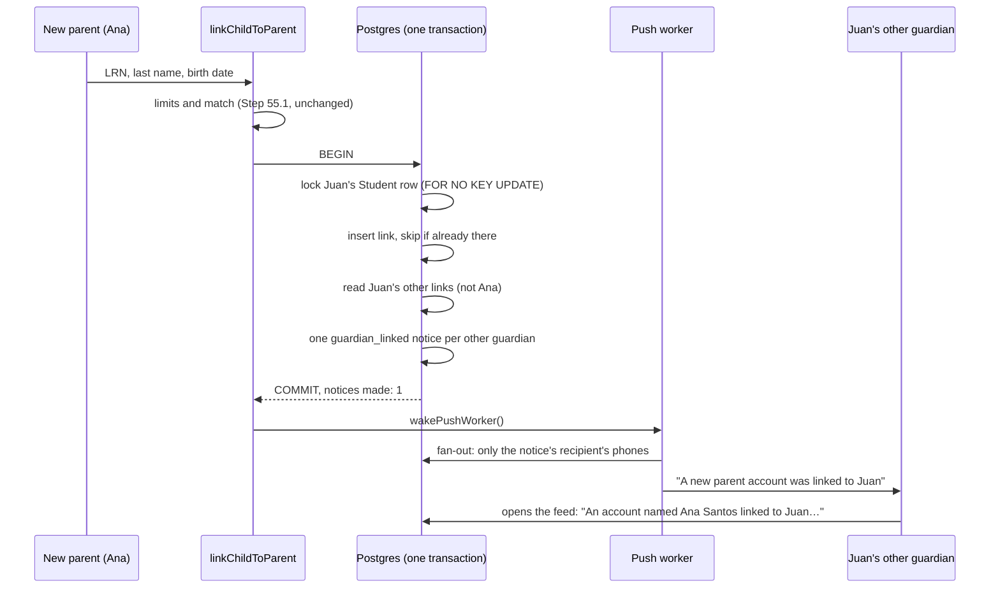

# Step 55.2: Other guardians are told of each new link

> **Written before the code, on 2026-10-22, and approved by the owner the same day.** From this step on, a recipe always comes first (owner, 2026-10-22). The systems-architect reviewed the plan once (round 1) and then the built code; both rounds' points are folded in below. **Updated after building** to match the real diff: what changed from the approved version is listed in "Changed while building" at the end. Topic docs to update while building: `docs/NOTIFICATIONS.md`, `docs/PUSH.md`, `docs/PARENT-API.md`, `docs/DATA-MODEL.md`, `docs/SCALING.md` 1.2.

## Why

Since Step 55.1, a stranger can't guess a child's birth date anymore. But someone who already knows the child's LRN, last name and birth date (a relative, an ex-partner, a classmate's parent) can still link the child, and then see when the child arrives and leaves, plus their photo. Nobody would know.

The owner decided (2026-10-22) that a principal does **not** approve each link: it would only add work for the principal. So the protection is that **the people who already care for the child find out**. When a parent links a child, every guardian already linked to that child gets a notice in their feed and on their phone:

> An account named Ana Santos linked to Juan. If you don't know them, contact the school.

The school's own view of every link, with a way to remove a wrong one, is Step 55.3.

## Decisions

1. **One notice per guardian who's told, not one shared row.** Today a notification belongs to a child, and every guardian of that child sees the same row and shares its read mark. A link notice can't work that way: the parent who just linked must not get it, and a guardian who links *later* must not see old notices naming the guardians before them. So a notification gets a **recipient** (`recipientParentId`). Empty means "every guardian of the child", which is every tap notification, unchanged. Set means "only this parent".
2. **No principal approval** (owner, 2026-10-22). Also recorded in `docs/PLAN.md` and `docs/SCALING.md` 1.2.
3. **Always sent**, even when the school's notification setting is "off". That setting is about taps. This is a safety notice.
4. **The link and its notices are saved in one transaction**, the same way a tap and its notification are (`prisma-tap-writer.ts`). A link can never be saved without its notices. The push worker is woken afterwards, like after a tap.
5. **Two parents linking the same child at the same moment.** Without care, each transaction reads the other links before the other's link is saved, sees nobody, and nobody is told. So the transaction first locks the child's `Student` row. The lock is `FOR NO KEY UPDATE`, **not** `FOR UPDATE` (architect): saving a tap, a notification or a link takes a light `FOR KEY SHARE` lock on the student through its foreign key. `FOR UPDATE` would block that, so a parent linking at 7 AM could hold up that same child's tap at the gate. `FOR NO KEY UPDATE` only makes two linkers of the same child wait for each other. The first to finish has no one to tell about the second, since the second wasn't linked yet. The second sees the first and tells them. So exactly one notice is made, never zero.
6. **The link is inserted with "skip if it already exists"** (`createMany` with `skipDuplicates`, which is `ON CONFLICT DO NOTHING`), not by catching the unique-key error. In Postgres, an error inside a transaction cancels the whole transaction, notices included. "0 rows inserted" means "already linked", the same answer as today.
7. **Kinds are a union the compiler checks** (architect). `notificationKindLabel` is a two-way ternary today (`kind === "time_in" ? "tapped in" : "tapped out"`), so a new kind would silently read "tapped out" in the bell, the feed and the push. The `Notification` type becomes a *discriminated union*: a tap notice (`time_in` or `time_out`) or a link notice (`guardian_linked`). The label becomes a `switch` with no default, so forgetting a kind is a compile error. `notificationKindSchema` keeps meaning "tap direction" (`time_in`/`time_out`). It's used as that all over the attendance code, and taps never become `guardian_linked`.
8. **`tappedAt` is kept as the column name.** For a link notice it holds the time of the link. Renaming it touches about 15 files for no change in behaviour. Its comment says what it means now.
9. **Deleting a parent account later** (Step 60, which the app stores require). `recipientParentId` cascades: the account's own notices go with it. `aboutParentId` is set to empty: the other guardian's notice stays, and reads "A parent account linked to Juan." (architect)
10. **The name is "an account named …"** (architect): sign-up checks nothing about a name. The lock screen shows no adult's name at all: "A new parent account was linked to Juan." Only the child's first name appears, as with taps (`push-message.ts`).
11. **Same Android channel** (`attendance`). A new channel only works once the app creates it, and Android drops pushes sent to a channel the phone doesn't have.

**Known gaps, said plainly:**
- A child with no other guardian tells nobody until Step 55.3 shows the school.
- A guardian whose sign-in on their phone is more than 30 days old gets the feed notice but no push (Step 54.1's rule).
- The parent app shows a link notice as "tapped out" until it's updated for the new `kind`.



## Steps

### 1. The migration (`guardian_link_notices`)

`prisma/schema.prisma`:

```prisma
enum NotificationKind {
  time_in
  time_out
  // A parent linked this child (Step 55.2): for each of the child's other guardians.
  guardian_linked
}

model Notification {
  // …the fields already there…
  // When it happened: the tap's time, or for guardian_linked the link's.
  tappedAt          DateTime
  // Empty: every guardian of the child (taps). Set: only this parent (Step 55.2).
  recipientParentId String?
  recipientParent   Parent?  @relation("NotificationRecipient", fields: [recipientParentId], references: [id], onDelete: Cascade)
  // guardian_linked only: who linked. Empty once their account is deleted.
  aboutParentId     String?
  aboutParent       Parent?  @relation("NotificationAbout", fields: [aboutParentId], references: [id], onDelete: SetNull)

  // Postgres doesn't index a foreign key by itself; these stay tiny (link notices only).
  @@index([recipientParentId], map: "Notification_recipient", where: raw("\"recipientParentId\" IS NOT NULL"))
  @@index([aboutParentId], map: "Notification_about", where: raw("\"aboutParentId\" IS NOT NULL"))
}

model Parent {
  // …
  noticesFor   Notification[] @relation("NotificationRecipient")
  noticesAbout Notification[] @relation("NotificationAbout")
}
```

```bash
npx prisma migrate dev --name guardian_link_notices --create-only
# read the SQL: ALTER TYPE … ADD VALUE, two nullable columns, two foreign keys, two partial indexes
npx prisma migrate dev
npx prisma generate
```

Adding nullable columns and an enum value doesn't rewrite the table, so it's instant on Heroku's release step. Existing rows get an empty recipient, which means "every guardian", exactly what they mean today.

A second migration (`notification_recipient_check`, from the architect's code review) makes the rule a database rule too: a link notice always has a recipient, a tap's notification never does. Its own migration because Postgres can't use an enum value in the transaction that added it. Prisma doesn't model CHECK constraints, so `--create-only` gives an empty file to write by hand:

```bash
npx prisma migrate dev --name notification_recipient_check --create-only
```

```sql
ALTER TABLE "Notification" ADD CONSTRAINT "Notification_recipient_matches_kind"
  CHECK (("kind" = 'guardian_linked') = ("recipientParentId" IS NOT NULL));
```

Adding it reads the table once to check the existing rows (all taps, all without a recipient).

### 2. The types (`src/features/parents/schemas.ts`, `types.ts`)

```ts
/** A tap's direction, and the kind of a tap's notification. */
export const notificationKindSchema = z.enum(["time_in", "time_out"]);

const notificationBase = {
  id: z.string().min(1),
  schoolId: z.string().min(1),
  studentId: z.string().min(1),
  tappedAt: z.iso.datetime(),
  read: z.boolean(),
};

export const notificationSchema = z.discriminatedUnion("kind", [
  // A tap: every guardian of the child sees it, and shares its read mark.
  z.object({ ...notificationBase, kind: notificationKindSchema, recipientParentId: z.null() }),
  // A new guardian linked (Step 55.2): one row per guardian told.
  z.object({
    ...notificationBase,
    kind: z.literal("guardian_linked"),
    recipientParentId: z.string().min(1),
    aboutParentId: z.string().min(1).nullable(),
  }),
]);
```

`types.ts` names the two halves: `TapNotification` (what the tap writers take, so a tap can't be written with a recipient) and `LinkNotification`.

The feed also needs the linking parent's name, which isn't stored on the notice. `listPageForStudent` returns `FeedNotification = Notification & { aboutParent: ParentName | null }`, read with the page in one query (Prisma's `include` with only those two fields). `ParentNotificationItem.notification` is a `FeedNotification`, so the name travels with the notice to the bell and the feed. Writing a notification still takes a plain `Notification`.

`notificationKindLabel` (`notification-format.ts`) becomes an exhaustive `switch`. Every place that shows a notification goes through it or through the new `linkNoticeText`.

Every place that builds a tap notification (`record-tap.ts`, `record-manual-time-in.ts`, the seed, tests) adds `recipientParentId: null`.

### 3. Linking saves its notices (`prisma-parent-student-link-repository.ts`)

`create(link)` becomes `createWithNotices(link)` and answers `{ link, noticesMade } | null` (null = already linked). The interface comment and the mock repository change to match.

```ts
// Exported, so the test locks exactly the way the code does (architect).
export async function lockStudentForLink(tx: Prisma.TransactionClient, studentId: string): Promise<void> {
  await tx.$queryRaw`SELECT 1 FROM "Student" WHERE "id" = ${studentId} FOR NO KEY UPDATE`;
}

// Up to 5 seconds for a free connection at the morning peak, 10 to finish.
const LINK_TRANSACTION = { maxWait: 5_000, timeout: 10_000 };

async createWithNotices(link) {
  return db.$transaction(async (tx) => {
    await lockStudentForLink(tx, link.studentId);

    const inserted = await tx.parentStudentLink.createMany({
      data: [{ id: link.id, ...toParentStudentLinkData(link) }],
      skipDuplicates: true,
    });
    if (inserted.count === 0) return null;

    const others = await tx.parentStudentLink.findMany({
      where: { studentId: link.studentId, schoolId: link.schoolId, parentId: { not: link.parentId } },
      select: { parentId: true },
    });
    if (others.length === 0) return { link, noticesMade: 0 };
    await tx.notification.createMany({
      data: others.map(({ parentId }) => ({
        schoolId: link.schoolId,
        studentId: link.studentId,
        kind: "guardian_linked" as const,
        tappedAt: new Date(link.linkedAt),
        recipientParentId: parentId,
        aboutParentId: link.parentId,
      })),
    });
    return { link, noticesMade: others.length };
  }, LINK_TRANSACTION);
}
```

The mock repository does the same in memory, writing into a `notifications` array it's given (the seed's by default), so the service tests can read back what was told.

`linkChildToParent` (`link-child-to-parent.ts`):
- calls `createWithNotices`;
- uses its own `now` for `linkedAt`, not `new Date()` (architect);
- returns `noticesMade` in its `ok: true` result.

Both callers, the Server Action (`auth-actions.ts`) and `POST /api/v1/parents/children`, call `wakePushWorker()` when `noticesMade > 0`.

### 4. Each notice reaches only its parent

Every read and write that serves a parent now knows which parent is asking. In `NotificationRepository` (Prisma and mock):

| Method | Change |
|---|---|
| `listPageForStudent(schoolId, studentId, page)` | `+ viewerParentId`; `where … AND (recipientParentId IS NULL OR recipientParentId = viewer)`; includes `aboutParent`'s two names |
| `countUnreadForStudent(schoolId, studentId, cap)` | `+ viewerParentId`, same filter |
| `markReadForChildren(children, id)` | `+ viewerParentId`, same filter: one parent can't mark another's notice read |
| `markAllReadForChildren(children)` | `+ viewerParentId`, same filter |

`src/services/parents/notifications.ts` passes `parentId` through. The capped count and the paging still walk the `(studentId, tappedAt)` index backwards and stop early: the filter is checked on each row as it's read (architect). This gets measured once with `EXPLAIN ANALYZE` (Verify, step 4).

The push fan-out (`prisma-push-outbox-repository.ts`, `fanOut`) adds one condition to its join:

```sql
JOIN "ParentStudentLink" AS l ON l."studentId" = n."studentId" AND l."schoolId" = n."schoolId"
  AND (n."recipientParentId" IS NULL OR l."parentId" = n."recipientParentId")
```

### 5. The words

| Where | Tap (unchanged) | Link notice |
|---|---|---|
| Bell (one line, truncated) | **Juan** tapped in | **Juan** has a new parent account linked |
| Feed (`/parent/notifications`) | **Juan Cruz** tapped in · 7:56 AM | An account named **Ana Santos** linked to **Juan Cruz**. If you don't know them, contact the school. · 6:12 PM |
| Feed, account since deleted | | A parent account linked to **Juan Cruz**. If you don't know them, contact the school. |
| Push (lock screen) | Juan tapped in at 7:56 AM | A new parent account was linked to Juan |
| Feed page's subtitle | Every time your child taps in or out shows up here, and every new parent account linked to them. | |

The API's feed item (`toNotificationJson`, `docs/PARENT-API.md`) keeps its fields and adds one, only for this kind:

```json
{ "id": "…", "childId": "student-0001", "childName": "Juan Cruz", "kind": "guardian_linked",
  "at": "2026-10-22T18:12:00.000+08:00", "read": false,
  "guardian": { "firstName": "Ana", "lastName": "Santos" } }
```

`guardian` is `null` once that account is deleted. Never the other parent's email or mobile. The push's `data` stays `{ notificationId, childId }`. The raw-row type in `claimDue` (`DueDelivery.kind`) widens to every kind, and `toPushMessage` switches on it.

### 6. Tests

- **`link-child-to-parent.test.ts`** (mock):
  - a second guardian makes one notice, for the first guardian only, about the second;
  - a first guardian makes none;
  - "already linked" makes none;
  - `linkedAt` is the given `now`.
- **`notifications.test.ts`** (mock):
  - the guardian who's told sees the notice; the parent who linked doesn't;
  - a guardian who links later doesn't see older notices;
  - only the recipient can mark a notice read, and only they count it as unread.
- **`prisma-link-notices.pg.test.ts`** (new, real Postgres, skipped without `E2E_DATABASE_URL`, like `link-attempts.pg.test.ts`), on a seed child nobody is linked to:
  - two new parents linking one child at once, five times over: **exactly one** notice each time, to whoever saved first, naming the second, and one link row per parent. (The architect first wrote "each notifies the other", then agreed that can't happen: the first had no one to tell. **Never zero** is the point.)
  - the overlap forced: a first link holds its lock after its insert, the second starts, then the first commits. The second must wait, see the first and tell them; without the lock it would read the links too early and tell nobody.
  - the same parent sending the form twice at once: one link, one notice to the other guardian, and the second send answers `null`;
  - while `lockStudentForLink` holds a child's row, a tap notification for them saves at once on another connection (2-second statement limit);
  - **the control**: with `FOR UPDATE` instead, that same write is cancelled by the 2-second limit, so the test above can tell the two locks apart.
- **`prisma-push-outbox.test.ts`**: a link notice gets deliveries only for its recipient's phones.
- **`push-message`, `notification-format`, `api-responses`**: the new wording, including the deleted-account case.
- **`parent-student-link-repository.test.ts`**: a guardian linked to the same child id at another school isn't told (the notice query is limited to the link's school). This replaced the planned `isolation.test.ts` case: that file mocks every repository, so the rule lives in the repository's own test.
- **`e2e/parent.spec.ts`**: a new parent named **Noticed Parent** links **Carmen Sison** (`student-0006`, linked to `parent-balanga-1` in the seed, with an LRN). Their own feed doesn't show "An account named Noticed Parent linked to Carmen Sison."; `parent-balanga-1`'s does. The first test in the file links Carmen too, at the same time (Playwright runs tests in parallel), so this one checks for its own parent's name, not just "linked to" (P-030).

## Verify it worked

1. The routine: `npm run lint && npm run check:tokens && npm run typecheck && npm test && npm run build`, then `npm run test:e2e`.
2. `npm run dev`, then:
   - sign up a new parent and link **Juan Cruz** (Balanga, `student-0001`; his LRN and birth date are in `src/data/seed/students.ts`);
   - sign in as `parent-one@balanga.example` (password `Talaan123!`): the bell shows "**Juan** has a new parent account linked", and the feed shows the full sentence with the new parent's name;
   - the new parent's own bell shows nothing about it.
3. With the parent app signed in as `parent-one@balanga.example` on a phone: the push "A new parent account was linked to Juan" arrives within a few seconds. Expect "tapped out" inside the app until it's updated for the new kind.
4. **Measure** (architect). In `psql`, run the capped unread count with the new filter:

   > **Opening `psql`.** Docker must be running (if `docker ps` doesn't list `talaan-postgres`, run `docker start talaan-postgres` first).
   >
   > ```bash
   > docker exec -it talaan-postgres psql -U postgres -d talaan
   > ```
   >
   > The prompt changes to `talaan=#`. Type `\q` to leave. What each part of the command means: [Learning log: getting into `psql`](../LEARNING-LOG.md#getting-into-psql-and-what-each-part-of-the-command-means-owner-question).

   ```sql
   EXPLAIN ANALYZE SELECT count(*) FROM (
     SELECT 1 FROM "Notification"
     WHERE "studentId" = 'student-0001' AND "schoolId" = 'school-balanga' AND read = false
       AND ("recipientParentId" IS NULL OR "recipientParentId" = 'parent-balanga-1')
     ORDER BY "tappedAt" DESC LIMIT 10) AS capped;
   ```

   Expect `Index Scan Backward using "Notification_studentId_tappedAt_idx"`. The seed is small, so Postgres may pick a full read anyway. If it does, run `SET enable_seqscan = off;` first and check that the index is usable at all, as in `docs/SCALING.md` 3.2.
5. After pushing: Heroku's release step runs the migration by itself. Then copy `docs/PARENT-API.md` to the app's repository again (`mobile/README.md`, "Keeping it current"), since the feed has a new `kind` and the `guardian` field.

## If something goes wrong

- **"Invalid value for argument `kind`. Expected NotificationKind."** when linking in `npm run dev`: the dev server was started before `prisma generate` and still has the old client in memory. Stop it and run `npm run dev` again (P-031).
- **`ALTER TYPE … ADD VALUE cannot run inside a transaction block`**: older Postgres versions refuse this. Postgres 12 and newer allow it, as long as the new value isn't *used* in the same migration. This migration doesn't use it, so leave the generated SQL as it is.
- **The type checker lists many `recipientParentId` errors**: every tap notification needs `recipientParentId: null` now. That's the union doing its job. Add it, don't loosen the type.
- **The concurrent-link test makes zero notices**: the lock line is missing or runs after the insert. It must be the transaction's first statement.

## What you'll learn

- **Row locks have strengths.** `FOR UPDATE` blocks even the light lock a foreign key takes; `FOR NO KEY UPDATE` doesn't. Picking the weaker one keeps a background action from slowing the gate.
- **An error inside a Postgres transaction cancels all of it**, so "insert, and skip if it's already there" is safer than "insert, and catch the error".
- **A discriminated union turns "did I handle every kind?" into a compile error** instead of a wrong word on a parent's phone.

## Before you commit

```bash
docker start talaan-postgres
npm run lint
npm run check:tokens
npm run typecheck
npm test
npm run build
npx playwright test   # before a push
```

## Changed while building

1. **The lock is one exported helper** (`lockStudentForLink`), used by the repository and the test, so changing it back to `FOR UPDATE` fails a test (architect's code review).
2. **A control test and a forced overlap** in the Postgres test (architect's code review), on top of the planned cases.
3. **A CHECK constraint** in a second migration (architect's code review).
4. **The transaction waits longer for a connection** (`maxWait: 5s`, `timeout: 10s`) instead of Prisma's 2 and 5 (architect's code review). A link that runs out fails alone, never a tap.
5. **The bell says "Juan has a new parent account linked"**: the bell's line is "first name + label", the same shape as a tap's.
6. **The feed page's subtitle** mentions link notices.
7. **The browser test uses Carmen Sison and its own parent name** after colliding with the first parent test (P-030).
8. **The isolation case lives in the link repository's test**, not `isolation.test.ts`.

## What's next

Step 55.3: the school sees each link in the student drawer and on the dashboard, and a principal can remove one.
