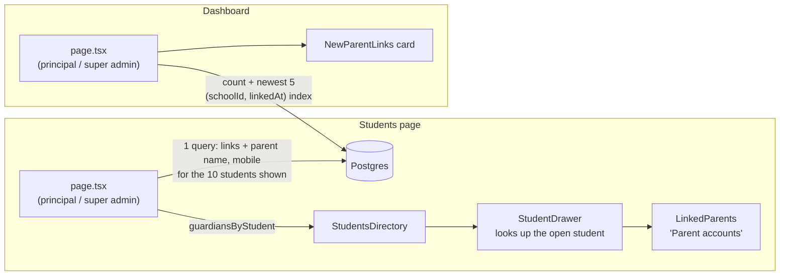

# Step 55.3: The school sees each link

> **Written before the code, on 2026-10-22, and approved by the owner the same day** (with the split into 55.3 and 55.4). Updated after building where the real code differs; see "Changed while building". A systems-architect reviewed the plan once (round 1, 2026-10-22). It found the original Step 55.3 ("see each link, and remove one") too big for one review, and proposed cutting it in two. This recipe is the first half: **seeing**. Removing a link, and keeping the removed parent from linking again, is Step 55.4. Both halves of 55.4 must ship together, or a removed parent could link again a minute later. If building changes anything, this file is updated to match before the review report. Topic docs to update while building: `docs/NOTIFICATIONS.md` (who sees a link), `docs/DATA-MODEL.md`, `docs/SCALING.md` 1.2.

## Why

Since Step 55.2, a child's guardians are told when someone new links the child. The school still can't see it. A principal who gets a call ("someone I don't know is following my son") has nowhere to look, and with no approval step (owner, 2026-10-22), the school's job is to notice and act. Before it can act (Step 55.4), it has to see:

1. **In the student drawer:** who has linked this child in the app, with their mobile number and the day they linked.
2. **On the dashboard:** the school's new links from the last 7 days, so a principal notices them without opening every student.

## Decisions

1. **Principals and super admins only.** A teacher can't open the student drawer (`canEdit` is false), and the teacher's dashboard is unchanged. A parent's mobile number is personal data, and only the people who'd act on a wrong link need it.
2. **What staff see:** the parent's name, mobile number and link date. Not their email: the mobile is enough to call them, the same as the student's own guardian contact.
3. **Read-only in this step.** Nothing in the drawer changes when it's opened; Step 55.4 adds "Remove".
4. **One query for the page's students, not one per student.** The students page shows 10 at a time. Their links, with each parent's name and mobile, come in **one** query for those 10 (`studentId IN (…)`, on the existing `studentId` index), only for staff who can open the drawer.
5. **The drawer reads the links from the page's current data, by student id** (architect). Today the drawer copies a student's row into its own state when it opens. Copying the links the same way would keep showing a removed parent after Step 55.4's `refresh()`. So the drawer is given a map of links by student id from the page, and looks the open student up in it each time it renders.
6. **The dashboard asks two small questions:** how many links in the last 7 days, and the newest 5 with names. A new index `(schoolId, linkedAt)` replaces the `schoolId`-only one. It answers both, and anything that looked up links by `schoolId` alone still uses it (architect).
7. **No new table, no new setting.** Two queries more on the dashboard, one more on the students page, only for principals and super admins.



## Steps

### 1. The index (migration `parent_links_by_school_and_date`)

`prisma/schema.prisma`, in `ParentStudentLink`:

```prisma
  // The dashboard's "new links in the last 7 days" (Step 55.3); also any lookup by school alone.
  @@index([schoolId, linkedAt])
```

in place of `@@index([schoolId])`.

```bash
npx prisma migrate dev --name parent_links_by_school_and_date --create-only
# read it: DROP INDEX "ParentStudentLink_schoolId_idx"; CREATE INDEX "ParentStudentLink_schoolId_linkedAt_idx" …
npx prisma migrate dev
npx prisma generate
```

Then **restart `npm run dev`** if it's running (P-031).

### 2. The types (`src/features/parents/types.ts`)

```ts
/** A parent account linked to a child, as the school sees it (Step 55.3). Never their email. */
export type LinkedGuardian = {
  linkId: string;
  studentId: string;
  linkedAt: string;
  parent: Pick<Parent, "firstName" | "lastName" | "mobile">;
};

/** One of a school's newest links, for the dashboard. */
export type RecentLink = {
  linkId: string;
  linkedAt: string;
  parent: ParentName;
  student: Pick<Student, "id" | "firstName" | "lastName">;
};
```

### 3. Two repository methods (`ParentStudentLinkRepository`, mock and Prisma)

```ts
/** The links of these students, at `schoolId` only, each with the parent's name and mobile; oldest first. One query. */
listGuardiansInSchool(schoolId: string, studentIds: string[]): Promise<LinkedGuardian[]>;
/** How many links `schoolId` got since `since`, and the newest `take` of them with names. */
listRecentInSchool(schoolId: string, since: string, take: number): Promise<{ total: number; links: RecentLink[] }>;
```

Prisma:

```ts
async listGuardiansInSchool(schoolId, studentIds) {
  if (studentIds.length === 0) return [];
  const rows = await db.parentStudentLink.findMany({
    where: { schoolId, studentId: { in: studentIds } },
    orderBy: FIRST_LINKED_FIRST,
    include: { parent: { select: { firstName: true, lastName: true, mobile: true } } },
  });
  return rows.map((row) => ({ linkId: row.id, studentId: row.studentId, linkedAt: row.linkedAt.toISOString(), parent: row.parent }));
},
async listRecentInSchool(schoolId, since, take) {
  const where = { schoolId, linkedAt: { gte: new Date(since) } };
  const [total, rows] = await Promise.all([
    db.parentStudentLink.count({ where }),
    db.parentStudentLink.findMany({
      where,
      orderBy: [{ linkedAt: "desc" }, { id: "desc" }],
      take,
      include: {
        parent: { select: { firstName: true, lastName: true } },
        student: { select: { id: true, firstName: true, lastName: true } },
      },
    }),
  ]);
  return { total, links: rows.map(/* to RecentLink */) };
},
```

The mock does the same over its arrays, and takes the seed's parents and students for the names (options `parents`, `students`, like the notification mock's `parents` from Step 55.2).

### 4. The drawer's "Parent accounts" (`src/features/students/`)

- `page.tsx` (students): when the viewer can edit, after `searchStudents`, one call to `listGuardiansInSchool(schoolId, items.map((row) => row.student.id))`, grouped into `guardiansByStudent: Record<string, LinkedGuardian[]>`, passed to `StudentsDirectory`. A teacher's page makes no such call.
- `StudentsDirectory` → `StudentDrawer` → `StudentForm`: a new prop `guardians`, looked up as `guardiansByStudent[drawer.student.id] ?? []` **at render**, not stored in the drawer's state (Decision 5).
- New `linked-parents.tsx` (`LinkedParents`): a `<section>` after the "Parent or guardian" fieldset, only when editing a student (never for "Add student"):

  | | |
  |---|---|
  | Heading | Parent accounts |
  | Under it | Parents who linked Juan in the Bantay Aral app. They see Juan's arrivals and get notifications about Juan. |
  | Each row | **Ana Santos**, and under it "09171234567 · Linked October 22, 2026" |
  | None | No parent has linked Juan in the app yet. |

  The product's name comes from `PRODUCT_NAME`, and the child is named rather than "his" or "her", which the app doesn't know. It's a plain list (`<ul>`), no inputs, so the form's Save and Cancel are unchanged. The mobile number is shown as stored (`09171234567`), the same as the guardian contact field above it.

### 5. The dashboard's "New parent links" (`src/features/parents/new-parent-links.tsx`)

- `page.tsx` (dashboard), principal and super admin branch only: `listRecentInSchool(schoolId, <now minus 7 days>, 5)`, using the page's own `getNow()`.
- A `DashboardCard` titled **New parent links**, placed after **Needs attention**, with a pill "N this week" in the same style as Needs attention's "N open".
- Each row: "**Ana Santos** linked **Juan Cruz**", and under it "October 22, 2026, 12:48 PM" (the app's own `formatSchoolDate` and `formatSchoolTime`). The row links to `/students?q=Juan%20Cruz`, where the principal opens Juan.
- Empty: `EmptyState` with a `UserPlus` icon, "No new parent links", "Parents who link a child in the last 7 days show up here."

### 6. Tests

- **`parent-student-link-repository.test.ts`** (mock):
  - `listGuardiansInSchool` gives only the asked students, at that school only, oldest first, with name and mobile;
  - an empty list asks nothing;
  - `listRecentInSchool` counts and lists only the window and the school, newest first, at most `take`.
- **`prisma-isolation.test.ts`** (Postgres): another school's id gets neither a Balanga child's guardians nor Balanga's recent links.
- **`linked-parents.test.tsx`** and **`new-parent-links.test.tsx`** (Testing Library): the rows, the empty states, the "N this week" pill, and the student search link.
- **`e2e/students.spec.ts`**: the principal searches for and opens **Juan Cruz** (`student-0001`, two seed guardians) and sees both under "Parent accounts". A teacher still can't open the drawer (already covered).
- **`e2e/parent.spec.ts`**: after "Noticed Parent" links Carmen Sison (Step 55.2's test), the principal opens Carmen and sees "Noticed Parent" under "Parent accounts".
- The dashboard card itself is checked by `a11y.spec.ts`'s existing dashboard page (axe) and the component test. A browser test asserting a specific row would race the other tests' links (P-030).

## Verify it worked

1. The routine: `npm run lint && npm run check:tokens && npm run typecheck && npm test && npm run build`, then `npm run test:e2e`.
2. **Restart `npm run dev`**, then sign in as the Balanga principal:
   - `/students`, open Juan Cruz: "Parent accounts" lists the two seed parents with their mobiles;
   - open a student nobody linked: "No parent has linked … in the app yet.";
   - link a child as a new parent (`/parent/signup`), then `/dashboard`: **New parent links** shows them at the top, with "1 this week" or more.
3. Sign in as a teacher: the dashboard has no **New parent links**, and students still can't be opened.
4. **Measure** (architect): in `psql`,

   > **Opening `psql`.** Docker must be running (if `docker ps` doesn't list `talaan-postgres`, run `docker start talaan-postgres` first).
   >
   > ```bash
   > docker exec -it talaan-postgres psql -U postgres -d talaan
   > ```
   >
   > The prompt changes to `talaan=#`. Type `\q` to leave. What each part of the command means: [Learning log: getting into `psql`](../LEARNING-LOG.md#getting-into-psql-and-what-each-part-of-the-command-means-owner-question).

   ```sql
   SET enable_seqscan = off;
   EXPLAIN ANALYZE SELECT * FROM "ParentStudentLink"
   WHERE "schoolId" = 'school-balanga' AND "linkedAt" >= now() - interval '7 days'
   ORDER BY "linkedAt" DESC LIMIT 5;
   ```

   Expect `Index Scan Backward using "ParentStudentLink_schoolId_linkedAt_idx"`. (The seed is small, so without `enable_seqscan = off` Postgres would rather read the whole table.)
5. After pushing: Heroku's release step runs the migration (an index swap on a table of a few rows: instant).

## If something goes wrong

- **"Invalid value for argument" or a missing field in `npm run dev`** right after the migration: restart the dev server (P-031).
- **The drawer shows no parents for a student who has some:** the page only loads links for the 10 students on the current page. Check that the student opened is one of `items`, and that `guardiansByStudent` is looked up by the open student's id, not copied when the drawer opened.

## What you'll learn

- **One query for a page, not one per row.** `WHERE "studentId" IN (…)` asks for all 10 students' links at once. The students page's own card lookup still asks once per student (the architect noted it: an older N+1, left for Step 62, "Pages ask the database once").
- **An index can serve more than one question.** `(schoolId, linkedAt)` answers "this school's links since a date, newest first", and also "this school's links" on its own, since a lookup can use the first column of an index alone.
- **Copying server data into client state freezes it.** Reading from props at render keeps it fresh after `refresh()`.

## Before you commit

```bash
docker start talaan-postgres
npm run lint
npm run check:tokens
npm run typecheck
npm test
npm run build
npx playwright test   # before a push
```

## Known limits (architect's code review)

- **In a demo, the card's "last 7 days" counts from the demo morning** (`DEMO_NOW`, 2026-06-19) and has no upper end, so it also lists links made today. On a real server `DEMO_NOW` is never set, so it's simply the last 7 days. Cutting at "now" would hide every link made during a demo.
- **A row opens the students page searched by the child's name**, so "Ana Cruz" also finds "Ana Cruzado", and two children with the same name both show. Linking straight to the student needs a way to open the drawer from the address, which the students page doesn't have yet.
- **The page sends the mobile numbers of the 10 students' parents to the browser**, not only the open student's. Only principals and super admins get them.

## Changed while building

1. **Dates are written out** ("October 22, 2026"), with the formatters the rest of the app already uses, instead of the shorter "Oct 22" sketched above.
2. **The browser tests** read the seed parents' names from `src/data/seed/parents.ts` (they're generated, not fixed), and the drawer's list is found by its role: a `<section>` with a heading is a "region" named "Parent accounts".

## What's next

Step 55.4: a principal removes a wrong link. The parent is kept from linking that child again until the school allows it. Their queued pushes about the child are dropped, and the parent app gets a `403 link_blocked`.

Already settled for it in this step's architect review (2026-10-22), to carry into its recipe:
- **A `LinkBlock` table**, not a `removedAt` on the link: every link read and the push fan-out would otherwise need `removedAt IS NULL`. It records who removed the link (`removedByStaffId`).
- **Drop the removed parent's pushes that are `waiting` *or* `sending`.** A claimed push that comes back as "retry" is set to `waiting` again (`prisma-push-outbox-repository.ts`, `saveResult`), so deleting only waiting ones could still send it. At most one push already handed to Expo can still arrive.
- **Save the block only if the delete removed the link**, so two principals removing at once don't collide on the block's unique key.
- **Removal is immediate** (after a confirmation), not held for the drawer's Save. Nobody is told; the parent just stops seeing the child.
- **Check that older builds of the parent app** show a plain message for an error code they don't know.
