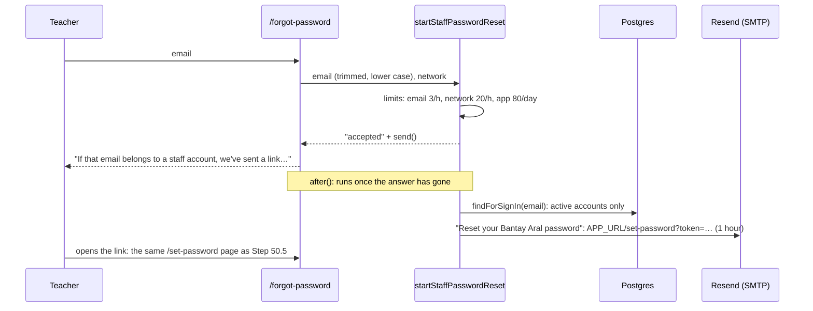

# Step 55.5: Email, and staff reset their own password

> **Written before the code, on 2026-10-23, and approved by the owner the same day, with the `nodemailer` dependency.** Updated after building where the real code differs; see "Changed while building". Cut from the plan's Step 55.5 (forgot password by email) so each half can be reviewed in one sitting. This half sets up email and lets staff reset their own password. Parents' emailed codes, for the app and the web portal, become Step 55.6. The systems-architect reviewed the plan once, and its points are included below. If building changes anything, this file is updated to match before the review report. Topic docs to write or update while building: a new `docs/EMAIL.md`, plus `docs/AUTH.md`, `docs/DEPLOY.md` (config vars), `docs/COMMANDS.md` and `.env.example`.

## Why

A teacher who forgets their password has to ask the principal for a reset link (Step 50.5). A principal has to ask the super admin. That works, but it depends on someone else being free, and the plan has always meant people to recover their own accounts. This step adds:

1. **An email service** behind a small interface, the same way pushes and photos are set up. Step 55.6 reuses it for parents.
2. **"Forgot your password?" on the staff sign-in page**, which emails the person a set-password link that works for 1 hour.

## What it costs

- **Resend, over SMTP:** free for 3,000 emails a month, at most 100 a day (check resend.com/pricing before signing up). One school's resets come to a few dozen a month.
- **The domain:** `bantayaral.com`, which you already own. Sending from it costs nothing extra.
- **Heroku:** nothing changes. One more package (`nodemailer`), no new dyno or add-on.

Changing to Brevo (300 a day free) or Amazon SES later means new settings only, because the app speaks SMTP, the standard protocol they all use.

## Decisions

1. **SMTP through `nodemailer`. This adds a dependency, so please approve it.** nodemailer is the standard Node library for sending email. It has no dependencies of its own and comes with its own types, and its licence (MIT-0) is even looser than MIT. The version is pinned exactly, `10.0.16` (published 2026-10-07): nodemailer has published 15 releases since then, the newest yesterday, so the recipe uses one that has been out for two weeks. The alternative is each provider's own HTTP API through `fetch`, which needs no package but means new code for each provider, against the "easy to move" rule.
2. **Text-only emails.** They're easier to deliver and need no colors (`check:tokens` forbids color values outside the theme files, and an email can't use the theme's CSS variables). Gmail and Outlook make the link clickable.
3. **Links in emails use `APP_URL`, never the request's own address.** `requestOrigin()` (`src/lib/request-origin.ts`) trusts the request's `Origin`, `X-Forwarded-Host` or `Host` header. Anyone can send those, so a forged request would mail a real staff member a working link to the attacker's site ("reset poisoning"). `APP_URL` is a setting, for example `https://bantayaral.herokuapp.com`. Links are built with `new URL(path, APP_URL)`, and a live server requires it to start with `https://`. The principal's copy link (Step 50.5) keeps `requestOrigin()`, because the principal is signed in and sees the link before sending it.
4. **The same set-password link as Step 50.5, valid for 1 hour.** It uses the same token, the same purpose and the same `/set-password` page. Only the expiry is passed in: 1 hour for an emailed link, still 7 days for a link the principal makes. Its password fingerprint (`pv`) still makes it work once, and setting the password still signs out every other browser.
5. **The same answer whether or not the email has an account:** "If that email belongs to a staff account, we've sent a link to it. It works for 1 hour." The lookup and the send happen in `after()` (from `next/server`), which runs once the answer has gone. So the answer takes the same time either way and reveals nothing (architect: `after()` is supported on a Node server like Heroku's, and a database outbox isn't needed: the person can just ask again, and an outbox would store a live link). The email is trimmed and lowercased, and the network address read, *before* `after()`, since request data isn't available once the answer has gone.
6. **Invited accounts get nothing** (architect). An invited account has no password yet, and its email was typed by the principal and never checked. Emailing it a link would be an email invitation, which decision 8 rules out. It gets the same answer as an unknown email, with nothing sent, so the invited person still uses the principal's link.
7. **Limits** (in memory, like the sign-in limits; a restart clears them):
   - 3 requests per email per hour;
   - 20 requests per network per hour (the last `X-Forwarded-For` entry, as for parents);
   - **80 emails a day from the whole app** (architect). Without this, someone cycling through 40 staff emails could use up Resend's 100 a day, and real resets (and Step 55.6's parent codes) would then fail without anyone knowing. It counts emails actually sent, and the server log says when it's reached.

   Over a per-email or per-network limit: "Too many requests. Wait an hour and try again." Over the daily limit: "We can't send emails right now. Try again tomorrow, or ask your principal for a reset link." Neither message says whether the email has an account.
8. **Staff invitations stay a copy link, not an email (the plan's open question).** A principal sends an invite by Messenger or Viber to a person they know. An emailed invite would trust an address someone typed, and one typo would give a school account to a stranger. Email is only for someone getting back into an account they already use.
9. **"Your password was changed" email** (architect). After a reset (not a first password), the person gets a short email saying so. If it wasn't them, they know at once.
10. **A successful reset clears that email's sign-in lockout** (architect), so someone locked out after 5 wrong tries can sign in with the new password straight away.
11. **The "log" sender, for development and before email is set up.** `EMAIL_SENDER="log"` writes each email to the terminal, link included, so you can test without an account. On a live server it writes only "1 email: <subject>". The body holds a live link, and Heroku keeps its logs. While a live server is on "log", the sign-in page keeps today's "Ask your principal" note instead of the link (architect), so it never says "we've sent a link" when nothing went.



## Your part (before the live test; development works without it)

1. **Resend account** at resend.com (free plan). **Domains → Add domain:** `mail.bantayaral.com`, region **Tokyo (ap-northeast-1)**, the closest to the Philippines. A subdomain is Resend's own advice: if its sending reputation ever suffers, `bantayaral.com` itself isn't affected.
2. **DNS at Cloudflare** (bantayaral.com → DNS → Add record). Add exactly the records Resend shows. Copy each value from Resend; their names will look like this:
   - `MX` `send.mail`, priority 10 (where bounces go back to Resend)
   - `TXT` `send.mail`, `v=spf1 include:amazonses.com ~all` (SPF: Resend may send for this name)
   - `TXT` `resend._domainkey.mail`, a long key (DKIM: proves each email really came from you)
   - and one of your own: `TXT` `_dmarc`, `v=DMARC1; p=none;` (DMARC: tells Gmail what to do with mail that fails the other two; Gmail and Yahoo expect it)

   Leave each one **DNS only (grey cloud)**. Then press **Verify** in Resend. It usually takes minutes, sometimes a few hours.
3. **API key:** Resend → API Keys → Create, permission **Sending access**, domain `mail.bantayaral.com` only. Resend shows it once.
4. **Heroku config vars** (Settings → Reveal config vars), only after the code is deployed:
   ```
   EMAIL_SENDER=smtp
   SMTP_HOST=smtp.resend.com
   SMTP_PORT=465
   SMTP_USER=resend
   SMTP_PASSWORD=<the API key>
   EMAIL_FROM=Bantay Aral <no-reply@mail.bantayaral.com>
   APP_URL=https://bantayaral.herokuapp.com
   ```
   Until then, the live server must have `EMAIL_SENDER=log` set, or it won't start (decision 11 and step 2). **Add `EMAIL_SENDER=log` to Heroku before this step's deploy.**
5. **Your `.env`** (I don't read or edit it): nothing is needed. Unset means "log", and links use `http://localhost:3000`.

## Steps

### 1. The package

```bash
npm install --save-exact nodemailer@10.0.16
```

Then diff `package.json` and `package-lock.json`: one new entry, no other changes.

### 2. Settings (`src/lib/env.ts`)

- `appUrl(env)`: `APP_URL` without a trailing slash, or `http://localhost:3000` off a live server.
- `isLiveServer(env)`: `NODE_ENV === "production"` and `E2E !== "1"`, the same rule `src/instrumentation.ts` used, moved here so both share it. A Heroku dyno (`DYNO` set) is always live, even with `E2E` set by mistake (architect's code review).
- `checkProductionEnv` adds, after the `PUSH_SENDER` check:
  - `EMAIL_SENDER` must be `"smtp"` (send emails) or `"log"` (only log them, until email is set up);
  - `"smtp"` needs `SMTP_HOST`, `SMTP_PORT`, `SMTP_USER`, `SMTP_PASSWORD`, `EMAIL_FROM` and `APP_URL`; `SMTP_PORT` must be a whole number, and `APP_URL` must start with `https://`.

  As with every problem it reports, only the setting's name goes in the message, never its value.

### 3. The email service (`src/lib/email/email-sender.ts`)

```ts
export type EmailMessage = { to: string; subject: string; text: string };
export type EmailResult = { ok: true } | { ok: false; error: string };

/** Where emails go (Step 55.5), chosen by EMAIL_SENDER, so changing provider is a setting, not new code. */
export interface EmailSender {
  send(message: EmailMessage): Promise<EmailResult>;
}
```

- `createLogEmailSender({ showBody })`: writes the subject, plus the whole message when `showBody` is true (off a live server).
- `createSmtpEmailSender(settings)`: `nodemailer.createTransport({ host, port, secure: port === 465, auth: { user, pass }, connectionTimeout: 10_000, greetingTimeout: 10_000, socketTimeout: 10_000 })` (architect: a hung connection gives up after 10 seconds). `send` never throws. A failure returns nodemailer's error code (for example `EAUTH`, `ETIMEDOUT`), never the address.
- `emailSender()`: one sender per server, from `EMAIL_SENDER` (unset means `"log"`).
- `canEmailPeople(env)`: true when `EMAIL_SENDER` is `"smtp"`, or when it isn't a live server (development and the browser tests, where "log" stands in).

### 4. The link's expiry (`src/services/auth/set-password-link.ts`)

`makeSetPasswordToken(staffId, passwordHash, secret, now, validForSeconds = SET_PASSWORD_LINK_DAYS * 86_400)`. The default keeps the principal's 7 days, and the email passes `RESET_EMAIL_LINK_SECONDS` (3,600, in `set-password-rules.ts`). Also new: `setPasswordUrl(token, appUrl)`, which is `new URL(setPasswordPath(token), appUrl).toString()`.

### 5. The limits (`src/services/auth/login-throttle.ts`)

```ts
/** 3 reset emails asked for one staff email in an hour (Step 55.5). */
export const staffResetEmailThrottle = createLoginThrottle({ maxFailures: 3, windowMs: ONE_HOUR });
/** 20 reset requests from one network in an hour, whatever the emails. */
export const resetAddressThrottle = createLoginThrottle({ maxFailures: 20, windowMs: ONE_HOUR });
/** 80 emails a day from the whole app, under Resend's free 100, so one person can't use up the day. */
export const dailyEmailCap = createLoginThrottle({ maxFailures: 80, windowMs: ONE_DAY });
```

The email key is `staff-reset:<email>`, trimmed and lowercased the way `staffThrottleKey` does it, so the reset count and the sign-in count are never shared. The daily cap uses one key, `all`.

### 6. The service (`src/services/auth/staff-password-reset.ts`)

```ts
export type StartResetResult =
  | { outcome: "accepted"; send: () => Promise<void> }
  | { outcome: "too_many" }
  | { outcome: "unavailable" };

export function startStaffPasswordReset(email: string, address: string | null, deps: ResetDeps): StartResetResult;
```

1. The daily cap is reached → `unavailable`.
2. The email or the network is locked → `too_many`. Otherwise count one against each. It counts the same whether or not the email has an account.
3. `accepted`, with `send`, which `after()` runs:
   - `staff.findForSignIn(email)`: null for an unknown email *and* for an invited account (no password yet) → nothing is sent;
   - check the daily cap again, and count this email against it;
   - make the 1-hour token and send "Reset your Bantay Aral password";
   - catch everything and log only "reset email failed: <code>", never the email address, so a failure never escapes `after()`.

The email (`src/services/auth/reset-emails.ts`, with `PRODUCT_NAME`, never "Talaan"):

```
Subject: Reset your Bantay Aral password

Hi Ana,

Someone asked to reset the password for your Bantay Aral account, ana.reyes@school.example.
To choose a new password, open this link within 1 hour:

https://bantayaral.herokuapp.com/set-password?token=…

The link works once. If you didn't ask for it, you can ignore this email. Your password stays the same.
```

```
Subject: Your Bantay Aral password was changed

Hi Ana,

The password for your Bantay Aral account, ana.reyes@school.example, was just changed.
If you didn't do this, choose a new one straight away with “Forgot your password?” on the sign-in page.
```

### 7. The page and its action

- **`requestPasswordReset(input)`** in `src/features/auth/actions.ts`: Zod checks `{ email }` with the existing `emailSchema`, reads the network from `headers()`, calls `startStaffPasswordReset`, passes `send` to `after()`, and returns `{ ok: true }` or `{ ok: false, formError }`.
- **`src/app/forgot-password/page.tsx`**: the sign-in page's layout (art panel, mobile header, theme toggle). It has a title, one email field, a "Send reset link" button (disabled while sending) and "Back to sign in". After sending, the form makes way for the answer (with `aria-live`), the email typed, and "Didn't get it? Check your spam folder, or send it again in a few minutes." When `canEmailPeople()` is false, the page shows today's "Ask your principal" note instead of the form.
- **`src/features/auth/forgot-password-form.tsx`**: the client form, built like `login-form.tsx` (React Hook Form + Zod, inline errors, input kept on an error).
- **The sign-in page** (`src/app/page.tsx` → `login-form.tsx`) passes `canResetByEmail`. When it's true, "Forgot your password?" is a link to `/forgot-password`. When it's false, it stays today's toggle.
- **`setPasswordWithLink`**: after storing the hash, it clears that email's sign-in lockout (`staffSignInThrottle.recordSuccess`). If the account was already active, meaning this was a reset and not a first password, it sends "Your password was changed" in `after()`, counted against the daily cap.
- **Messages** (`src/features/auth/messages.ts`): `LINK_USED_MESSAGE` becomes "This link has expired or was already used. Use “Forgot your password?” on the sign-in page to get a new one." The three new answers live here too.

### 8. Tests

- `email-sender.test.ts`: on a live server, the log sender writes the subject and never the body; off one, it writes the whole message; the SMTP sender passes the right settings to a fake `createTransport` and turns a thrown error into `{ ok: false, error: code }` with no address.
- `env.test.ts`: `EMAIL_SENDER` missing or unknown, `"smtp"` without each setting, an `http://` `APP_URL`; all fine with `"log"`.
- `staff-password-reset.test.ts` (fake sender and mock repository):
  - an active account gets one email, whose link starts with `APP_URL` and opens for that person;
  - an unknown email and an invited account get none, with the same `accepted` answer;
  - the 4th request for one email in an hour and the 21st from one network get `too_many`;
  - a reached daily cap gives `unavailable`;
  - a sender failure is caught and logs no address.
- `set-password-link.test.ts`: a 1-hour link expires after 1 hour; the 7-day default still holds.
- `login-form.test.tsx`: the link when email works, the toggle when it doesn't.
- `forgot-password-form.test.tsx`: an invalid email shows an inline error; a sent request shows the answer with the email typed.
- **e2e** (`e2e/login.spec.ts`): from the sign-in page to `/forgot-password`, the same answer for a seeded staff email and a made-up one; and in `e2e/a11y.spec.ts`, the page is axe-clean in light and dark. The browser tests can't read the emailed link. The unit tests cover it, and you follow a real one in "Verify it worked".

## Verify it worked

1. `npm install`, then restart `npm run dev` (a new package isn't loaded by a server that's already running).
2. Open http://localhost:3000, sign out if you're signed in, and click **Forgot your password?**
3. Type a seeded teacher's email (see `docs/COMMANDS.md`'s demo accounts) and send. The page says a link was sent, and the `npm run dev` terminal shows the whole email.
4. Open the link from the terminal: the usual "Set your password, …" page. Set one, and you're signed in. The terminal then shows "Your Bantay Aral password was changed".
5. Open the same link again: "This link doesn't work any more", with the new wording.
6. Send for a made-up email: the same answer, and nothing in the terminal.
7. Send the same email 4 times: the 4th says "Too many requests".
8. Phone width (360px) and desktop (1280px), light and dark: the page looks like the sign-in page.
9. **The live test, after "Your part":** set the Heroku config vars, then send a reset to your own staff email. It should arrive in Gmail's inbox, not spam, within a minute, from "Bantay Aral", and the link should open on `bantayaral.herokuapp.com`.

## If something goes wrong

- **The live server doesn't start after the deploy:** the log names the missing setting, most likely `EMAIL_SENDER`. Add `EMAIL_SENDER=log`, or the full set from "Your part".
- **"reset email failed: EAUTH":** the API key is wrong, or isn't allowed to send for `mail.bantayaral.com`.
- **"reset email failed: ETIMEDOUT":** the port is blocked or wrong. Try `SMTP_PORT=587`, which uses STARTTLS on the same host.
- **It lands in spam:** check that Resend shows the domain as verified, and that `_dmarc` exists. New domains often go to spam for their first few emails. Marking one "Not spam" helps.

## What you'll learn

- How an app sends email: the app hands the message to a provider over SMTP, and DNS records (SPF, DKIM, DMARC) prove the provider may send for your domain.
- Why a reset page answers the same for every email, and why `after()` matters for that.
- Why a link in an email must never be built from a request's own headers.

## Before you commit

The full routine in `docs/LEARNING-LOG.md`: `npm run lint`, `npm run check:tokens`, `npm run typecheck`, `npm test`, `npm run build`, `npm run test:e2e`. Then the steps in "Verify it worked".

Suggested commit: `feat(auth): let staff reset a forgotten password by email`

## Known limits

- **The limits live in memory**, so a restart (Heroku's daily one too) clears them. The daily cap can then let up to another 80 through, but Resend's own 100 a day still holds, and a refused email is logged.
- **The link is in the address bar**, so it appears in Heroku's router log. That was already true of Step 50.5's 7-day links. This one lasts an hour and works once.
- **Nothing tells the principal** when a staff member resets their own password. Step 60's audit log is the place for that.
- **A new domain's first emails may go to spam** until Gmail learns it. DMARC and a verified domain help.
- **The daily limit is a rolling 24 hours**, and once reached it holds for 24 hours, while Resend counts by calendar day. That's always on the safe side, but "Try again tomorrow" can be a few hours off.
- **Two submits of one link at the same moment can both set a password**, since reading the link and storing the password aren't one step. That was already true of Step 50.5's links, and it needs the link itself, so the second password only replaces the first.

## Changed while building

- **The email isn't carried to `/forgot-password` in `?email=`.** The address bar's query lands in Heroku's router log, which would put staff emails in the logs. The reset page's field starts empty.
- **The form moves focus.** After sending, focus moves to the answer, since the button that had it is gone; "Send again" puts it back in the email field, with the email kept.
- **The architect's code review** found nothing blocking. Three small points were taken: a dyno is always a live server (`DYNO`), `SMTP_PORT` must be a number, and "Your password was changed" now says to use "Forgot your password?" rather than "ask your principal", since a super admin has no principal. Two went into "Known limits": the rolling daily limit and two submits of one link at once.
- **Moving the live-server rule** into `isLiveServer()` changed `src/instrumentation.ts` too, and the copy of it in `docs/DEPLOY.md`.

## What's next

Step 55.6: parents reset a forgotten password with a 6-digit code emailed to them, from the app and the web portal, through the same email service and the same daily cap.
