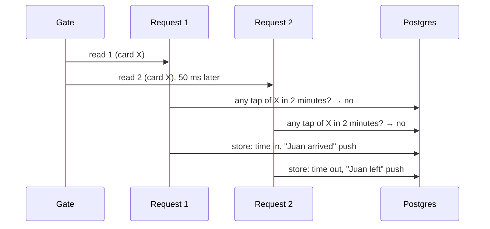

# Step 56: One read, one tap

> **Written before the code, on 2026-10-23, and approved by the owner the same day.** Updated after building where the real code differs; see "Changed while building". From `docs/SCALING.md` 1.3. The systems-architect reviewed the plan once; its points are included below (one blocking, about the test, now part of the plan). If building changes anything, this file is updated to match before the review report. Topic docs to update while building: `docs/GATE.md` (the tap service and the gate page), `docs/ATTENDANCE-MODEL.md` (the 2-minute rule), `docs/SCALING.md` 1.3 (marked done), and `docs/PLAN.md`'s Step 58 (the architect's note). No command changes.

## Why

The gate sends every card read to the server straight away. The server then asks "was this card tapped in the last 2 minutes?" and, if not, stores the tap. Those are two separate moments. If the reader reads one card twice within a fraction of a second, which a USB reader can do when a card is held on it, both requests ask before either has stored anything. Both hear "no", and both are stored:



Juan gets a time in and a time out in the same second, and his parents get "arrived" and "left" together. This is called a **race**: two requests racing between the check and the write.

This step makes the check and the write **one step per card**, so the second request waits for the first and then sees its tap. The gate also stops resending a card it has just read.

## What it costs

Nothing. No new package, table or service. Each tap's transaction takes one more statement (the lock), held only for the few milliseconds of the insert.

## Decisions

1. **A Postgres lock per card, held only while checking and writing.** Inside the tap's existing transaction, first `pg_advisory_xact_lock(hashtextextended('tap-card|<school>|<serial>', 0))`: a lock on a number made from the school and the card, which Postgres frees by itself when the transaction ends. A second request for the same card waits there (milliseconds), then checks and finds the first one's tap. Other cards never wait for it. (Architect: right here. A `SERIALIZABLE` transaction would need retry loops; locking the `Card` row would also work, but the lock doesn't need a row.)
2. **Inside the lock, in this order:**
   1. this tap's id already stored → `"exists"`, so a gate's resend after a dropped connection still gets its first answer back, not "Already tapped";
   2. the same 2-minute window query as today → found → `"duplicate"`, nothing written;
   3. otherwise write the tap, alert, notification and the gate's last-seen time, as today.

   This works because Postgres's default isolation (Read Committed) gives each statement a fresh view, so after waiting for the lock, the reads see the first request's committed tap. A comment says the isolation level must stay the default.
3. **The lock comes first**, before the gate's `lastSeenAt` update (architect), so every tap transaction takes its locks in the same order and two can never wait on each other.
4. **The quick check before the transaction stays.** Most repeats (a student tapping again a minute later) are answered without opening a transaction. The lock only matters for the rare reads that arrive together.
5. **The writer answers `"duplicate"`**, and the service then reads the first tap (now stored) and answers "Already tapped" exactly as the quick check does. If that read somehow finds nothing, it throws rather than pretending the tap was recorded (architect).
6. **A time in recorded by hand takes the same lock** (architect: cheap, so include it). Today Step 55's "Record time in" checks "no tap today?" and then writes, the same race with a gate tap of the student's card: a time in, a time out and a second "arrived" push. When the student has a card, the manual write now locks that card and checks for any tap of it that school day inside the lock. With no card there's no gate tap to race.
7. **The gate ignores the same card read again within 5 seconds of its last read**, before sending it. Measured from the *last* read, so a card held on a reader that re-reads every second is never resent. The screen keeps showing that card's answer. The server's 2-minute rule stays the real guard; this only saves requests.

## Steps

### 1. The writer (`src/data/repositories/tap-writer.ts`, `prisma-tap-writer.ts`)

```ts
export interface TapWrite {
  // …as today, plus:
  /**
   * The card's "already tapped" window (Step 56): when set, the card is locked,
   * and a tap of it in this window means nothing is written. Null: no check.
   */
  duplicateWindow: { from: string; to: string } | null;
}

export interface TapWriter {
  record(write: TapWrite): Promise<"created" | "exists" | "duplicate">;
}
```

In the Prisma writer, at the start of the transaction, when `duplicateWindow` is set and the tap has a serial:

```ts
await tx.$executeRaw`SELECT pg_advisory_xact_lock(hashtextextended(${tapCardLockKey(tap.schoolId, tap.cardSerial)}, 0))`;
if (await tx.tap.findUnique({ where: { id: tap.id }, select: { id: true } })) throw new TapExists();
const earlier = await tx.tap.findFirst({
  where: { schoolId: tap.schoolId, cardSerial: tap.cardSerial, tappedAt: { gt: from, lt: to } },
  select: { id: true },
});
if (earlier) throw new TapDuplicate();
```

`tapCardLockKey(schoolId, serial)` is `"tap-card|<school>|<serial>"`, exported so the Postgres test can take the same lock. The two private error classes end the transaction without writing, and become `"exists"` and `"duplicate"`. The existing `P2002` catch stays, for two resends of one id with no window.

### 2. The gate's taps (`src/services/taps/record-tap.ts`)

- Pass `duplicateWindow: { from: at − 2 min, to: at + 2 min }`, the same window as the quick check.
- On `"duplicate"`: `findByCardBetween` again → `{ outcome: "duplicate", previousTap, student }`. Nothing found → throw.

### 3. A time in by hand (`src/services/taps/record-manual-time-in.ts`)

When the student has an active card: `duplicateWindow` is that school day (`schoolTimeToIso(date, "00:00")` to the next day's), so any tap of the card that day, by the gate or by hand, means `"already_tapped"`. With no card: `null`, as today. `"duplicate"` answers `already_tapped`, the same as `"exists"`.

### 4. The gate (`src/features/gate/repeat-filter.ts`, `gate-kiosk.tsx`)

```ts
/** The same card read again this soon after its last read is the reader repeating itself, not a new tap (Step 56). */
export const REPEAT_WINDOW_MS = 5_000;

export function createRepeatFilter(windowMs = REPEAT_WINDOW_MS) {
  let last: { raw: string; at: number } | null = null;
  return {
    /** True when this is the same card as the last read, within the window of it. Every read moves the window. */
    isRepeat(raw: string, at: number): boolean { … },
  };
}
```

In `handleScan`, a repeat keeps the current card on screen (resets the idle timer) and sends nothing. The filter is made once per page (`useState(createRepeatFilter)`).

Two browser tests in `e2e/gate.spec.ts` read the same card twice in a row, so they now wait `REPEAT_WINDOW_MS + 200` before the second read. The "duplicate" one also checks the filter itself: a read at once sends no request and keeps the answer on screen.

### 5. Tests

- `repeat-filter.test.ts`: the same card within 5 s is a repeat; a card held for 20 s (a read every second) is one read; after 5 s of quiet it's new; a different card in between is new.
- `record-tap.test.ts` and `record-manual-time-in.test.ts`: the fake writers answer the new `"duplicate"`; a `"duplicate"` from the writer becomes "Already tapped".
- **`record-tap.pg.test.ts`** (real Postgres, the pattern of `record-manual-time-in.pg.test.ts`: a date far ahead, its own gate row, its rows removed afterwards, skipped without `E2E_DATABASE_URL`). The architect's blocking point: two `recordTap` calls at once don't reliably both get past the quick check before either writes, so a test of only that could pass without the lock. So:
  - **a read while another read of the card is mid-write**: the test opens its own transaction, takes the card's lock (`tapCardLockKey`), inserts a tap and doesn't commit. The real writer is then called: it must still be waiting 300 ms later, and answer `"duplicate"` once the test commits, with one `Tap` row. Without the lock it doesn't wait and stores a second tap, so this test fails every time without the fix;
  - **`recordTap` twice at once, with a gate in front of the quick check** that holds both requests until both have asked (so both see "no tap"), → one `recorded`, one `duplicate`, one `Tap` row, at most one `Notification`;
  - **a gate tap and a time in by hand at once** for one student with a card → one tap;
  - **two different cards at once** → both recorded (the lock is per card);
  - **a resend of the same id** while the first is being written → the first's answer, not "Already tapped".

  While building, the first two are run once **with the lock line removed**, to see them fail, then put back. The build log records that run.

## Verify it worked

1. `npm test`: the new Postgres test runs (not skipped) and passes.
2. The routine in `docs/LEARNING-LOG.md`, including `npm run test:e2e` (the gate's browser tests must still pass unchanged).
3. At the gate, if you have the USB reader: open `/gate`, hold one card on the reader for 10 seconds. One tap, one answer on screen. The `npm run dev` terminal shows one `POST /api/v1/gate/taps`, not one per second.
4. Tap the same card again after 6 seconds: "Already tapped" (the server's 2-minute rule).

## If something goes wrong

- **`P2028` ("Transaction already closed" or "Unable to start a transaction in the given time")** under load: the database pool is full, not the lock. Step 61 sets the pool size on purpose.
- **A card is read but the gate shows nothing new:** it's within 5 seconds of the same card's last read. Wait, or tap a different card.

## What you'll learn

- What a race between "check" and "write" is, and why two separate database calls can't prevent it on their own.
- How a short lock makes the check and the write one step, and why it's per card so other students never wait.
- Why a test of a race must force both requests into the gap, or it can pass without the fix.

## Before you commit

The full routine in `docs/LEARNING-LOG.md`: `npm run lint`, `npm run check:tokens`, `npm run typecheck`, `npm test`, `npm run build`, `npm run test:e2e`. Then "Verify it worked".

Suggested commit: `fix(gate): record one tap per card read, even when two arrive together`

## Known limits

- **Time in or time out is still worked out before the lock** (from the student's other taps). A wrong one needs another tap of the same student, more than 2 minutes away, stored during this request: near impossible with one gate today. Step 58's offline queue could send old taps all at once, so the architect's note is added to Step 58 in `docs/PLAN.md`: send the queue one tap at a time, or work out the direction inside the lock.
- **Reading the student's whole tap history** for each tap, and the database pool's size, are Step 61's (`docs/PLAN.md`).
- **The gate's 5-second filter lives in the page's memory**: a page reload forgets it. The server's rule still holds.

## Changed while building

- **The plain "two writes at once" test was replaced** (`docs/PROBLEMS-LOG.md`, P-037). Run with the lock line deleted, it passed 3 times out of 3: `Promise.all` doesn't make both requests reach the check before either writes. The new test holds one request mid-write from the test itself, and fails 3 out of 3 without the lock. The recordTap-with-a-barrier test and the gate-and-hand test stay as extra checks; without the lock they failed only some runs.
- **`tapCardLockKey()`** is exported from the writer, so the test takes exactly the writer's lock.
- **The gate's browser tests wait past the 5 seconds** before reading the same card again (Step 4).
- **The architect's note for Step 58** is in `docs/PLAN.md`.
- **The architect's code review** found nothing blocking and confirmed the held-transaction test proves the lock. Taken:
  - the filter gets `forget(raw)`, called when a send fails, so a card held on the reader after a failed send is tried again at once instead of being dropped for 5 seconds (with a unit test);
  - the held-transaction test always lets its transaction go (`try … finally`), even when a check fails, so it never leaves a row or an open transaction behind;
  - the test file's header says which test proves the lock and which only check the result.

  Not taken: the filter compares the raw text, so one card read once by the USB reader (digits) and once by Web NFC (hex) isn't seen as a repeat. The server's lock still makes it one tap, and a gate uses one or the other.

## What's next

Step 57: lost cards and alerts.
