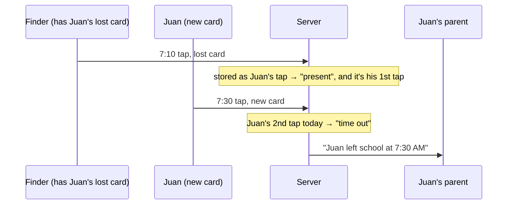

# Step 57: Lost cards and alerts

> **Written before the code, on 2026-10-23, and approved by the owner the same day.** Updated after building; see "Changed while building". From `docs/SCALING.md` 1.4 and 1.5. The owner decided two things first (2026-10-23): a lost card's tap **does not count** as its owner's attendance, and marking an alert handled is **just a yes or no**, with no record of who or when. The systems-architect reviewed the plan once and agreed with the approach. It found four gaps, all now part of the plan, and marked "(architect)" below. If building changes anything, this file is updated to match before the review report. Topic docs to update while building: `docs/GATE.md` (what a lost card's tap stores), `docs/ATTENDANCE-MODEL.md` (lost taps don't count), `docs/SCALING.md` 1.4 and 1.5 (marked done), and a note on `docs/backend/step-45-tap-service.md` decision 4. No command changes.

## Why

When someone taps a card that was reported lost, the tap is stored under the **owner's** name, so the "Needs attention" alert can say whose card it was (Step 45, decision 4). But every screen that counts attendance reads that same name:



Juan shows as present from a tap he didn't make, his real arrival becomes a time out, and his parent is told he left. The gate monitor shows the same wrong labels.

Separately, nothing can mark an alert handled. The dashboard loads **every alert the school ever had**, keeps the open ones, then asks the database for each one's tap separately: one query per alert, forever growing. The gate monitor also loads every alert ever, just to label today's 12 taps.

## What it costs

Nothing new to pay for. One nullable column and one index on `Alert`, a table with a handful of rows. The dashboard goes from 1 + (number of open alerts) queries to 2, and the monitor from "every alert ever" to "the alerts of the 12 taps on screen".

## Decisions

1. **A lost card's tap is stored with no student. The alert carries the owner.** `Alert` gains `studentId` (who the lost card belonged to when tapped). Every attendance count already leaves out taps with no student (`deriveTapKind`, `dayTapSummary`, `countByStatus`, the parent's history, the `(studentId, tappedAt)` index), so nothing in the attendance math has to learn about alerts. (Architect: right choice. Keeping the student on the tap and leaving out alerted taps everywhere would need every counter and parent query to join `Alert`, and one would eventually be missed.) `Alert.studentId` is nullable, for future alert types about no student (a gate gone offline, say).
2. **Existing data is moved in the same migration.** Each alert gets its tap's student, then those taps lose it. Both statements are written so running them twice changes nothing (`WHERE … IS NULL`), so a half-applied migration can be re-run safely, whether or not Prisma wraps the file in a transaction (architect).
3. **A resend after a dropped connection decides from the alert, not the card** (architect). Today `replay()` checks whether the card is lost *now*, so a normal tap whose card was reported lost later would replay as a lost-card tap. Now: the stored tap has an alert → `lost_card`, naming `alert.studentId` (or the tap's own student, for an alert written by the old code during the release window); no alert and a student → `recorded`; neither → `unknown_card`.
4. **The guardhouse monitor's photo comes from the answer, not the tap** (architect): `publishStoredTap` looks up the photo by `result.student?.id`, since a lost tap no longer has a student on it.
5. **`deriveTapKind` ignores taps with no student** (architect). Today `null === null` would make two student-less taps count each other.
6. **Who can mark an alert handled:** a principal, or a super admin viewing the school, the same people who see "Needs attention". A teacher gets an error. Marking an alert already handled by someone else counts as done (two principals clicking at once both see success). No confirm dialog: nothing is deleted, the row stays with `acknowledged = true`.
7. **The dashboard shows at most 10 open alerts**, newest first, with "N open" counting all of them, the same pattern as "New parent links".
8. **No index on `Alert.studentId`.** The architect suggested one so deleting a student doesn't scan alerts, but nothing in the app deletes a student (every `Student` relation is `Restrict`), and the table is tiny. Added if student deletion is ever built.

## Steps

### 1. Schema and migration (`prisma/schema.prisma`)

```prisma
model Alert {
  id           String    @id @default(uuid())
  schoolId     String
  school       School    @relation(fields: [schoolId], references: [id], onDelete: Restrict)
  tapId        String    @unique
  tap          Tap       @relation(fields: [tapId], references: [id], onDelete: Restrict)
  // Step 57: whose lost card it was. The tap itself has no student, so it
  // never counts as their attendance. Null for an alert about no student.
  studentId    String?
  student      Student?  @relation(fields: [studentId], references: [id], onDelete: Restrict)
  type         AlertType
  createdAt    DateTime  @default(now())
  acknowledged Boolean   @default(false)

  // "This school's open alerts, newest first" (the dashboard).
  @@index([schoolId, acknowledged, createdAt])
}
```

`Student` gains `alerts Alert[]`. The `Tap.studentId` comment changes to: null for a lost card's tap (its alert names the owner, Step 57).

`npx prisma migrate dev --create-only --name lost_card_taps_have_no_student` writes the column, index and foreign key. Then add, by hand, at the end of the file:

```sql
-- Step 57: a lost card's tap no longer belongs to the card's owner. Move the
-- owner onto the alert, then take them off the tap. Safe to run twice.
UPDATE "Alert" a SET "studentId" = t."studentId"
  FROM "Tap" t WHERE a."tapId" = t."id" AND a."studentId" IS NULL;
UPDATE "Tap" t SET "studentId" = NULL
  FROM "Alert" a WHERE a."tapId" = t."id" AND t."studentId" IS NOT NULL;
```

Then `npx prisma migrate dev` to apply it locally and regenerate the client.

### 2. The app's `Alert` (`src/features/attendance/schemas.ts`)

`alertSchema` gains `studentId: z.string().min(1).nullable()`. `toAlert` and `toAlertData` carry it.

### 3. The alert repository (`alert-repository.ts`, `prisma-alert-repository.ts`)

`listBySchool` (every alert ever) is removed. In its place:

```ts
export type OpenAlert = Alert & { tap: Tap };

export interface AlertRepository {
  /** The newest open alerts with their taps, and how many are open in all. */
  listOpen(schoolId: string, limit: number): Promise<{ alerts: OpenAlert[]; total: number }>;
  /** The alerts raised by these taps, for labelling a few taps on screen (and a resend). */
  listForTaps(schoolId: string, tapIds: string[]): Promise<Alert[]>;
  /** Marks an alert handled. False when this school has no such alert. */
  acknowledge(schoolId: string, alertId: string): Promise<boolean>;
}
```

- `listOpen`: `findMany({ where: { schoolId, acknowledged: false }, include: { tap: true }, orderBy: { createdAt: "desc" }, take: limit })` and `count` with the same `where`, sent together in one `$transaction([...])`.
- `listForTaps`: `findMany({ where: { schoolId, tapId: { in: tapIds } } })`. Empty list → no query.
- `acknowledge`: `updateMany({ where: { id: alertId, schoolId } , data: { acknowledged: true } })` → `count === 1`. Scoped by school, so a principal can't touch another school's alert by guessing an id.

The mock repository (used by `isolation.test.ts`) gets the same three, with the taps passed in for `listOpen`.

### 4. Recording a lost card's tap (`src/services/taps/record-tap.ts`)

- Kind `lost`: the tap is stored with `studentId: null`; the alert gets `studentId: card.studentId`. The gate's answer still names the owner (`student` from the card).
- `replay()` takes a new dependency, `alerts: Pick<AlertRepository, "listForTaps">`, and follows decision 3. The card lookup leaves `replay()`.
- The comment "A lost card's tap keeps its owner" changes to say why it no longer does.

### 5. Counting and the monitor

- `deriveTapKind` (`src/features/attendance/status.ts`): a tap with no `studentId` matches nothing.
- `publishStoredTap` (`src/services/taps/publish-tap.ts`): photo by `result.student?.id` (decision 4).
- `monitorEventsFromTaps` (`src/features/gate/monitor-events.ts`): its third argument becomes `lostCardOwners: Map<tapId, studentId | null>`, checked **before** "no student → unknown card" (architect), so a lost tap shows its owner's name and photo with the lost-card look.
- `/gate/display` (`src/app/gate/display/page.tsx`): loads today's taps, takes the newest 12, then `listForTaps` for just those. The page's alert query no longer reads every alert ever.

### 6. The dashboard (`src/app/(app)/dashboard/page.tsx`)

- `alertRepository.listOpen(schoolId, 10)` replaces `listBySchool` and the one-query-per-alert loop.
- The "Live taps" card: the 7 newest taps' alerts through `listForTaps`, so a lost card's tap shows "Juan Dela Cruz · Lost card" instead of "Unknown card". The teacher's class feed is unchanged (it only shows taps with one of their students, and a lost tap has none).

### 7. Mark handled (`src/services/alerts/mark-alert-handled.ts`, `src/features/attendance/actions.ts`, `needs-attention.tsx`)

The rules live in a service, like Step 55's `recordManualTimeIn`, so they're tested without a session:

```ts
/** "Mark handled" on a dashboard alert (Step 57): principals and super admins only. */
export async function markAlertHandled(
  input: { schoolId: string; alertId: string; role: Role },
  deps = { alerts: alertRepository },
): Promise<"handled" | "not_allowed" | "not_found">
```

A teacher → `not_allowed`, before any query. `alertId` is checked with Zod (architect) → a malformed one is `not_found`. Otherwise `alerts.acknowledge(schoolId, alertId)`.

The server action `markAlertHandled(alertId)` in `actions.ts` stays thin, like `recordTimeIn`: session → school picked → staff → the service → `refresh()`, answering `{ ok: true } | { ok: false; error }`. `not_found` → "That alert is no longer open."; `not_allowed` → "Only a principal can mark alerts handled."

`NeedsAttention` names the owner from `alert.studentId`. Each alert gets:

- **A card already reported lost was just tapped** (as today)
- **Juan Dela Cruz's card, at 8:05 AM. It didn't count as their time in.**
- a **Mark handled** button (outline, small, at least 44 px tall on a phone), from a small client component `MarkHandledButton`: `useTransition`, disabled while sending, toast "Marked handled" or the error. The alert disappears when the page refreshes.

### 8. Seed data (`src/data/seed/taps.ts`, `seed.test.ts`)

The seeded lost-card tap gets `studentId: null`, its alert `studentId: seedStudents[0].id`; the comment says why (architect). `seed.test.ts`'s lost-card test also checks that the tap has no student and the alert names one.

### 9. Tests

- `record-tap.test.ts`: a lost card's tap is written with no student and an alert naming the owner; the gate's answer names the owner; **the owner's next real tap is a time in**; a resend of a lost tap answers `lost_card` from its alert; a resend of a normal tap whose card was marked lost afterwards still answers `recorded`.
- `status.test.ts`: `deriveTapKind` ignores taps with no student.
- `monitor-events.test.ts` (new or extended): a lost tap shows its owner as `lost_card`, and doesn't shift the owner's time in or time out.
- `alert-repository.test.ts` (mock) and a new `prisma-alert-repository.pg.test.ts` (real Postgres, the pattern of `record-tap.pg.test.ts`, skipped without `E2E_DATABASE_URL`): `listOpen` is newest first, capped, counts all, leaves out handled alerts and other schools'; `listForTaps` stays in its school; `acknowledge` works once per school and refuses another school's alert.
- `mark-alert-handled.test.ts`: a teacher is refused without touching the repository; a malformed id is `not_found`; a principal's call reaches the repository with their own school; an alert already handled is still `handled` (decision 6).
- `needs-attention.test.tsx`: the owner's name, the "didn't count" line, and a **Mark handled** button per alert.

## Verify it worked

1. The routine in `docs/LEARNING-LOG.md`: `npm run lint`, `npm run check:tokens`, `npm run typecheck`, `npm test`, `npm run build`, `npm run test:e2e`. The new Postgres test must run, not be skipped.
2. `npm run dev`, sign in as the demo principal, open `/dashboard`:
   - "Needs attention" shows the seeded lost card with the owner's name and "It didn't count as their time in".
   - On `/attendance`, that student (the first seeded student) has no time in from the lost card.
   - Click **Mark handled**: a toast, and the alert is gone; "0 open".
3. At the gate, with the reader: report a card lost (Students → the student → "Card lost? Replace it"), then tap the old card at `/gate`. The gate and `/gate/display` show the lost-card warning with the owner's name and photo. Then tap their new card: it's a **time in**, not a time out.
4. On the live database, after deploying (architect): no lost-card tap still has a student. This Mac has no `psql`, so through the Docker database's (`docs/COMMANDS.md`):
   ```bash
   docker start talaan-postgres
   docker exec -it talaan-postgres psql "$(heroku config:get DATABASE_URL --app bantayaral)" -c 'SELECT count(*) FROM "Tap" t JOIN "Alert" a ON a."tapId" = t.id WHERE t."studentId" IS NOT NULL;'
   ```
   should print `0`.

## If something goes wrong

- **The migration fails half-way on Heroku:** fix the cause and run `heroku run npx prisma migrate resolve --rolled-back <name>`, then deploy again. The two `UPDATE`s are safe to run again.
- **A lost-card tap during the deploy still counts:** the old code runs for a moment after the migration, and stores a lost card's tap the old way. Deploy outside gate hours. If the check in "Verify it worked" 4 doesn't print `0`, run both `UPDATE`s from the migration once more in `heroku pg:psql` (they're safe to re-run). Until then, the dashboard still names the owner from the tap.

## What you'll learn

- How one column in the wrong place spreads a mistake to every screen that reads it, and why moving the data (the owner onto the alert) fixes all of them at once instead of patching each screen.
- A data migration: SQL that changes existing rows, written so running it twice is harmless.
- Loading a list with its related rows in one query (`include`) instead of one query per row (the "N + 1" problem).

## Before you commit

The full routine in `docs/LEARNING-LOG.md`, then "Verify it worked".

Suggested commit: `feat(alerts): let staff resolve lost-card alerts without shifting time in`

## Known limits

- **The same lost card tapped again within 2 minutes** answers "Already tapped" with no name, since the earlier tap has no student. The first tap's alert already named them.
- **No record of who handled an alert, or when** (owner's decision). Two columns if it's ever needed.
- **A handled alert can't be reopened.** Nothing asks for it yet.
- **No browser test** clicks "Mark handled": it would use up the one seeded alert for every later run. The unit and Postgres tests cover it.

## Changed while building

- **The live feed's wording.** A lost card's row shows the owner's name with **Lost card tapped, not counted** under it (in the absent red), instead of "Juan Dela Cruz · Lost card", so the line also says it didn't count.
- **The mock repository takes the taps too:** `createMockAlertRepository(alerts, taps, options)`, since `listOpen` returns each alert with its tap. `isolation.test.ts` passes both.
- **One more isolation check** (`src/features/isolation.test.ts`): Oceanview's principal can't mark a Balanga alert handled, and it stays open.
- **The dashboard falls back to the tap's student** (architect's code review): `alert.studentId ?? alert.tap.studentId`, so an alert the old code wrote during the deploy still names the owner. "If something goes wrong" now says to run both `UPDATE`s again if the live check isn't `0`.
- **The test database needed the migration** before the new Postgres test could run (`docs/PROBLEMS-LOG.md`, P-038). It's done; nothing for you to do.
