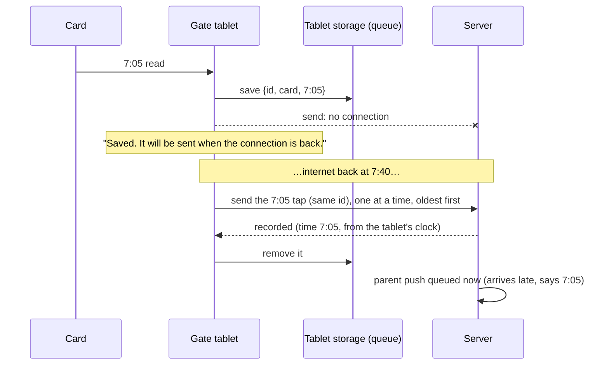

# Step 58: The gate keeps taps while offline

> **Written before the code, on 2026-10-23, and approved by the owner the same day** (decision 9 as proposed; decision 11's service worker kept out of this step). Updated after building; see "Changed while building". From `docs/SCALING.md` 1.6 and the note Step 56's architect added to `docs/PLAN.md`. The systems-architect reviewed the plan once. It found three blocking gaps, all now part of the plan, and marked "(architect)" below. Two things need the owner's answer: decision 9 (a parent push skipped when a tap arrives late) and decision 11 (making the gate page itself open with no internet is moved to its own step). If building changes anything, this file is updated to match before the review report. Topic docs to update while building: `docs/GATE.md` (a new "Offline" section), `docs/SCALING.md` 1.6 (marked done), `docs/PLAN.md` (the "known small gaps" line and Step 58's note).

## Why

Today, when the school's internet drops, the gate shows **"Not sent: no connection. The tap wasn't recorded; tap again."** In a morning rush, many students won't tap again. Their time in is lost, their parents hear nothing, and the attendance page later marks them absent although they came.

The gate already gives every tap its own id the moment the card is read, and the server already accepts the same id twice without storing it twice (Step 45). So a tap can safely wait on the tablet and be sent later. What's missing is the waiting room, and the rules for emptying it.



## What it costs

Nothing to pay for. No new package, table or service. On the tablet, each waiting tap takes about 100 bytes in the browser's storage: 2,000 taps (four mornings of a 500-student school with the internet down) is about 200 KB. On the server, waiting taps arrive as ordinary taps, one request each.

## Decisions

1. **Every tap is written to the tablet's storage first, then sent.** Not only when sending fails: if the tablet loses power in the middle of a send, the tap is still there when it restarts. When the server answers, the tap is removed. A key in `localStorage` (`talaan.gate.queue`), the same storage the roster already uses. (Architect: localStorage is fine at this size; IndexedDB would be more code for nothing here.)
2. **When nothing is waiting, a tap is sent at once, as today**, without waiting for any other tap (Step 47's fast path). **When taps are waiting, a new tap joins the end of the line.** Then every tap reaches the server in the order it was read, which is what the time in/out order needs (Step 56's note).
3. **The waiting line is sent one tap at a time, oldest first**, each waiting for its answer. It starts when the browser says it's back online, every 30 seconds while anything waits, and after every answer. It stops at the first failure and tries again later.
4. **What counts as "try again later":** no connection, no answer within 10 seconds (each send now has a time limit, so a hanging request can't freeze the line), a server error (5xx, which Heroku answers while restarting or deploying) and "too many requests" (429). (Architect: queue on 5xx and 429 too.) A tap that timed out may in fact have been stored: sending it again with the same id gets the first answer back, nothing doubles.
5. **What counts as done:** any answer from the server. Recorded, already tapped, lost card, unknown card and "not a card serial" (400) all remove the tap from the line.
6. **One tap can't block the rest** (architect, blocking). Only an error **answered by the server** (5xx or 429) counts as a failed try; no connection and no answer in time don't, or a long outage would mark the oldest tap stuck within minutes. After 5 such tries, that tap moves to a separate **stuck** list. The line carries on behind it. Stuck taps are never deleted. They're tried again every 10 minutes, and the screen shows "1 tap couldn't be sent. Keep this tablet on and tell the office."
7. **Waiting taps are never deleted** (architect, blocking). Today **Disconnect**, or a token the office revoked, wipes everything on the tablet. That would throw away taps the server never got. Now it wipes the token, the roster and the photos as before, but **keeps the waiting taps**, marked with the school they were read for. They're sent when a gate token of the **same school** connects on this tablet again; another school's token never sends them. To know the school, the gate keeps what the heartbeat already answers (`device.schoolId`, with the label) in `talaan.gate.device`.
8. **The tablet asks the browser to keep its storage** (`navigator.storage.persist()`), and a full storage is caught, never a crash. With storage full, the tap is still sent if it can be, and the screen says "This tablet's storage is full. Tell the office." (Architect: don't refuse or evict taps early; at 100 bytes each, about 20,000 fit next to the roster in the usual 5 MB.) The setup notes in `docs/GATE.md` add one line: set the kiosk browser so it never clears site data on restart.
9. **A late tap doesn't send a misleading push (needs the owner's OK)** (architect, blocking). Time in and time out come from the order of the day's taps. A waiting 7:05 tap can arrive after a later tap of the same student, from a second gate or a time in recorded by hand at 8:30. It's still stored with its real time, and every screen then shows the right order. But at the moment it arrives it would count as "the first tap so far" and send "arrived at 7:05", the second "arrived" push. Proposed rule, on the server: **a tap that arrives when the same student already has a later tap that day is recorded, but sends no push.** The parent already got a push for the later tap. One query's worth of work: `recordTap` already loads the student's taps to work out time in or out.
10. **What the screen says.** A waiting tap shows the student's name and photo from the tablet's own roster, with **"Saved. It will be sent when the connection is back."** in grey, the same grey as "Checking". Not green: it isn't confirmed yet. A card the roster doesn't know (an unknown card, or a lost one, which the roster leaves out on purpose) shows **"Saved. Not on this gate's list. Please ask the gate attendant."** (architect). A strip under the header counts the line: "No connection. 3 taps saved on this tablet." while offline, "Sending 3 saved taps…" while it empties. A saved tap counts as handled for the 5-second repeat filter, so holding the card on the reader doesn't save it twice (architect).
11. **Opening the gate page with no internet is its own step (needs the owner's OK).** After a power cut or a browser restart during an outage, the tablet can't load `/gate` at all today: the browser shows its own "no internet" page. Fixing that needs a **service worker** (a small script the browser keeps, which serves the saved page when the network is gone). It's a new moving part with its own risks (an old copy of the page staying after a deploy), so it's proposed as **Step 58.1**, after this one. This step covers the common case: the internet drops while the page is open.
12. **Starting up when the server can't answer.** The page can open while the server can't do its work, for example when the database is down but the web server isn't. Then the heartbeat fails with a server error. Today the gate then sits on "Couldn't reach the server". Now, with a token already on the tablet and the heartbeat failing for any reason but "token refused", the gate starts with the copies it has: the saved label, the roster, and **photos read straight from the tablet's photo cache** (new `photosFromCache`, no network). It checks in again every 30 seconds until it works. The clock warning waits for a real check-in. (Architect: without Step 58.1 this case is uncommon, since a page that loaded means the server was there a moment ago. It's cheap, so it stays.)

## Steps

### 1. The waiting line (`src/features/gate/tap-queue.ts`, new)

Plain functions over a small storage object, so the tests use a fake one:

```ts
export type QueuedTap = {
  id: string;          // the tap's own id, made when the card was read
  raw: string;         // exactly what the reader typed
  scannedAt: string;   // the tablet's clock at the read
  schoolId: string;    // the school it was read for (decision 7)
  tries: number;       // error answers from the server (5xx, 429); no connection doesn't count
};

export type TapQueue = { waiting: QueuedTap[]; stuck: QueuedTap[] };

export function readQueue(storage: Storage | null): TapQueue;               // corrupt or missing → empty
export function writeQueue(storage: Storage | null, queue: TapQueue): "saved" | "full";
export function addTap(queue: TapQueue, tap: QueuedTap): TapQueue;           // to the end
export function removeTap(queue: TapQueue, id: string): TapQueue;            // from either list
export function recordServerError(queue: TapQueue, id: string): TapQueue;   // tries + 1; the 5th moves it to stuck
export function forSchool(queue: TapQueue, schoolId: string): TapQueue;    // only what this school's token may send
```

### 2. The sender (`src/features/gate/tap-sender.ts`, new)

```ts
/** Sends the waiting line one tap at a time, oldest first (decisions 2–6). */
export function createTapSender(deps: {
  load: () => TapQueue;
  save: (queue: TapQueue) => void;
  send: (tap: QueuedTap) => Promise<GateTapResponse>; // throws GateOfflineError or GateServerError: "try again later"
  onAnswer: (id: string, response: GateTapResponse) => void;
  onChange: (queue: TapQueue) => void;
}): {
  /** Saves a new tap, then sends it now (nothing waiting) or after the rest. */
  add(tap: QueuedTap): void;
  /** Starts sending if it isn't already. Safe to call often. */
  kick(): void;
};
```

One send in flight at a time for the line. The fast path (decision 2) is a send of the new tap when the line held nothing else. Either way, the tap was saved first.

### 3. The calls (`src/features/gate/gate-client.ts`)

- `sendTap` gets `signal: AbortSignal.timeout(10_000)` and throws `GateOfflineError` for no connection and a timeout, and `GateServerError` for 5xx and 429 (decision 6 counts only these). Other answers keep today's behaviour.
- `checkIn` also returns `schoolId`. A good check-in saves `{ label, schoolId }` in `talaan.gate.device`, read back by `readStoredDevice()`.
- `forgetGate()` keeps `talaan.gate.queue` (decision 7). It still wipes the token, roster, device and photos.
- New `photosFromCache(roster)`: object URLs for every roster photo already in the photo cache, without the network (decision 12).
- `askToKeepStorage()`: `navigator.storage?.persist?.()`, ignored where it's missing.

### 4. The screen (`gate-display.ts`, `tap-card.tsx`, `gate-kiosk.tsx`)

- A scan gets a new state, `{ kind: "saved" }`, and a new `TapKind`, `"saved"`, with the wording in decision 10. `"not_sent"` stays, for the one case left: storage full **and** no connection.
- `handleScan` makes the tap as today, then `sender.add(...)`. The answer settles the scan the same way as today, whenever it comes. A scan still on screen changes from "Saved" to its real answer once sent.
- The strip under the header counts the line and the stuck list.
- `connect`: on a good check-in, as today, then `sender.kick()`. On a check-in that fails for any reason but 401, with a stored token and device: start from the stored copies (decision 12), and retry the check-in every 30 seconds.
- A tablet whose line holds another school's taps (after connecting a different school's token) leaves them alone, and the strip says "3 taps from another school are saved on this tablet."

### 5. The late-tap rule (`src/services/taps/record-tap.ts`, decision 9)

In `directionOf`, which already has the student's taps:

```ts
// A tap that arrives after a later tap of the same day (a gate that was
// offline, Step 58): stored with its real time, but the parent already
// heard about the later one, so no push now.
const laterSameDay = studentTaps.some(
  (other) => other.id !== tap.id && schoolDateOf(other.tappedAt) === day && other.tappedAt > tap.tappedAt,
);
const notified = !laterSameDay && school ? shouldNotifyParents(school.notificationPreference, direction) : false;
```

### 6. Tests

- `tap-queue.test.ts`:
  - first in, first out;
  - kept across a reload (a new read of the same storage);
  - corrupt JSON reads as empty;
  - the 5th failure moves a tap to stuck;
  - removing works from either list;
  - "full" is reported, not thrown;
  - `forSchool` filters.
- `tap-sender.test.ts` (a fake `send` the test controls):
  - one send at a time;
  - oldest first;
  - stops at the first offline error and keeps the rest;
  - any answer removes the tap;
  - a new tap waits behind older ones but goes at once when the line is empty;
  - a tap the server keeps answering 503 is stuck after 5 tries and doesn't block the next one;
  - a long outage (many "no connection" failures) never marks a tap stuck;
  - the tap is saved before `send` is called.
- `gate-display.test.ts`: the "saved" wording, with and without a roster match.
- `record-tap.test.ts`: a tap that arrives after a later tap of the same student that day is recorded with no notification; in the right order it's notified as today.
- `e2e/gate.spec.ts`, with Playwright's `context.setOffline(true)`:
  - three cards read offline show "Saved" and "3 taps saved on this tablet";
  - nothing for those taps is in the database yet, and no notification rows;
  - back online, the strip empties, each tap is in the database **exactly once**, with its offline time, and the notification rows appear only now;
  - a reload with the heartbeat answering 503 (Playwright's `page.route`) still shows a student's photo from the cache on a tap.

## Verify it worked

1. The routine in `docs/LEARNING-LOG.md`: `npm run lint`, `npm run check:tokens`, `npm run typecheck`, `npm test`, `npm run build`, `npm run test:e2e`.
2. `npm run dev`, open `/gate` with the test token. Switch your computer's Wi-Fi off (or Chrome DevTools → Network → Offline). Tap three cards: each says "Saved…", and the strip says "3 taps saved on this tablet."
3. Wait a minute, then turn the network back on. Within 30 seconds the strip empties. On `/attendance`, the three students show the time they tapped, not the time the network came back.
4. On the monitor `/gate/display`, the three taps appear once each.
5. With the reader, hold one card on it while offline for 10 seconds: one "Saved", not ten.
6. With taps waiting, click **Disconnect**, connect again with the same token: the taps are still sent.

## If something goes wrong

- **"Storage full"**: the kiosk browser limits site storage. Raise it in the kiosk app's settings, or free space; the taps still go straight to the server while it's online.
- **Taps stuck**: leave the tablet on and online; they're tried every 10 minutes. If the count doesn't fall, the server is refusing them: check `heroku logs --tail` for `POST /api/v1/gate/taps` errors.
- **Waiting taps vanished after a restart**: the kiosk browser was set to clear site data. Change that setting (decision 8).

## What you'll learn

- "Save first, then send": why a tap that's on the tablet's storage survives a power cut, and one that's only in memory doesn't.
- Why an id made on the device lets a request be sent twice safely (idempotency), and why that's what makes a retry queue simple.
- Why order matters for time in and time out, and what a server can and can't fix when two devices send out of order.

## Before you commit

The full routine in `docs/LEARNING-LOG.md`, then "Verify it worked".

Suggested commit: `feat(gate): keep taps while offline and send them when back`

## Known limits

- **A restart during an outage still shows the browser's "no internet" page** until Step 58.1 (decision 11).
- **A time in recorded by hand while the gate's taps wait** can turn the order around: if staff record 8:30 for a student whose 7:05 tap is still waiting, the 8:30 one becomes a time out once the 7:05 arrives. Decision 9 keeps the push from repeating, but the record shows both. Rare: staff record by hand when a card fails, not when the internet is down.
- **The tablet's clock decides the time of a waiting tap.** A clock more than 7 days off is replaced by the arrival time (Step 45). The clock warning shows after the first good check-in.

## Changed while building

- **"Not sent" is gone entirely.** The recipe kept it for "storage full and no connection". But a tap the storage can't hold still stays in the page's own memory, and the sender keeps trying it while the page is open, so "Saved" is still true. The strip says the storage is full. The old `failed` state and the repeat filter's `forget()` were removed with it.
- **A tap on its way isn't counted as waiting.** Otherwise the strip flashed "1 tap saved on this tablet" for a moment on every normal tap. A tap sent at once is marked "on its way" before it's saved, so the count never sees it.
- **The error classes live in `gate-client.ts`**, next to the calls that throw them: `GateOfflineError` (no connection, no answer in 10 s, an answer cut off, or 429, 502, 503, 504), `GateServerError` (any other error answer), `GateUnauthorizedError`.
- **Fixed after the architect's code review** (`docs/PROBLEMS-LOG.md`, P-042), each with a test:
  - **No error answer ever deletes a tap.** The first build dropped a tap on a 4xx other than 401/403, shown as "Couldn't read the card". A school's web filter or login page answering 404 or 407 would have deleted taps. Every error answer now counts toward "stuck" instead (decision 6), and the "refused" error class is gone.
  - **502, 503 and 504 don't count toward "stuck".** Heroku answers 503 while restarting, so a long outage would have moved taps aside one every 2.5 minutes. They're treated like no connection, and only 500s and 4xx count, as decision 6 meant ("an error answered by the server").
  - **The sender re-reads storage on every change** instead of saving its own copy, and stays silent once stopped. A send from before a Disconnect could otherwise have saved an old line over the new one.
  - **An offline start only trusts the saved gate for the same token.** `saveToken` forgets it when the token changes, and a check-in that works again replaces the school with the server's.
  - **A new tap waits while the line is being sent**, even behind its last tap.
  - **Older tablet browsers without `AbortSignal.timeout`** send without the 10-second limit instead of failing every tap.
- **The browser tests:** the offline test runs on the desktop project only (the line doesn't depend on screen width), with three seeded students who already tapped that morning, so the station tests leave them alone. The start-up test extends Step 47's photo test, which already has a cached photo: it answers the heartbeat with 503 and reloads. Under the tests' pinned clock (`DEMO_NOW`), the server stores the arrival time, not the tablet's (`chooseTapTime`), so "kept its offline time" is covered by `tap-time.test.ts`, not the browser test. A small script, `e2e/tap-rows.ts`, counts the stored taps and their notifications by id.
