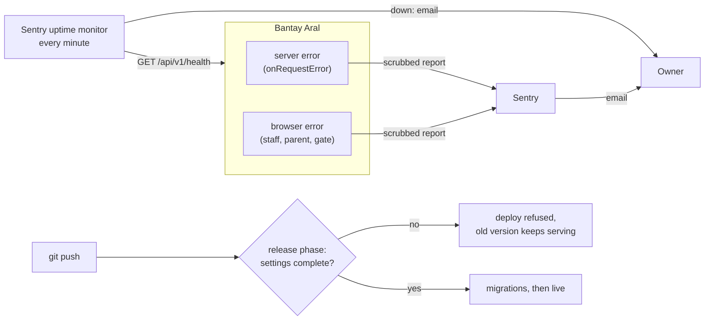

# Step 59: Know when something breaks

> **Written before the code, on 2026-10-23, and approved by the owner the same day.** Updated after building; see "Changed while building". From `docs/SCALING.md` 1.7 and `docs/PROBLEMS-LOG.md` P-041. The owner chose Sentry's free plan and split the old Step 59 in three (this step; 59.1 error pages; 59.2 a practice restore). The systems-architect reviewed the plan once and found nothing that blocks a build or a deploy. Its three gaps, all about what could reach Sentry, are now part of the plan and marked "(architect)". If building changes anything, this file is updated to match before the review report. Topic docs: a new `docs/ERROR-TRACKING.md`, plus `docs/DEPLOY.md` (the new setting and the uptime monitor), `docs/SCALING.md` 1.7 and `docs/COMMANDS.md`.

## Why

Today nobody hears when something breaks. A server error shows only in `heroku logs`, which keeps about the last 1,500 lines. A browser error on a principal's laptop or the gate tablet never leaves that screen. And twice a deploy went live with a required setting missing, so every page answered "Internal Server Error" until someone happened to look (P-026, P-041).

This step adds three alarms:



## What it costs

- **Sentry's Developer plan: $0.** 5,000 errors a month, one user, 30 days of history, and one uptime monitor ([sentry.io/pricing](https://sentry.io/pricing/), checked 2026-10-23). Past 5,000, Sentry stops accepting reports for the rest of the month; it doesn't bill. The paid plan starts at $26 a month and isn't needed at this size.
- **One new package**, `@sentry/nextjs` (owner-approved with the choice of Sentry). It adds JavaScript to every page; measured during the build and reported (Lighthouse target: 90).
- **Server memory:** the Sentry server part runs inside the web dyno (512 MB). Measured after the deploy with `heroku logs`' memory lines.

## What a report stores, and what it never does

Students are minors, so a report carries only what's needed to find the bug.

| Sent | Never sent |
|---|---|
| The error's type, message and stack trace (which file and line) | IP addresses, cookies, request headers |
| The page's address **without** anything after `?` | Form contents and request bodies (names, mobiles, passwords) |
| The browser and operating system | Search text (`?q=Juan`), which is part of the query string |
| Whether it was the server or the browser | Clicks and page-visit records ("breadcrumbs"), which can include a name from a button label or a photo's description (architect) |
| | Console logs, screen recordings ("Session Replay") and performance tracing |
| | A database error's own message, which can quote the data it was saving (architect) |

Student and staff ids (random UUIDs) can appear in a page's address. They aren't names, and Sentry keeps reports for 30 days.

## Decisions

1. **One setting, `NEXT_PUBLIC_SENTRY_DSN`**, the address Sentry gives the project. It isn't a secret: Sentry designs it to be readable in the browser. Both the server and the browser read it. **Unset means off**: development, the tests and CI send nothing. It's optional, so a live server without it still starts. Because Next.js copies `NEXT_PUBLIC_` values into the built code, **changing it needs a new build** (a deploy), not just `heroku config:set` (architect).
2. **Every Sentry option sits in one file**, `src/lib/error-reporting.ts`, the only place that knows Sentry beyond the two start-up files. Swapping the provider later means changing this file and those two.
3. **Privacy settings** (the table above):
   - `sendDefaultPii: false`.
   - Every `dataCollection` category off: headers, cookies, IP address, query strings, request bodies, database values. Sentry turns them all **on** by default.
   - `maxBreadcrumbs: 0` (architect: removing only the console records isn't enough).
   - No Replay, no tracing.
   - On top of that, a `scrubEvent` function runs on every report before it leaves (`beforeSend`). It removes the request's data, cookies, headers and query string, any user, and the query string from every address. It replaces the message of any `PrismaClient…` error with just its type.
4. **Noise that would use up the quota is ignored** (architect): "Failed to fetch", "Load failed", "NetworkError when attempting to fetch resource" and the gate's own "Check-in failed", "Roster failed" and "Tap failed". An offline gate tablet would otherwise send thousands. Sentry's spike protection stays on (it is by default).
5. **The server starts Sentry first**, in `register()` (`src/instrumentation.ts`), before the settings check. A bad setting is then reported too: `register()` sends it and waits up to 2 seconds before throwing as today, since Next.js catches that throw itself (architect). Server errors in pages, actions and API routes reach Sentry through Next.js's own hook, `export const onRequestError`.
6. **The existing error pages report too.** An error that a page's `error.tsx` catches never reaches Sentry by itself, so `src/app/(app)/error.tsx` and `src/app/parent/error.tsx` call `reportError(error)`. Step 59.1 rebuilds these pages; this is only the one line.
7. **No source maps yet.** Sentry's `withSentryConfig` would upload them during the build, so browser errors show the original code. That needs a secret token in the build and Sentry reachable from Heroku's build. Without it, browser stack traces show the shrunk code, which still names the file; server traces are readable. Next.js's hooks work without it (architect). Revisit if a browser error is hard to place.
8. **A deploy missing a setting is refused** (P-041's option 3). `scripts/check-settings.ts` runs the same `checkProductionEnv` the server runs, and exits with an error listing what's missing. The `Procfile` runs it before the migrations:

   ```
   release: npx tsx scripts/check-settings.ts && npx prisma migrate deploy
   ```

   When a release command fails, Heroku doesn't switch to the new version: the old one keeps serving, the migrations don't run, and the release log says what's missing. The script always checks, without asking "is this the live server?", since the release dyno may not say so (architect). Heroku also runs the release phase on `heroku config:set`, so removing a required setting is refused the same way. Set related settings in one command.
9. **The uptime check is Sentry's included monitor**, set up by the owner in Sentry's site. It checks `https://bantayaral.com/api/v1/health` every minute and emails when it fails. That address answers `{"ok":true,"database":"ok"}`, or 503 when the database can't be reached. Steps in `docs/ERROR-TRACKING.md`.

## Steps

### 1. The package

```bash
npm install --save-exact @sentry/nextjs@11.8.0
```

Then diff `package.json` and `package-lock.json` before anything else (CLAUDE.md: tools aren't guaranteed additive).

### 2. `src/lib/error-reporting.ts`

```ts
/** Sentry's settings for both the server and the browser (Step 59, docs/ERROR-TRACKING.md). */
export function sentryOptions(dsn: string | undefined) { /* dsn, sendDefaultPii, dataCollection, maxBreadcrumbs, ignoreErrors, beforeSend */ }

/** Removes everything that could identify a person from a report before it leaves. */
export function scrubEvent<T extends ErrorEvent>(event: T): T { … }

/** For error pages: sends an error that a page's error boundary caught. */
export function reportError(error: unknown): void { … }
```

### 3. Start-up

- `src/instrumentation-client.ts` (new): `Sentry.init(sentryOptions(process.env.NEXT_PUBLIC_SENTRY_DSN))`.
- `src/instrumentation.ts`:
  - in the Node.js branch, `Sentry.init(…)` first;
  - on a bad setting, `captureException` and `await flush(2000)` before the throw;
  - `export const onRequestError = Sentry.captureRequestError`.

### 4. Error pages

`(app)/error.tsx` and `parent/error.tsx`: `useEffect(() => reportError(error), [error])`.

### 5. The release check

- `scripts/check-settings.ts` (new): prints each problem and exits 1, or prints "Settings OK" and exits 0.
- `Procfile` as in decision 8.
- `.env.example` gets the new setting, commented out.

### 6. Tests

- `src/lib/error-reporting.test.ts`:
  - `scrubEvent` removes the request's body, cookies, headers, query string and user;
  - it strips `?…` from the request address and from every stack frame's address;
  - it replaces a `PrismaClientValidationError`'s message;
  - it leaves a plain error's message and stack;
  - `sentryOptions` has every `dataCollection` category off, `maxBreadcrumbs: 0`, no `dsn` when unset, and the ignore list.
- `scripts/check-settings.test.ts`: problems → exit code 1 with each listed; none → 0.

## Verify it worked

1. The routine in `docs/LEARNING-LOG.md`: `npm run lint`, `npm run check:tokens`, `npm run typecheck`, `npm test`, `npm run build`, `npm run test:e2e`. With no DSN set, nothing changes and nothing is sent.
2. Make the Sentry project and the uptime monitor (`docs/ERROR-TRACKING.md`), and set the DSN on Heroku **before** the deploy (it's read at build time):
   ```bash
   heroku config:set NEXT_PUBLIC_SENTRY_DSN="https://…@….ingest.sentry.io/…" --app bantayaral
   ```
3. Push. The release log shows "Settings OK" before the migrations.
4. **A deliberate error:** no test address is added, since it would stay on the live server. Instead, open any page of the live site, then the browser's console (right-click → Inspect → Console), and type `setTimeout(() => { throw new Error("Sentry test from the browser") })`. The `setTimeout` matters: an error typed straight into the console doesn't count as the page's own. Within a few minutes Sentry emails you. Open the report and check by hand that it holds no name, email, mobile or IP address (architect).
5. **The uptime check:** in Sentry, the monitor shows "up". `heroku ps:scale web=0 --app bantayaral` stops the site; within a few minutes Sentry emails "down". `heroku ps:scale web=1 --app bantayaral` brings it back. Do this outside school hours.
6. **The refused deploy:** `heroku config:unset EMAIL_SENDER --app bantayaral`. The release fails with "EMAIL_SENDER must be …" and the site keeps working. Then `heroku config:set EMAIL_SENDER=log --app bantayaral`.

## If something goes wrong

- **Every deploy is refused:** read the release log (`heroku releases:output --app bantayaral`); it lists each missing setting. Set them, then push again or run `heroku releases:retry --app bantayaral`.
- **No reports arrive:** check the DSN was set before the last build (`heroku config:get NEXT_PUBLIC_SENTRY_DSN --app bantayaral`), then push again.
- **Too many reports:** a new kind of noise. Add its message to the ignore list in `src/lib/error-reporting.ts`.

## What you'll learn

- What an error tracker sends, and how to keep personal data out of it on purpose: every option chosen, then a last scrub before anything leaves.
- Heroku's release phase as a gate: a failed release command keeps the old version serving.
- Why a `NEXT_PUBLIC_` setting is fixed at build time.

## Before you commit

The full routine in `docs/LEARNING-LOG.md`, then "Verify it worked" steps 2–6 after the deploy.

Suggested commit: `chore(ops): report errors and downtime, and refuse a deploy missing a setting`

## Known limits

- **Browser stack traces show shrunk code** until source maps are uploaded (decision 7).
- **No "which deploy" tag on reports** (Sentry's `release`), for the same reason.
- **One person gets the emails:** the free plan has one user.
- **A tap that waits on the gate isn't an error**, so a long outage at the gate shows up only as the uptime check failing, not as reports.

## Changed while building

- **`sendDefaultPii` is gone in Sentry 11.** Its `dataCollection` categories replace it. Every category is set to off by name, including one the plan didn't list: `stackFrameVariables`, on by default, which would send the values of variables in server stack frames (a student object, say).
- **`withSentryConfig` is used after all, but only for its bundle trimming** (decision 7 changed). Measured with a real browser, the compressed JavaScript `/login` downloads:

  | Build | Before the page's `load` event | In all |
  |---|---|---|
  | No Sentry | 148.3 KB | 148.3 KB |
  | Sentry, plain | 224.4 KB | 224.4 KB |
  | Sentry, trimmed (tracing, Replay, debug left out) | | 180.3 KB |
  | **Sentry, trimmed and loaded after the page (built)** | **148.9 KB** | 180.3 KB |

  `bundleSizeOptimizations` and `sourcemaps: { disable: true }`, `telemetry: false`, `silent: true`: still no source maps, no token and no network in the build. It also tags each report with the deploy's commit (`release`) by itself, so that known limit is gone. The helper lives in `@sentry/nextjs/config` (P-043).
- **The browser loads Sentry after the page's `load` event** (new `src/lib/browser-error-reporting.ts`), so it never delays a first screen. The error pages call `reportBrowserError`, which loads it when needed. `startErrorReporting` starts only once (`Sentry.getClient()`). The trade-off: an error in a page's very first moment isn't reported.
- **The release check's logic is `releaseCheck()` in `src/lib/env.ts`**, tested in `env.test.ts`. The script itself is three lines, run by hand with every setting missing (exit 1, each named) and with all present (exit 0).
- **Checked for real against a fake Sentry on the laptop** (`docs/ERROR-TRACKING.md`, "What a report holds"). A browser error on `/login?q=Juan+Dela+Cruz` arrived with no query, no email typed into the form, and `"infer_ip": "never"`. A server-side `PrismaClientValidationError` quoting a student arrived as just its type. A report does include a few lines of the source code around each frame: code, never a person's data, so it stays (it's what makes a server error readable without source maps).
- **The uptime monitor has nothing to build**; its task in `docs/PLAN.md` is ticked once the owner has set it up and it has emailed a "down".
- **Fixed after the architect's code review:**
  - **A server error is reported once, not twice.** The error pages skip an error with a `digest`, which the server already reported through `onRequestError`. The server's report is tagged with that `digest`, so Step 59.1's reference code can find it.
  - **Reports start only in a production build** (`NODE_ENV`), so a DSN in a laptop's `.env` never sends `npm run dev` errors to the live project.
  - **A failed load of Sentry's code** (an offline gate) is caught, quietly.
  - **`scrubEvent` also strips the query from `contexts.nextjs.request_path`**, as a second guard: Sentry already filters it, since `urlQueryParams` is off. It also drops `server_name`, the machine's name.
- **The server path was checked for real too.** A throwaway route that throws (deleted straight after) was called with `?q=Juan+Dela+Cruz` and a cookie, against the fake Sentry. The report arrived with the address and no query, `GET`, no cookie, no name.
