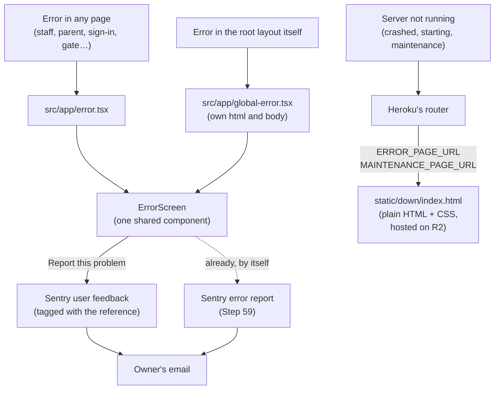

# Step 59.1: One error page, with a way to report the problem

> **Written before the code, on 2026-10-25, and approved by the owner the same day, along with the illustration they generated.** Updated after building; see "Changed while building". The owner narrowed the step on 2026-10-25: one error page for every kind of problem, plus a way to report it, following the owner's reference design (a ChatGPT mock-up: desktop, phone and kiosk layouts, and the four states of the report dialog). The design also needs a plain HTML and CSS copy of the same page for when the server isn't running at all, which Heroku shows by itself. If building changes anything, this file is updated to match before the review report. Topic docs: `docs/ERROR-TRACKING.md` (a new "Error page" section), `docs/DEPLOY.md` (the two new Heroku settings), `docs/COMPONENTS.md` (the new shared screen), `docs/COMMANDS.md`.

## Why

Today two pages have an error screen, the staff area and the parent pages. Each says "let us know" but gives no way to do it. Every other page (sign-in, set-password, forgot-password, `/gate`, `/gate/display`) shows Next.js's bare default. A failure in the root layout shows nothing of ours at all. And when the server isn't running (a crash, a restart, a failed start), Heroku shows its own grey "Application error" page.

After this step, every one of those cases shows the same page:



## What it costs

- **Sentry user feedback: $0.** Checked during the build (docs.sentry.io/product/user-feedback, 2026-10-25). The page doesn't say whether feedback counts against the 5,000 errors a month or has a quota of its own. Either way, a person has to press Send, so the number stays small. Sentry → Settings → Subscription shows it once real reports arrive.
- **Hosting the "down" page: $0.** It goes in a second, **public** Cloudflare R2 bucket, `bantayaral-status`, in the account the photos already use. It holds two files of about 60 KB together. R2's free tier covers 10 GB of storage, 10 million reads a month and free downloads. The photos bucket stays private.
- **The illustration:** one WebP image, kept under 60 KB, loaded only when an error page is shown, so it costs normal pages nothing.
- **No new package.** `captureFeedback` is already part of `@sentry/nextjs`. The shadcn `Textarea` is one copied file, not a dependency.

## Decisions

1. **One page, one component.** `ErrorScreen` (`src/features/errors/error-screen.tsx`) is the only error UI. It is used by:
   - `src/app/error.tsx`, a new root error page. It catches errors in every page under the root layout: staff, parent, sign-in, set-password, forgot-password, `/gate` and `/gate/display`.
   - `src/app/global-error.tsx`, for when the root layout itself fails.

   `src/app/(app)/error.tsx` and `src/app/parent/error.tsx` are deleted. The cost: an error in a staff page now replaces the whole screen, sidebar included, instead of only the content area. That matches the design, which is a full page with its own header, and "Try again" brings the sidebar back.
2. **Following the reference design:**
   - **Header:** the Bantay Aral logo (`BantayAralLogo`) on the left, the light/dark toggle (`ThemeToggle`) on the right. The mock-up's **Help** link is left out, because there's no help page for it to open.
   - **Heading:** "Something" on one line and "went wrong" on the next, in Lexend. The first line uses `text-brand-ink` and the second `text-brand-green-text`. Both are existing tokens that already pass AA in light and dark.
   - **Body:** "We're sorry. An unexpected error happened. Please try again. If the problem continues, you can report it." in `text-muted-foreground`.
   - **Reference code box:** a document icon, the label "Reference code", the code, and a copy button labelled "Copy reference code". The button shows "Copied" through an `aria-live` region; a toast isn't used, because `global-error` has no toaster. The box is hidden when there's no code.
   - **Buttons:** **Try again** (primary, with a rotate icon) and **Report this problem** (outline, with a warning-triangle icon). Both are full width up to `max-w-sm` and 44px tall.
   - **Layouts:**
     - From 768px: two columns, text on the left and the illustration on the right.
     - Below 768px: the illustration sits on top, capped at about 160px tall, so both buttons stay on screen at 360 × 640 without scrolling.
     - The mock-up's mirrored "kiosk" layout isn't built separately. The gate tablet is wider than 768px, so it gets the two-column layout, and one layout is simpler to keep right.
3. **The report dialog** (`report-problem-dialog.tsx`) is the shadcn `Dialog`, which traps focus and returns it to the button when closed. It has the mock-up's four states:
   - **Idle:** the text "Help us improve Bantay Aral. Tell us what you were doing when this happened. Optional. Don't include student names.", a `Textarea` with a 300-character limit and a visible "42/300" count, and **Cancel** and **Send**.
   - **Sending:** Send is disabled, with a spinner and "Sending…".
   - **Sent:** a check in `status-present` colors, "Thanks, we got it", "Your report has been sent. We'll look into this.", and **Done**.
   - **Failed:** an alert icon in `destructive` colors, "Could not send the report", and **Cancel** and **Try again**. The typed note is kept, so nothing is lost.

   The result is announced through `aria-live="polite"`.
4. **The reference code.** It matches the page to its Sentry report, using one search, `digest:<code>`:
   - **Server errors** already have Next.js's `digest`, and Step 59 already tags their Sentry report with it.
   - **Browser errors** have no digest, so the page makes an 8-character code (`crypto.randomUUID()`, first 8 hex digits) and tags the report with it under the same `digest` tag. `reportBrowserError(error, reference)` gets the extra argument. It still doesn't send a second report for a server error.
5. **What a report sends** (through `captureFeedback`, in `src/lib/error-reporting.ts`, the one file that knows Sentry; see "Changed while building"):
   - the person's note, or "No note added." when they leave it empty, because Sentry refuses an empty message;
   - the page's address without anything after `?`;
   - the tag `digest: <reference code>`.

   It never sends a name, an email or contact details: the `name` and `email` fields are left out. The note is the only free text. The dialog asks for no student names, and the 300-character cap keeps it short. The build checks whether feedback passes through `beforeSend` (`scrubEvent`). If it doesn't, the same scrub is attached to feedback, so the rules from Step 59's table still hold.
6. **When reports are off** (no `NEXT_PUBLIC_SENTRY_DSN`):
   - On a production build, the Report button is hidden, because there's nowhere to send to.
   - Under `npm run dev`, the button stays so every dialog state can be seen. Send prints the report to the browser console and shows "Thanks, we got it".
7. **`global-error.tsx`** makes its own `<html>` and `<body>`, as Next.js requires (`node_modules/next/dist/docs/01-app/03-api-reference/03-file-conventions/error.md`, "global-error"). It also:
   - imports `globals.css` and the same two fonts;
   - sets the default preset's tokens with `ThemePresetStyle`.

   There's no theme provider there, so it has no toggle. It follows the device's light or dark setting, with a `matchMedia` check when it first shows.
8. **The "down" page**, `static/down/index.html` with its image beside it, is plain HTML and CSS. It sits outside `src/`, so the app never serves it and `check:tokens` doesn't scan it. It copies the page's look:
   - the same header, heading, illustration and layouts;
   - the token values copied from `tokens.css`, each with a comment naming the token it came from, and dark mode through `prefers-color-scheme`;
   - fonts from Google Fonts with a system-font fallback.

   It differs from the in-app page in three ways:
   - **Text:** "Bantay Aral is down for a moment. We're already working on it. Please try again in a few minutes."
   - **No reference code and no Report button.** The server isn't running, so there's nothing to look up, and Sentry's uptime monitor (Step 59) has already emailed the owner.
   - **Try again** is a link to `https://bantayaral.com/` with `target="_top"`. Heroku shows the page inside a frame, and its docs warn that links there may need `target="_blank"`. The build tests `_top` on the live site and switches to `_blank` if it's blocked.

   One page serves both `ERROR_PAGE_URL` and `MAINTENANCE_PAGE_URL`, because "down for a moment" fits both. Heroku asks for a URL with the same protocol as the site, which is HTTPS. The R2 public address (`https://pub-….r2.dev/index.html`) is HTTPS.
9. **P-010's option 2, included.** Heroku only shows the "down" page when the app gives no answer. A live server with a bad setting answers every request with a bare 500 instead (P-010), so the page would never appear. So `register()` in `src/instrumentation.ts` now ends the process (`process.exit(1)`) after the report has been flushed. Heroku then marks the dyno crashed, shows the "down" page, and restarts it with its usual back-off. This only applies on a live server. Step 59's release check already stops a deploy with a missing setting, so this covers the remaining case: a setting changed with `heroku config:set` after a deploy.

## Steps

### 1. The illustration (owner first)

Ask ChatGPT for the confused student from the mock-up as its own image. Ask for a transparent background, at least 800 px wide, with the pale blob and trees behind the student. Save it anywhere and give the path. I convert it to WebP, about 640 px wide and under 60 KB:
- `public/errors/confused-student.webp` for the app, through `next/image` with `alt=""`, since it's decorative;
- a copy in `static/down/`.

It arrived with the approval: 903 × 1151 after trimming, 57 KB as WebP.

### 2. Files

| File | What |
|---|---|
| `src/components/ui/textarea.tsx` | shadcn `Textarea`, added with `npx shadcn@latest add textarea`. Every file it touches is diffed afterwards. |
| `src/features/errors/error-screen.tsx` | The page. Props: `reference?`, `onRetry`, `onReport?` (hidden when absent), `showThemeToggle` |
| `src/features/errors/report-problem-dialog.tsx` | The dialog and its four states |
| `src/features/errors/error-reference.ts` | `errorReference(error)`: the digest, or a new 8-character code |
| `src/app/error.tsx` | The root error page: works out the reference, reports a browser error, renders `ErrorScreen` |
| `src/app/global-error.tsx` | The same, inside its own `<html>` and `<body>` |
| `src/app/(app)/error.tsx`, `src/app/parent/error.tsx`, `src/app/(app)/error.test.tsx` | Deleted. Their tests move to the new component. |
| `src/lib/error-reporting.ts` | `reportError(error, reference)` tags `digest`. New `sendProblemReport({ note, reference }, pageUrl)` uses `captureFeedback` and waits for Sentry's answer. An event processor scrubs feedback. |
| `src/lib/error-reporting.problem-report.test.ts` | `sendProblemReport` against a fake Sentry client |
| `src/features/errors/error-page.tsx` | Shared by both error page files: reference, browser report, Report's action (added while building) |
| `src/lib/fonts.ts` | The two fonts, for the root layout and `global-error.tsx` (added while building) |
| `src/lib/stop-server.ts` | `process.exit(1)`, kept out of the Edge build (added while building, P-049) |
| `src/lib/browser-error-reporting.ts` | Passes the reference through, and `sendProblemReport` loads Sentry on demand, like reports do now |
| `src/instrumentation.ts` | `process.exit(1)` after the flush, on a live server only |
| `src/app/design-system/…` | `ErrorScreen` and every dialog state, in light and dark (dev-only page) |
| `src/app/design-system/throw/page.tsx` | Dev-only (404 in production, the same check as `/design-system`): throws, so the real error page can be seen |
| `static/down/index.html`, `static/down/confused-student.webp` | The "down" page |

### 3. Tests

- **Vitest, `ErrorScreen`:**
  - shows the reference and copies it;
  - Try again calls `onRetry`;
  - the Report button is hidden without `onReport`;
  - the dialog goes from idle to sending to sent, and to failed and back with the note kept;
  - the 300-character limit holds.
- **Vitest, `errorReference`:** uses the digest when there is one, otherwise 8 hex characters.
- **Vitest, `sendProblemReport`:**
  - sends no name or email and no query string, and tags the reference;
  - an empty note becomes "No note added.";
  - a failed send rejects.
- **Playwright:**
  - `/design-system/throw` shows the error page with a reference code;
  - axe finds no violations on the error page or the open dialog.

## Your part (owner)

1. Generate the illustration (step 1) and give me the file.
2. Create the public bucket and upload the page. The bucket was made on 2026-10-26. The two files go straight into it, side by side, with **no folders**: `static/down/` is only where they're kept in this repository. Every click, and what to check, is in `docs/DEPLOY.md`, "Put the 'down for a moment' page up", steps 2 to 4.
3. Point Heroku at it, before or after the push. Neither setting is checked by the release phase, so the order doesn't matter:
   ```bash
   heroku config:set ERROR_PAGE_URL=https://pub-….r2.dev/index.html MAINTENANCE_PAGE_URL=https://pub-….r2.dev/index.html --app bantayaral
   ```
4. Check Heroku's app generation: `heroku apps:info --app bantayaral`. Heroku's docs say custom error pages don't work on "Fir"-generation apps. An app made with plain `heroku create` is "Cedar", which works.
5. Make sure a report emails you. Sentry's default "Alert me on every new issue" alert covers new feedback. If you turned it off, add an alert with the filter `Issue Category is equal to Feedback` (Alerts → Create alert).
6. Finish setting up Step 59's uptime monitor if it isn't yet. The "down" page says the owner has already been told, and that monitor is what does the telling.

## Verify it worked

1. The usual checks: `npm run lint`, `npm run check:tokens`, `npm run typecheck`, `npm test`, `npm run build`, `npm run test:e2e` (now including `e2e/error-page.spec.ts`), and `npm run test:a11y` (the error page joined its list of screens).
2. `npm run dev`, then open `http://localhost:3000/design-system/throw`:
   - the error page shows with a reference code;
   - the copy button works;
   - Report → type a note → Send → "Thanks, we got it", and the browser console shows the report.

   Check it at 360 px and 1280 px, in light and dark.
3. `/design-system` shows every dialog state, in light and dark.
4. Open `static/down/index.html` straight from Finder at 360 px and 1280 px, in light and dark.
5. On the live site, after the push:
   - `heroku maintenance:on --app bantayaral` → `https://bantayaral.com` shows the "down" page → `heroku maintenance:off`;
   - a real report sent from an error page shows up in Sentry → User Feedback, tagged with the reference, and emails the owner.

## Known limits

- An error in the very first moment of a page, before Sentry loads, is still not reported by itself (Step 59). The Report button loads Sentry when it's pressed, so a person can still report it.
- The note is free text. The dialog asks for no student names, but it can't stop someone typing one. Sentry keeps it for 30 days.
- An `r2.dev` address is rate-limited by Cloudflare and meant for light use. That's fine for an error page. If `bantayaral.com`'s DNS is on Cloudflare, a custom subdomain such as `status.bantayaral.com` can replace it later, with only `config:set` changing.
- A 404 still shows the existing "This page doesn't exist" page, `src/app/not-found.tsx`. It isn't an error, so it isn't part of this step.

## Changed while building

- **`captureFeedback`, not `sendFeedback`** (P-048). `sendFeedback` only exists in Sentry's browser build, and `error-reporting.ts` is built for the server and Edge too, so Turbopack refused it. `sendProblemReport` calls `captureFeedback` (in all three builds) and waits for Sentry's answer itself, through `client.on("afterSendEvent")` matched on the event id, the way `sendFeedback` does inside. It gives up after 15 seconds. Without a running Sentry client it rejects at once.
- **The feedback scrub was confirmed needed** (P-045). Sentry's `processBeforeSend` only calls `beforeSend` for errors, so `startErrorReporting` adds an event processor that runs `scrubEvent` on feedback.
- **One more wrapper, `src/features/errors/error-page.tsx`**, shared by `error.tsx` and `global-error.tsx`. It works out the reference, reports a browser error, and decides what Report does. Both page files are three lines.
- **`src/lib/fonts.ts`** holds the two fonts, so `global-error.tsx` can load the same ones as the root layout.
- **`global-error.tsx` follows the saved light/dark choice** (next-themes' `theme` in `localStorage`) before the device's.
- **The reference code uses `crypto.getRandomValues`**, not `randomUUID`, which only exists on https or localhost. A tablet on the school's network over plain http still gets a code.
- **P-010's stop:**
  - **Builds are untouched** (P-047). `register()` runs during `npm run build` too, so a build still only throws.
  - **The stop has its own module, `src/lib/stop-server.ts`** (P-049). It's imported only where the code already runs on Node.js, because the Edge build warned about `process.exit`.
- **The illustration's frame has a round lower half**, so the picture's flat bottom edge follows the circle, as in the design. The hair and the question mark still rise above it.
- **`/design-system/throw` also works in the browser tests' production server** (`E2E=1`, never set on a real server), read at request time with `connection()`. Those tests have no Sentry address, so they check the page, its code and that there's no Report button. The dialog's states are covered by Vitest and seen in `/design-system`'s preview.
- **The "down" page's Try again** goes back to the address the person opened (`document.referrer`, inside Heroku's frame), falling back to `https://bantayaral.herokuapp.com/`. Its heading is "Down for / a moment", in the same two colors.
- **Known, development only** (P-050): after a server error, React warns about next-themes' `<script>` in the dev overlay. Watched.
