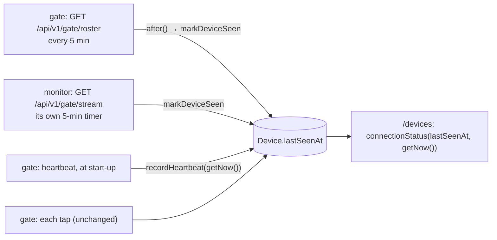

# Step 59.12: The Devices page

> **Written from the real diff on 2026-11-20.** The owner approved the plan and asked for it to be built straight away, after a review with the systems-architect for cost (two rounds; round 1 found two blocking points, both fixed in the plan before any code). The design is the owner's board, `design/device-management.png`. The full story is in `docs/BUILD-LOG.md`, "Step 59.12"; how it works is in `docs/GATE.md`, "The Devices page".

## Why

Until now, a school's gates and monitors could only be made, and seen, from the terminal (`npm run device:create`). This step gives principals and super admins a **Devices** page that lists them, and makes **Online** mean something. Adding a device is Step 59.13; disabling and enabling one is 59.14.

```
Devices
The tablets and screens at your school's gates.

Device name          Type      Connection        Last seen       Status
Test gate            Gate      ● Online          2 minutes ago   Enabled
Test guardhouse TV   Monitor   ○ Never connected —               Enabled
```

## What it costs

- About 12 small writes an hour per running device: a gate's roster check and a monitor's feed each mark it seen every 5 minutes, and at most once per 4 minutes.
- One indexed read when the page is opened. No new table, column, index, setting or package.

## How "seen" works



## The changes

**1. `src/features/devices/connection.ts` (new):** the page's rules.

```ts
export const ONLINE_WITHIN_MS = 12 * 60_000;

export function connectionStatus(lastSeenAt: string | null, now: string): Connection {
  if (!lastSeenAt) return "never";
  return Date.parse(now) - Date.parse(lastSeenAt) <= ONLINE_WITHIN_MS ? "online" : "offline";
}
```

Plus `lastSeenLabel` ("Just now", "2 minutes ago", "3 hours ago", "1 day ago") and the labels: `KIND_LABEL` (Gate, Monitor), `CONNECTION_LABEL`, and `STATUS_LABEL`, where the page's Enabled/Disabled stand for the database's `active`/`revoked`. Tests: `connection.test.ts`, with the boundary at exactly 12 minutes, never seen, and a time ahead of the clock.

**2. `src/data/repositories/device-repository.ts` and `prisma-device-repository.ts`:** two methods.

```ts
const DEVICE_COLUMNS = { id: true, schoolId: true, label: true, kind: true, status: true, lastSeenAt: true } as const;

async listBySchool(schoolId) {
  const rows = await db.device.findMany({
    where: { schoolId },
    select: DEVICE_COLUMNS,                                  // never tokenHash
    orderBy: [{ kind: "asc" }, { createdAt: "asc" }],        // gates first (the enum's order)
  });
  return rows.map(toDevice);
},
async markSeen(id, at, minGapMs) {
  const seenAt = new Date(at);
  await db.device.updateMany({
    where: { id, OR: [{ lastSeenAt: null }, { lastSeenAt: { lt: new Date(seenAt.getTime() - minGapMs) } }] },
    data: { lastSeenAt: seenAt },
  });
},
```

`toDevice` now takes just those columns (`Pick<DeviceRow, keyof typeof DEVICE_COLUMNS>`). The gap is worked out from `at` (the app's clock), not the database's `now()`, so a pinned demo clock stays consistent. Tests: `prisma-device-repository.pg.test.ts` (new): another school's devices never listed, the order, no `tokenHash`, and a write only past the gap.

**3. `src/services/devices/mark-seen.ts` (new):** `markDeviceSeen(id, at)` calls `markSeen(id, at, SEEN_GAP_MS)` with a 4-minute gap and catches any error (a warning with no names), so it never throws. Tests: `mark-seen.test.ts`.

**4. `src/app/api/v1/gate/roster/route.ts`:** after a gate's key is accepted:

```ts
const seenAt = getNow();
after(() => markDeviceSeen(auth.device.id, seenAt));
```

`after` (from `next/server`) runs it once the roster has been sent, so the write never slows or fails the answer.

**5. `src/features/gate/monitor-viewer.ts`:** `MonitorViewer` gains `deviceId`, the monitor device's id, or null for a principal watching from their own sign-in. `monitor-viewer.test.ts` updated.

**6. `src/app/api/v1/gate/stream/route.ts`:** a monitor's feed marks it once on connect, then every 5 minutes on its own timer (`SEEN_EVERY_MS`), never inside the 25-second keep-alive. It checks `request.signal.aborted` first and clears the timer with the keep-alive:

```ts
const { deviceId } = viewer;
const markSeen = () => {
  if (deviceId && !request.signal.aborted) void markDeviceSeen(deviceId, getNow());
};
markSeen();
const seenTimer = deviceId ? setInterval(markSeen, SEEN_EVERY_MS) : null;
```

Tests: `route.test.ts` (new) with fake timers: marked on connect and at 5 minutes, nothing in between, nothing after the TV leaves, never for a principal.

**7. `src/app/api/v1/devices/heartbeat/route.ts`:** `recordHeartbeat(device.id, getNow())` instead of the real time (P-067). `serverTime` stays the real time.

**8. The sidebar, `src/components/app-shell/nav-items.ts`:** a `devices` segment, "Devices", icon `MonitorSmartphone`, for `SCHOOL_STAFF_ROLES`, between Staff and Settings. `nav-items.test.ts` updated.

**9. The page:**
- `src/app/(app)/devices/page.tsx` (new): the same guard as Staff (a teacher gets `AccessDenied`; a super admin without a school gets `NoSchoolSelected`), then `listBySchool(session.schoolId)` and `getNow()`.
- `src/features/devices/devices-list.tsx` (new): the empty state ("No devices yet"), or `DeviceCards` below 768px and `DeviceTable` from 768px, swapped with CSS.
- `device-table.tsx`, `device-cards.tsx`, `device-display.tsx` (new): the columns Device name, Type, Connection, Last seen, Status; the connection is a dot and a word (green for online, grey for offline, an empty ring for never), and the badge uses the fixed status colors.
- `device-art.tsx` (new, review rounds 1–4): the device drawings, as SVG in the board's flat outline style rather than lucide's stock icons or a generated image. `DeviceKindIcon` draws the tablet or the monitor in the school's color, with no tile behind it so it can be large enough to recognize: 28px beside the word "Gate" or "Monitor" in the table's Type column, and 40px on each card. `DevicesIllustration` is the empty state's picture. They draw with `currentColor` and theme fills only, so they follow every preset and dark mode:

  ```tsx
  export function DeviceKindIcon({ kind, className }: { kind: Device["kind"]; className?: string }) {
    const Glyph = kind === "gate" ? GateTabletGlyph : MonitorGlyph;
    return <Glyph className={cn("size-8 shrink-0 text-primary", className)} />;
  }
  ```
- `src/components/empty-state.tsx`: an optional `illustration` that takes the icon's place (`icon` is now optional). Test added in `empty-state.test.tsx`.
- Loading: the shared `src/app/(app)/loading.tsx`. Errors: the shared error page (Step 59.1), rather than the board's in-page error card.
- Tests: `devices-list.test.tsx` (new).

**10. Browser tests:** `e2e/devices.spec.ts` (new, added to `test:e2e`): Balanga's principal sees "Test gate" and "Test guardhouse TV" and not Oceanview's gate; Oceanview's sees only its own; a teacher gets "You don't have access to this page" and no Devices link. `e2e/a11y.spec.ts`: `/devices` in the page scan and the small-screen list.

## Dead end

A generated 3D image of the devices (review round 1) came out photo-realistic, on black, and fit neither the board nor the per-school themes. Drawn SVG replaced it. Full story: `docs/BUILD-LOG.md`, Step 59.12, "Review round 1".

## Left for later

- Every gate tap still rewrites `lastSeenAt` (P-066), noted under Step 61.
- The board's "Front entrance" line under a name: there's no location field, and the Add form doesn't ask for one.

## Checks

The usual routine (`docs/LEARNING-LOG.md`), then:

```bash
npx vitest run src/features/devices src/services/devices src/app/api/v1/gate/stream src/data/repositories/prisma-device-repository.pg.test.ts src/features/gate/monitor-viewer.test.ts src/components/app-shell
npx playwright test e2e/devices.spec.ts
npm run dev   # sign in as a principal → Devices, at 360px and 1280px, light and dark
```

To see Online on your laptop: open `/gate` with a gate key (it marks itself seen at start-up), then reload Devices.
