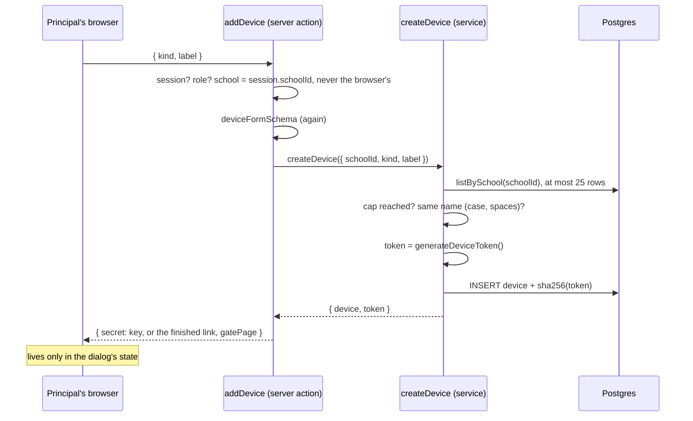

# Step 59.13: Add a gate or a monitor

> **Written from the real diff on 2026-11-21.** The owner approved the plan on 2026-11-20 (with the `qrcode` package) and asked for a cost review with the systems-architect: one round, no blocking concerns; its notes are built in. The design is the owner's board, `design/device-management.png` (screens 5 to 8). The full story is in `docs/BUILD-LOG.md`, "Step 59.13"; how it works is in `docs/GATE.md`, "Adding a device".

## Why

Until now a gate or monitor could only be made from a terminal (`npm run device:create`). This step puts **Add gate** and **Add monitor** on the Devices page. A device's secret is shown once, then only its hash exists.

```
Add gate ─► name ─► Create device ─► "Gate tablet added"
                                      key (copy) · "only time it will be shown" · next steps
Add monitor ─► name ─► Create device ─► "Monitor added"
                                      link (copy) · QR code · "only time it will be shown" · next steps
```

## What it costs

- One `INSERT` per device added, and the same one list query that checks the name and the cap. No new table, column, index or setting.
- `qrcode` (about 40 KB) is loaded only when a monitor's key step opens, so the Devices page itself doesn't grow.

## The flow



## The changes

**1. `src/features/devices/names.ts` (new):** the rules, in one place.

```ts
export const MAX_DEVICES_PER_SCHOOL = 25;
export function cleanDeviceName(name: string): string { return name.trim().replace(/\s+/g, " "); }
export function deviceNameKey(name: string): string { return cleanDeviceName(name).toLowerCase(); }
```

`deviceNameKey` cleans both sides of a comparison, so an older row saved with a trailing space still counts as a match. Plus the two refusal messages. Test: `names.test.ts`.

**2. `src/features/devices/schemas.ts`:** `deviceFormSchema` (`kind`, and a `label` trimmed, 1 to 60 characters), shared by the form and the server action.

**3. `src/services/devices/create-device.ts` (new):** `createDevice({ schoolId, kind, label }, devices = deviceRepository)`. It reads the school's own list (at most 25 rows, so no new query), refuses with `limit-reached` or `name-in-use`, and otherwise stores the device with `hashDeviceToken(token)` and returns the token. The two checks run before the insert, not in one transaction: adding a device is rare and only a principal does it, so two simultaneous adds could slip one extra past a check, which costs nothing. There is deliberately **no unique index** on the name: the owner's database already holds two "Main gate tablet" rows, so the migration would fail, and a future one would need those cleaned first. Tests: `create-device.test.ts` (hash stored, not the token; a new token each time; a name matched whatever its case or spaces, including an old row with a trailing space; a disabled device's name counts; the cap).

**4. `scripts/create-device.ts`:** now calls `createDevice`, so the terminal command follows the same rules.

**5. `src/features/devices/actions.ts` (new):** `addDevice(input)`.

```ts
const session = await getSession();
if (!session) return { ok: false, formError: SIGNED_OUT_MESSAGE };
if (!session.schoolId || session.role === "teacher") return { ok: false, formError: "You don't have permission to add devices." };
const parsed = deviceFormSchema.safeParse(input);
const created = await createDevice({ schoolId: session.schoolId, ...parsed.data });
```

The school is always `session.schoolId` (a super admin's is the school they opened). It returns `secret`: the gate's key, or, for a monitor, the finished link `${origin}/gate/display/connect?key=…`, built on the server so the browser never assembles a credential, and `gatePage` for the next steps. Nothing here logs or throws the secret. Test: `actions.test.ts` (signed out, teacher, no school; the name checked again; another school's id in the input ignored; the gate's key and the monitor's link; the refusals carry no secret).

**6. `src/app/gate/display/connect/route.ts`:** the redirect now sends `Cache-Control: no-store` and `Referrer-Policy: no-referrer`, because the address that reached it carried a key (P-068). Test: `route.test.ts` (new).

**7. The dialog:**
- `add-device-buttons.tsx`: "Add gate" and "Add monitor" under the heading, as on the board. Each open mounts the dialog with a new `key`, so it always starts at step 1 and a secret from the last open is gone.
- `add-device-dialog.tsx`: step 1 (an icon badge, "Device name", an example, Cancel and **Create device**, disabled and spinning while it works, so a double click can't make two devices) and step 2 (a green check, the secret in a read-only box with **Copy**, a yellow "This is the only time it will be shown", numbered next steps, **Close**). While step 2 is on screen `onEscapeKeyDown` and `onInteractOutside` are stopped and the corner × is hidden, so a stray click can't lose the one chance to copy it. The box scrolls inside itself on a short phone. A repeated name appears under the field; a full school appears as a toast.
- `monitor-qr.tsx`: draws the link as a QR code in the browser (`import("qrcode")` only when it opens, `toDataURL`), black on white in every theme (the library's own colors, so there is no color literal and a scanner always has contrast). It is meant for a phone or tablet that will be the monitor: scanning opens the link on the scanning device, so the next-steps text says so.
- `src/app/(app)/devices/page.tsx`: renders `<AddDeviceButtons />` under the header.

Test: `add-device-dialog.test.tsx` (the name checked before anything is sent; the gate's key and next steps; a monitor's link and QR; Escape ignored, then Close forgets the key; a refused name under the field).

**8. Browser tests (`e2e/devices.spec.ts`):** a principal adds a gate, sees the key, Escape does nothing, Close, the device is listed, and `/gate?token=<key>` says "Connected as …"; the same name in other case and spacing is refused; a principal adds a monitor, sees the QR code, and its link (opened with no staff session) reaches `/gate/display`. Each project uses its own names, since both run at once on one database.

## New packages (approved)

`qrcode` and, as a dev-only dependency, `@types/qrcode` for its types (it ships none). `package-lock.json` also lost seven `"dev": true` lines, because `qrcode`'s own dependencies are now needed at run time too.

## Left for later

- Disabling and enabling a device is Step 59.14. The next-steps text already says "until you disable it".
- The key still travels in the monitor link's address (P-068); the headers and Disable are the mitigation. A `#key=` fragment with a small page that posts it is the upgrade.
- A name could still be repeated by two simultaneous adds (accepted above).

## Review round 1: the monitor screen shows its own name

`/gate/display` only ever said "Gate monitor", so the owner couldn't tell which monitor a screen was. `MonitorViewer` (`src/features/gate/monitor-viewer.ts`) now carries the device's name:

```ts
export type MonitorViewer = {
  schoolId: string;
  kind: "monitor" | "staff";
  deviceId: string | null;
  deviceLabel: string | null; // null for a principal watching from their own sign-in
};
```

`page.tsx` passes `viewer.deviceLabel` to `GateMonitor`, whose header shows `{deviceLabel} · {schoolName}`, or just the school name for staff. Tests: `monitor-viewer.test.ts`, `gate-monitor.test.tsx` (new), `stream/route.test.ts` fixtures.

## Checks

The usual routine (`docs/LEARNING-LOG.md`), then:

```bash
npx vitest run src/features/devices src/services/devices src/app/gate
npx playwright test e2e/devices.spec.ts
npm run dev   # sign in as a principal → Devices → Add gate, Add monitor, at 360px and 1280px, light and dark
```

After adding a gate by hand: open `/gate` on any browser, paste the key, and the Devices page shows it Online after a reload. Remove test devices you add (there's no delete until 59.14 disables them; a disabled device still holds its name).
