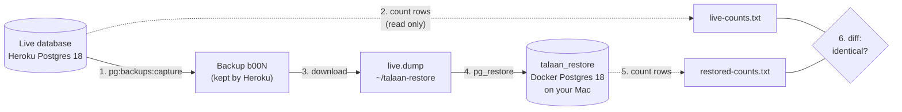

# Step 59.2: A practice restore

> **Written before the code, on 2026-10-26, and approved by the owner the same day.** `scripts/count-rows.sql` was then added and tried on the local `talaan_test` database: 17 tables, `_prisma_migrations` included. From `docs/PLAN.md` Step 59.2, cut from Step 59 on 2026-10-23. Almost all of it is commands the owner runs. The only new file is a small SQL script that counts rows. After the owner has done it once, `docs/DEPLOY.md` gets a "Backups and restoring" section with the real numbers (how long it took, how big the backup was), and this file gets a "Changed while doing it" section.

## Why

A backup nobody has restored is a hope, not a backup. Today `heroku pg:backups:capture` makes one, but nobody knows:
- whether it restores without errors;
- how long that takes;
- whether every row comes back;
- what exactly to type on the bad day.

Essential-0 has no "roll back to 10:42 this morning". A restore brings back the database as it was at the moment of one backup and **deletes everything since** (Heroku's docs: "deletes all data from the target database before restoring"). So practising on the live database is out. The practice goes into a separate database on your Mac, and the live one is only read from.



Your `talaan` and `talaan_test` databases aren't touched: the restore goes into a third database, `talaan_restore`, in the same container, and it's deleted at the end.

## What it costs

- **$0.** Backups come with Essential-0: 5 manual ones kept, with the oldest deleted when a sixth is captured. A schedule keeps 7 daily and 1 weekly (Heroku Dev Center, "Heroku PGBackups", checked 2026-10-26). Downloading a backup isn't charged.
- **Disk:** the backup is compressed, likely a few MB at this size. It's deleted at the end.
- **About 20 minutes** of your time, once.

## Decisions

1. **The same Postgres version on both sides.** The live database is Postgres 18 (`docs/DEPLOY.md`), and `talaan-postgres` runs the `postgres:18` image. `pg_restore` must be at least as new as the backup, so the restore runs **inside the container** (`docker exec talaan-postgres pg_restore …`), using its version 18. The Mac has no `psql` or `pg_restore` of its own (P-041), and doesn't need one.
2. **A fresh database, not `--clean`.** Heroku's import guide uses `--clean` to drop existing objects first. Restoring into a database made for it (`createdb talaan_restore`) avoids anything left over. `--no-owner --no-acl` skip Heroku's own user names and permissions, which don't exist on your Mac.
3. **"Every row came back" is checked by counting.** The new `scripts/count-rows.sql` counts the rows of every table in the app's schema. It's generic, so it never goes stale when a table is added. The same file runs against the live database and the restored one, and `diff` compares the two outputs. This includes Prisma's own `_prisma_migrations`, so the migration history is compared too.
4. **Counting live, before and after the capture.** The live database keeps changing (a parent signs in, a push is sent), so one live count could differ from the backup for an innocent reason. So live is counted once before the capture and once right after it:
   - **The two live counts match:** nothing changed during the capture, and the restored count must equal them.
   - **They differ:** something happened meanwhile. Wait a few minutes and try again. Doing it outside school hours makes this unlikely.
5. **A second check: `prisma migrate status`** against the restored database. It should say "Database schema is up to date", proving the backup matches the code that's live.
6. **Students are minors, and the backup holds their data.**
   - It goes in `~/talaan-restore/`, outside the repository, so it can never be committed.
   - It's deleted at the end, with the local database.
   - The Mac's disk should be encrypted (FileVault); `fdesetup status` says whether it is.
   - The backup never goes anywhere else: not into a chat, a cloud folder or an email.
7. **Check that backups run by themselves.** `docs/DEPLOY.md` currently mentions "Heroku's automatic ones". Essential plans only make scheduled backups once a schedule is set, so the first command checks whether one exists. If there isn't one, one is added for 2:00 AM Philippine time, when no gate is in use. It's free, and kept 7 days plus 1 week.

## Steps (owner, at a quiet time: evening or weekend)

### 0. Check the schedule and the disk

```bash
heroku pg:backups:schedules --app bantayaral
fdesetup status
```

If the first one says there are no schedules:

```bash
heroku pg:backups:schedule DATABASE_URL --at '02:00 Asia/Manila' --app bantayaral
```

`fdesetup status` should say "FileVault is On." If it's Off, tell me before going on.

### 1. A folder outside the repository, and the first live count

```bash
mkdir -p ~/talaan-restore
cd ~/Documents/talaan
docker exec -i talaan-postgres psql -X --no-align --tuples-only "$(heroku config:get DATABASE_URL --app bantayaral)" < scripts/count-rows.sql > ~/talaan-restore/live-before.txt
cat ~/talaan-restore/live-before.txt
```

- `docker exec -i` runs the container's `psql` with your typed input passed in.
- `"$(heroku config:get DATABASE_URL …)"` passes the live address in without it appearing on screen.
- `-X --no-align --tuples-only` prints just `table|rows` lines, so the two files can be compared line by line.
- It only reads from the live database: `count-rows.sql` only counts.

### 2. Capture a backup, then count again

```bash
heroku pg:backups:capture --app bantayaral
docker exec -i talaan-postgres psql -X --no-align --tuples-only "$(heroku config:get DATABASE_URL --app bantayaral)" < scripts/count-rows.sql > ~/talaan-restore/live-after.txt
diff ~/talaan-restore/live-before.txt ~/talaan-restore/live-after.txt && echo "live didn't change during the capture"
```

Note the backup's ID from the capture's output (`b00N`). If `diff` prints anything, something changed during the capture. Run step 2 again in a few minutes.

### 3. Download it

```bash
curl -o ~/talaan-restore/live.dump "$(heroku pg:backups:url b00N --app bantayaral)"
ls -lh ~/talaan-restore/live.dump
```

The download address works for 60 minutes. Write the file's size down for the write-up.

### 4. Restore into a fresh local database, timed

```bash
docker exec talaan-postgres createdb -U postgres talaan_restore
docker cp ~/talaan-restore/live.dump talaan-postgres:/tmp/live.dump
time docker exec talaan-postgres pg_restore --verbose --no-owner --no-acl -U postgres -d talaan_restore /tmp/live.dump
```

- `docker cp` puts the file inside the container, where its `pg_restore` can read it.
- `time` prints how long it took; write the `real` line down.
- **What to expect:** a list of `pg_restore: creating TABLE …` and `processing data for table …` lines, and no line starting `pg_restore: error`. A warning about a role or a `heroku_ext` schema is Heroku-specific and harmless (Heroku's import guide). Paste any `error` line to me.

### 5. Count the restored copy, and compare

```bash
docker exec -i talaan-postgres psql -X --no-align --tuples-only -U postgres -d talaan_restore < scripts/count-rows.sql > ~/talaan-restore/restored.txt
diff ~/talaan-restore/live-after.txt ~/talaan-restore/restored.txt && echo "every table has the same number of rows"
```

### 6. The migration check

```bash
DATABASE_URL="postgresql://postgres:<your password>@localhost:5432/talaan_restore" npx prisma migrate status
```

Use the same user and password as `DATABASE_URL` in your `.env`, with the database name changed to `talaan_restore`. Typing it in front of the command only affects this one command. Expect "Database schema is up to date!".

### 7. Clean up

```bash
docker exec talaan-postgres dropdb -U postgres talaan_restore
docker exec talaan-postgres rm /tmp/live.dump
rm -r ~/talaan-restore
```

The backup itself stays on Heroku, where it belongs.

### 8. Tell me

Send me:
- the capture's output;
- the dump's size;
- `time`'s `real` line;
- whether both `diff`s printed their "same" message;
- `migrate status`'s last line;
- anything that looked like an error.

I'll write `docs/DEPLOY.md`'s "Backups and restoring" with those real numbers.

## The real restore (for the write-up; not done in this step)

This is what `docs/DEPLOY.md` will say to do if the live data is ever lost or damaged, checked against what the app does:

1. **Choose the backup:** `heroku pg:backups --app bantayaral` lists them with their times. Everything after the chosen one is lost: taps, new students and cards, parent links, notifications, and sign-ins since then.
2. **Stop traffic:** `heroku maintenance:on --app bantayaral`. Visitors see the "down for a moment" page (Step 59.1). Gate tablets get a 503, which they treat as offline (`gate-client.ts`), so they keep new taps queued and send them afterwards.
3. **Keep the damaged state too:** `heroku pg:backups:capture --app bantayaral`. If the restore turns out to be the wrong choice, this copy lets it be undone.
4. **Restore:** `heroku pg:backups:restore b00N DATABASE_URL --app bantayaral`. Heroku asks you to type the app's name to confirm.
5. **Bring the schema up to the code:** `heroku run --app bantayaral "npx prisma migrate deploy"`. A backup from before a deploy lacks that deploy's migrations, and the release phase doesn't run again by itself.
6. **Open again:** `heroku maintenance:off --app bantayaral`, then `/api/v1/health`.
7. **Tell the school** which time the data goes back to.
   - Taps the gate sent and the server confirmed after the backup are gone, because the gate had already deleted them from its queue.
   - A push sent less than 6 hours before the restore may be sent once more. Its outbox row comes back as "waiting", and pushes older than 6 hours are never sent (`send-due.ts`).
   - Parents who signed in after the backup must sign in again.

## The one file

`scripts/count-rows.sql`:

```sql
-- Rows in every table of the app's schema (Step 59.2): run against the live
-- database and a restored copy, and compare the two outputs with diff.
-- Generic on purpose, so a new table is counted without changing this file.
SELECT table_name,
       (xpath('/row/n/text()',
              query_to_xml(format('SELECT count(*) AS n FROM %I.%I', table_schema, table_name), false, true, '')
       ))[1]::text::bigint AS row_count
FROM information_schema.tables
WHERE table_schema = 'public' AND table_type = 'BASE TABLE'
ORDER BY table_name;
```

`query_to_xml` runs a query built from each table's name and returns its result as a little XML document; `xpath` reads the count back out. That's the standard way in plain SQL to count every table in one statement, without a function or a loop. `%I` quotes each name, which matters for Prisma's capitalised table names like `"Student"`.

## Known limits

- **Counts prove that every row came back, not that every value did.** For a backup made by Postgres's own `pg_dump`, that's enough: a row restores whole or not at all.
- **Photos aren't in the database.** They're in R2 (`talaan-photos`), which has no backup in this step. The database only holds their keys. Losing R2 would lose the photos, not the attendance. Worth its own step later if photos become important.
- **The practice restores onto your Mac, not onto Heroku.** Step 4 of the real restore, `pg:backups:restore`, isn't rehearsed. Rehearsing it would need a second Heroku database, which costs money. It's Heroku's own documented command.
