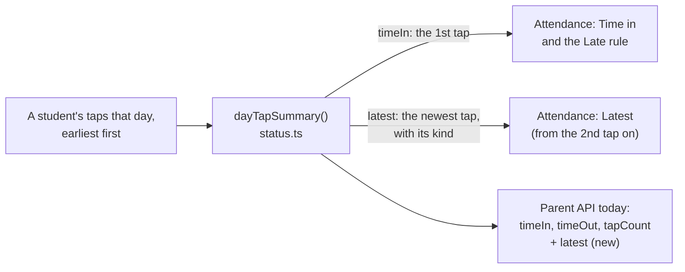

# Step 59.3: The latest tap, not just the first

> **Written before the code, on 2026-10-26, approved by the owner the same day, then built as written.** One addition while building: the parent app's own rules in `mobile/starter/docs/PRODUCT-RULES.md` and `mobile/starter/docs/PLAN.md` now say how to show `latest`, as `docs/PARENT-APP-BRIEF.md` asks for any API change. From P-052 in `docs/PROBLEMS-LOG.md` and option B, which the owner chose the same day. No architect review: nothing about storage, queries or load changes, only how a day's taps already in memory are summed up and shown.

## Why

The owner tapped Katrina Aguilar's card 13 times on the new kiosk tablet, the last a time in at 7:05 PM. Every tap was stored, and the "13 taps" list shows them all, but her row said:

| Time in | Time out | Status |
|---|---|---|
| 11:09 AM | — · 13 taps | Late |

That's Step 49's rule (`dayTapSummary` in `src/features/attendance/status.ts`): **Time in** is the first tap, and **Time out** is the last tap only when it's an out. With an odd number of taps, the row looks the same as a student who arrived at 11:09 and never moved. The parent app reads the same summary through `/api/v1/parents/me`, so it showed the same.

Showing only the newest tap was weighed and dropped: the arrival time would disappear, and Late is worked out from the arrival, so the row would say "Late" beside "7:05 PM".

## What it costs

Nothing. No new table, column, query or package. The summary already has every tap of the day in memory.

## What it will look like

| Student | Time in | Latest | Status |
|---|---|---|---|
| Katrina (13 taps, the last an in) | 11:09 AM | Back in 7:05 PM · 13 taps | Late |
| A usual day (in, then out) | 7:12 AM | Out 4:05 PM | Present |
| Only arrived | 7:12 AM | — | Present |

On a phone, the second line under the time in says the same: "Out 4:05 PM" or "Back in 7:05 PM".



## Decisions

1. **Time in stays the first tap.** It's the arrival, and `studentStatus` decides present or late from it. Nothing about status changes.
2. **"Latest" is the newest tap, shown from the 2nd tap on.** With one tap the newest tap *is* the time in, so the column shows "—" rather than the same time twice.
3. **A later time in reads "Back in".** Since Latest only shows from the 2nd tap on, an "in" there always means the student left and came back. "Back in 7:05 PM" says that; "In 7:05 PM" would look like the arrival.
4. **The summary gets `latest`, and loses `timeOut`.** `latest` is `{ tap, kind }`, the last of the day's labelled taps, so it's the same alternation as before (1st in, 2nd out, …). Nothing on the web reads `timeOut` once the table and phone list switch over. The parent API works it out from `latest` itself (decision 5).
5. **The parent API only adds.** `today` keeps `timeIn`, `timeOut` and `tapCount` with the same meaning, and gains `latest: { at, kind } | null` (null with no tap; with one tap, the time in). The parent app already on phones ignores a key it doesn't know, so nothing breaks. The Expo app can switch to `latest` in its own project; `docs/PARENT-APP-BRIEF.md` gets a line saying so.
6. **Same colours as now.** The cell stays muted text. The gate's blue "time out" is for the big tap card, not a table of 500 rows.

## The changes

**`src/features/attendance/status.ts`.** In `DayTapSummary`, `timeOut` is replaced by:

```ts
/** The newest tap and whether it was an in or an out; the same as the first with one tap. */
latest: { tap: Tap; kind: NotificationKind } | undefined;
```

and `dayTapSummary` returns `latest: labelled.at(-1)`.

**`src/features/attendance/attendance-table.tsx`.** The header "Time out" becomes "Latest". The cell shows, when there are 2 or more taps, "Out 4:05 PM" or "Back in 7:05 PM", then the existing `DayTapsIndicator`. Otherwise "—". A small shared helper, `latestLabel(kind)` in `status.ts`, gives "Out" or "Back in", so the table and the phone list can't drift apart.

**`src/features/attendance/attendance-card-list.tsx`.** The second line uses the same rule and words. The screen-reader text becomes ", out at" or ", back in at". The visible "In" before the time in stays, shown whenever there's a second line.

**`src/features/parents/api-responses.ts`.** `ChildTodayJson.today` gains `latest`, and `timeOut` is worked out as `latest?.kind === "time_out" ? latest.tap : null`, the same value as before.

**Tests.**
- `status.test.ts`: the `dayTapSummary` cases check `latest` (none, one tap, two, in-out-in, four), and one for `latestLabel`.
- `api-responses.test.ts`: the exact-keys test gains `latest`, and a new case covers in-out-in: `timeOut` null, `latest` a time in.
- `e2e/attendance.spec.ts`: on the demo morning, Rodel Espiritu's row reads "Back in 8:52 AM" and Precious Rivera's "Out 8:40 AM".

**Docs.** `docs/ATTENDANCE-MODEL.md` (the Step 49 paragraph), `docs/PARENT-API.md` (the `today` type and example), `docs/PARENT-APP-BRIEF.md` (one line), `docs/BUILD-LOG.md`, and P-052's status.

## Verify it worked

```bash
npm run lint
npm run check:tokens
npm run typecheck
npm test
npm run test:e2e
```

Then, by eye:
1. `npm run dev`, sign in as the principal, open **Attendance** for the demo morning: `/attendance?date=2026-06-19&grade=11&section=Aguinaldo`. Rodel Espiritu: "8:01 AM", "Back in 8:52 AM · 3 taps". Precious Rivera: "Out 8:40 AM".
2. The same page at 360 px wide: the second line under each time says the same.
3. After deploying, Katrina's row on `bantayaral.com` for 2026-10-26: "11:09 AM", "Back in 7:05 PM · 13 taps", "Late".
4. The parent API: `curl` `/api/v1/parents/me` with a parent token (`docs/COMMANDS.md` §7d). Each child's `today` has `latest`.

## If something goes wrong

- **TypeScript says `timeOut` doesn't exist on `DayTapSummary`.** Something still reads the old field. Switch it to `latest`, or, for the API, use the rule in decision 5.
- **The exact-keys API test fails.** It lists every key on purpose (no private data may slip in), so it needs `latest` added to the expected object.
