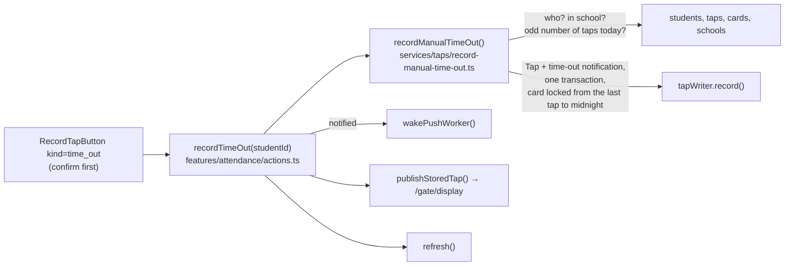

# Step 59.4: Record a time out by hand

> **Written before the code, on 2026-10-27, approved by the owner the same day (decision 9 and the 3-tap case included), then built as written.** The owner found the gap: a student whose card is lost can be given a time in by hand (Step 55), but never a time out, so their day ends "in" forever. Plan approved the same day, with one owner decision: **no "Record back in" by hand**. Recording by hand is a stopgap until the student has a card again, so it stays as small as it can. No architect review: no new table, column, index or query. It is Step 55's write, through the same writer and the same Step 56 lock, with one rule changed.

## Why

Today, on the attendance page:

| Student (no working card) | Time in | Latest |
|---|---|---|
| After "Record time in" at 7:10 AM | 7:10 AM, Recorded by staff | — |
| At 4:00 PM, going home | 7:10 AM, Recorded by staff | — (nothing to press) |

The student goes home, but the row, the parent app's `latest` (Step 59.3) and the parents' feed all still say they're at school. The gate can't help, because they have no card to tap.

## What it costs

Nothing. No migration, no new package, no new query: the service reads the same four things `recordManualTimeIn` reads.

## What it will look like

| Student, today | Time in | Latest |
|---|---|---|
| No tap | **[Record time in]** | — |
| 1 tap (in) | 7:10 AM | **[Record time out]** |
| 2 taps (in, out) | 7:10 AM | Out 4:00 PM, *Recorded by staff* |
| 3 taps (in, out, back in by card) | 7:10 AM | Back in 5:30 PM · 3 taps, then **[Record time out]** under it |

On a phone, "Record time out" sits under the times in the right-hand column, where "Record time in" sits before the first tap. The button only shows on today's roll, the same as "Record time in".



## Decisions

1. **Only while the student is in.** Allowed when the student has an odd number of taps today (1st, 3rd, …), because taps alternate in and out (`docs/ATTENDANCE-MODEL.md`, "derive, don't store"). The new tap is then a time out without storing a direction. With no tap, the answer is "no time in today". With an even number of taps, the answer is "already out". Both buttons mirror this, and the server checks again.
2. **No "Record back in" (owner, 2026-10-27).** Recording by hand covers a student without a working card for a short while, nothing more. A student who left and came back without a card stays "Out" until their card is replaced. The 3-tap row above can only happen when the student came back in with a card.
3. **Recorded as now**, as Step 55's time in is. Picking an earlier time stays a later step, if ever.
4. **Same people as time in.** A principal or super admin can record anyone at their school. A teacher can only record their own advisory class. That's `mayRecordFor()`, now exported and shared.
5. **Two clicks make one tap.** The id is built from the student, the date and the number of taps already seen (`manual-time-out|student|date|n`), so two clicks, or two staff members, that saw the same row make the same id, and the database keeps one. The next time out (after a card tap back in) sees a different `n`, so it gets a new id.
6. **A gate read in between is refused.** When the student has a card, the writer locks it (Step 56) and checks for any tap of that card *after the last tap the service saw*, up to the school's midnight. If the card did read at the gate in the meantime, the hand-recorded time out is not stored, and the answer is "already out". Without this, the day could be stored as in, out, out, which reads as in, out, in. With no card, no gate read can race it, so there's no window, the same as Step 55.
7. **Parents are told by the school's setting.** `shouldNotifyParents(preference, "time_out")`: only when the setting is "time in and time out". The feed and push say "tapped out", the same words a hand-recorded time in already shares with a card's ("tapped in"). New words for both are a later choice.
8. **The guardhouse monitor shows it**, as it shows a hand-recorded time in.
9. **One button component, not two.** `RecordTimeInButton` becomes `RecordTapButton` with `kind: "time_in" | "time_out"`, so the confirmation, pending state and toast can't drift apart. This changes the plan, which named a separate `record-time-out-button.tsx`. The accessible names stay "Record time in for …" and become "Record time out for …", so the existing tests keep working.
10. **"Recorded by staff" under the latest tap too**, so a hand-recorded time out never looks like a gate read.

## The changes

### 1. `src/services/taps/record-manual-time-in.ts`: share two pieces

- `mayRecordFor()` gets `export`.
- The UUID-shaping body of `manualTimeInId` moves to an exported `nameBasedUuid(name: string)`, and `manualTimeInId` becomes `nameBasedUuid(\`manual-time-in|${studentId}|${date}\`)`. The time-in ids don't change: the same text goes into the same hash.

### 2. New `src/services/taps/record-manual-time-out.ts`

```ts
export type ManualTimeOutResult =
  | { outcome: "recorded"; tap: Tap; student: TapStudent; direction: "time_out"; notified: boolean; replayed: false }
  /** No tap today: nothing to time out from. */
  | { outcome: "no_time_in"; student: TapStudent }
  /** The newest tap is already a time out, or another click or a gate read got there first. */
  | { outcome: "already_out"; student: TapStudent }
  | { outcome: "not_found" };

export function manualTimeOutId(studentId: string, date: string, tapsBefore: number): string;

export async function recordManualTimeOut(
  input: ManualTimeInInput,          // same input: schoolId, studentId, staff, now
  deps: ManualTimeInDeps = DEFAULT_DEPS,
): Promise<ManualTimeOutResult>;
```

How it works, in order:
1. Look up the student in the school. If they aren't there, or the staff member can't record them (`mayRecordFor`), answer `not_found`.
2. Read today's taps, the active card and the school together, as `recordManualTimeIn` does.
3. With 0 taps, answer `no_time_in`. With an even number, answer `already_out`.
4. Build the tap: `manualTimeOutId(student.id, date, taps.length)`, `stationId: "manual"`, the card serial or null, `source: "manual"`, `recordedById`, `tappedAt: now`.
5. Build the notification: kind `time_out`, only if the school's setting allows it.
6. Set `duplicateWindow = card ? { from: lastTap.tappedAt, to: next midnight } : null`. The writer's check is "after `from`", so the last tap itself doesn't count against it.
7. Write through `tapWriter.record()`. Anything but `created` answers `already_out`.

### 3. `src/features/attendance/actions.ts`: `recordTimeOut(studentId)`

The same shape as `recordTimeIn`: session, staff, service, `wakePushWorker()` when notified, `publishStoredTap()` (caught), `refresh()`. Its answers:
- `not_found`: "That student isn't in a class you can record."
- `no_time_in`: "{name} has no time in today."
- `already_out`: "{name} is already out."
- recorded: `{ ok: true, studentName, time }`.

The two results share one type: `RecordTimeInResult` is renamed to `RecordTapByHandResult`.

### 4. `src/features/attendance/record-time-in-button.tsx` → `record-tap-button.tsx`

`RecordTapButton({ kind, studentId, studentName, layout })`. Its words per kind:

| | time in | time out |
|---|---|---|
| Icon (lucide) | `UserCheck` | `LogOut` |
| Button | Record time in | Record time out |
| Dialog title | Record {name}'s time in now? | Record {name}'s time out now? |
| Description | (as today) | Use this when they're leaving and their card didn't work or they don't have one. It's recorded with the time right now and your name, and their parents are told. |
| Toast | {name}'s time in was recorded at 9:15 AM | {name}'s time out was recorded at 4:00 PM |

### 5. The rows

- **Prop rename.** `canRecordTimeIn` becomes `canRecordByHand` in `attendance-table.tsx`, `attendance-card-list.tsx`, `attendance-list.tsx` and `app/(app)/attendance/page.tsx` (still `date === today`). It now covers both buttons.
- **In each row**, `const canTimeOut = canRecordByHand && summary.taps.length % 2 === 1;`.
- **Table, Latest cell.** The latest text (or "—") and the taps indicator as now, then:
  - `ManualTapNote` under a hand-recorded latest tap;
  - the time-out button. It replaces the "—" when there's no latest yet, and sits under the latest tap when there is one.
- **Phone card.** Under the times paragraph, the time-out button (`layout="card"`), plus `ManualTapNote` under the latest line.

### 6. Tests

- **New `record-manual-time-out.test.ts`** (fake repositories, like Step 55's):
  - records a time out now, with who and the card serial, and a `time_out` notification;
  - refuses with no tap (`no_time_in`) and after in, out (`already_out`), writing nothing;
  - records after in, out, in (a card's back in);
  - a teacher can record only their own class; another school's student is `not_found`;
  - the window runs from the last tap to the school's midnight with a card, and there's none without one;
  - `already_out` when the writer answers `duplicate` or `exists`;
  - no notification when the setting is off or time in only;
  - `manualTimeOutId` is stable for the same count, differs by count, and is a valid UUID that never equals the time-in id.
- **New `record-manual-time-out.pg.test.ts`**: after a time in, two clicks at once store one time out and at most one notification.
- **`attendance-card-list.test.tsx`**: "Record time out" shows after one tap on today's roll, not after two, and not on a past day.
- **`e2e/attendance.spec.ts`**: the Step 55 test continues. After the time in, it records the time out from the same row (clock pinned at 9:15 AM) and checks:
  - the toast says "{name}'s time out was recorded at 9:15 AM";
  - the row reads "Out 9:15 AM";
  - "Record time out" is gone.

  The describe is renamed "record a time in and out by hand".
- `e2e/a11y.spec.ts` and `e2e/parent.spec.ts` use "Record time in for …" and need no change.

### 7. Docs

- `docs/ATTENDANCE-MODEL.md`: "Recording a time in by hand" becomes "Recording a time in or out by hand". Rule 2 changes, the file table gets a row, and the quick recipe names both services. No back in by hand, and why.
- `docs/PLAN.md`: Step 59.4.
- `docs/BUILD-LOG.md`: a section for this step.
- `docs/LEARNING-LOG.md`: an entry pointing here.

## Verify it worked

```bash
npm run lint
npm run check:tokens
npm run typecheck
npm test
npm run test:e2e
```

Then, by eye (`npm run dev`, signed in as the principal, today's Attendance):
1. Press "Record time in" on a student with no tap, and confirm. The Latest cell now shows "Record time out".
2. Press it and confirm. The toast reads "… time out was recorded at …". The row reads "Out 4:00 PM" with "Recorded by staff" under it, and neither button shows.
3. The same at 360 px wide: the button sits under the time in the right-hand column, at least 44 px tall.
4. Open a past date: no buttons.
5. As a teacher: only your own class shows the buttons. Recording another class through the action answers "That student isn't in a class you can record."

## If something goes wrong

- **TypeScript can't find `RecordTimeInButton` or `canRecordTimeIn`.** Something still uses the old names. Switch it to `RecordTapButton kind="time_in"` or `canRecordByHand`.
- **The time-in id test fails after the refactor.** `nameBasedUuid` must hash exactly `manual-time-in|${studentId}|${date}`, as before. A changed id would let a second click on a day already recorded make a second tap.
