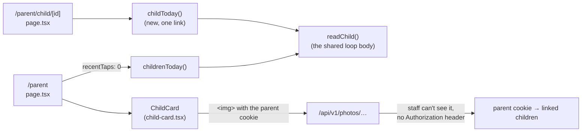

# Step 59.5: The parent home, like the app

> **Written before the code, on 2026-10-27, approved by the owner the same day, then built.** The owner wants the web parent portal to match the parent app (`talaan_parents_app`, the sibling repository): its design images are in `talaan_parents_app/design/`, and its home card is `src/components/child/child-card.tsx` there. One systems-architect round (2026-10-27): nothing blocking; its three suggestions are built in below (decisions 4, 6 and 7).
>
> **Changed while building, to follow the app.** At 17:13 the same day, after this recipe was written, the owner trimmed the app's card (app commit `be8aa0c`, "trim the card and add the designed header"): no school name and no "Your school sends" line, since "a parent knows their school"; the line moves to the app's future Profile tab. The web follows the app, so decision 1 lost both, and the `notificationSentence()` helper and its test were never written. The same commit had already shrunk the illustration to 360 × 240, so it's copied as it is (decision 3). The other changes made while building are marked *(built)* below.

## Why

The web parent home is still the first version: "Welcome, Juan", then one bordered box per child with a status and a list of recent taps. The app, which parents will mostly use, now has a designed home: a photo, the status, and a panel with the time in and the latest tap. A parent who opens both should see the same thing.

## What it costs

Nothing to run. No migration, no new package, no new kind of query. One static image (105 KB, served smaller by `next/image`). The home makes one query fewer per child than before (decision 6). A photo request from a web parent costs at most two extra queries, and only when the staff check has already said no (decision 4).

## What it looks like

```
┌───────────────────────────────────────────────┐
│                                    [school    │
│ My children                         illustr.] │
│ Check who's in school, the moment they tap in.│
├───────────────────────────────────────────────┤
│ ┌─────┐ Katrina Aguilar                    ›  │
│ │photo│ Grade 7 – Rizal                       │
│ │     │ (Late)                                │
│ └─────┘                                       │
│ ┌───────────────────────────────────────────┐ │
│ │ [→] Time in       │ [⇥] Out               │ │
│ │     10:04 AM      │     10:59 AM          │ │
│ └───────────────────────────────────────────┘ │
│ 3 taps today              (only when over 2)  │
└───────────────────────────────────────────────┘
                 [Link a child]
```

A child's day, `/parent/child/[id]`:

```
‹ My children
┌─────┐ Katrina Aguilar
│photo│ Grade 7 – Rizal
└─────┘ (Late)

Today
October 27, 2026
 1. In     10:04 AM
 2. Out    10:59 AM

Recent taps
 October 27, 2026    10:59 AM
 …  (the last 10, as the old card showed)
```



## Decisions

1. **Match the app, in the app's words.** The heading is "My children", with "Check who's in school, the moment they tap in." under it. The card shows the photo, the name, "Grade 7 – Rizal" and the status pill. *(Built: no school name and no "Your school sends" line, as on the app's card since 17:13 that day.)* The panel shows "Time in", and from the 2nd tap on, "Out" or "Back in" (`latestLabel`, Step 59.3).
2. **Tile colours.** The time-in tile is green (`bg-status-present`). The out tile is blue (`bg-status-out`), not the design's red, which only ever means Absent; the app made the same change. Before any tap, the tile is grey (`bg-status-idle`) with "—" (a screen reader hears "not yet"). The icons are lucide (`ArrowRightToLine` in, `ArrowRightFromLine` out) in `text-card`, like the app's icon on its tile. The status pill stays the web's `StatusPill`, unchanged, since staff pages use it too.
3. **The illustration.** `talaan_parents_app/assets/images/illustration-school.png` (360 × 240, 105 KB since the app's commit) is copied as it is to `public/brand/illustration-school.png`. It's decorative (`alt=""`). As in the app, it sits in the corner the heading leaves empty, its bottom level with the heading's, and the line under the heading runs the full width below it. It's 120 px wide on a phone and 160 px from 640 px, so "My children" never wraps under it at 360 px. *(Built: `loading="eager"`, not `priority`, which Next.js 16 deprecated; the guide recommends `eager` for an above-the-fold image that isn't the page's main content.)*
4. **Photos for a web parent (architect).** Before, the photo route accepted the app's `tal_par_` token but not the web parent's cookie, so a web parent couldn't see their own child's photo. Now, **only when the first answer is "no" and there's no `Authorization` header**, the route reads the parent cookie (`getParentSession()`), lists that parent's links, and checks again with the same `canViewPhoto`. Staff requests cost nothing extra. A teacher who is also a parent, signed in to both in one browser, still sees their own child's photo at another school. Anyone else's child stays 404. The cookie is `httpOnly`, `sameSite: "lax"`, `secure` in production, so another site can't embed a child's photo with it.
5. **The name is the card's one link, stretched over the whole card**, with a chevron. A screen reader hears one link per child, named for the child, and can still read the rest of the card as text. *(Built: the "stretched link" pattern, the name's link with an `after:absolute after:inset-0` layer. Making the whole card an `<a>` would have named the link with every word on the card. "Link a child" moved below the cards, as in the app, since the illustration takes the heading's right side.)*
6. **The home skips recent taps (architect).** It asks `childrenToday` for `{ recentTaps: 0 }`, one query fewer per child, since recent taps move to the child's page.
7. **The child's page reads one child (architect).** A new `childToday(parentId, studentId, now, deps)` finds that link first, as the API's per-child route does (`app/api/v1/parents/children/[id]/taps/route.ts`), then reads only that child. The loop body of `childrenToday` became a shared `readChild()`, so both read a child the same way. A student who isn't linked to this parent is `notFound()`, never "forbidden".
8. **Today's taps on the child's page** use `dayTapSummary` (labelled In or Out), drawn as the same numbered list the Attendance "N taps" dialog shows. *(Built: that list moved out of the dialog into `DayTapList`, `features/attendance/day-tap-list.tsx`, used by both, so they can't drift apart.)* "N taps today" also shows on the home card when there are more than 2. *(Built: the child's page has no school name either, the same as the card.)*

## The changes

### 1. The illustration

```bash
cp ../talaan_parents_app/assets/images/illustration-school.png public/brand/illustration-school.png
```

### 2. `src/services/photos/photo-viewer.ts` and `src/app/api/v1/photos/[...key]/route.ts`

A new `webParentPhotoViewer(deps)` in `photo-viewer.ts`: the signed-in parent from the cookie, with their links as `{ children: [...] }` (the same shape `parentPhotoViewer` makes for the app), or null. Its `deps` (`session`, `links`) default to `getParentSession` and the link repository, so the test passes fakes. In the route:

```ts
const authorization = request.headers.get("authorization");
const allowed =
  canViewPhoto(key, await resolvePhotoViewer(authorization)) ||
  // A parent on the web (Step 59.5), only once the usual viewers said no,
  // so a staff request reads nothing more. Never with a token: a token
  // that failed is the answer, whatever cookie the request also carries.
  (!authorization && canViewPhoto(key, await webParentPhotoViewer()));
if (!allowed) return notFound();
```

### 3. `src/services/parents/children-today.ts`

`readChild(link, now, deps, recentTapCount, schools)` holds what the loop did before, and answers null for a student no longer at the school. `childrenToday` calls it for each link. New:

```ts
/** One linked child, or null when this parent has no link to them. */
export async function childToday(parentId: string, studentId: string, now: string, deps: ChildrenTodayDeps): Promise<ChildToday | null>;
```

### 4. `src/features/parents/child-summary-card.tsx` → `child-card.tsx`

`ChildCard({ child }: { child: ChildToday })`, server-rendered, an `<article>`:
- `StudentAvatar` at `w-16` (64 px, the app's size);
- the name as an `h2` holding the stretched `Link` to `childPath(id)` (`/parent/child/${id}`), the class, the `StatusPill`, and a `ChevronRight`;
- the times panel (`bg-muted`). It's a `@container`: the two halves sit side by side from 15 rem of panel width and stack below it (a phone with large text), with the divider moving from the left edge to the top. A wrapping row would strand its divider;
- the "N taps today" line.

`formatTapDate` (only an alias of `formatSchoolDate`) is gone: `notification-list.tsx`, its other user, imports `formatSchoolDate` from `@/lib/school-time` instead.

### 5. Pages

- **`app/parent/(protected)/page.tsx`**: the heading and illustration (`HomeHeading`), the cards, the same empty state, then "Link a child" (filled when there are no children, outlined otherwise).
- **`app/parent/(protected)/loading.tsx`**: two card-shaped skeletons (photo, three lines, the panel).
- **New `app/parent/(protected)/child/[id]/page.tsx`**: a back link "My children" (44 px tall), the photo, name, class and status, then "Today" (with the date) and "Recent taps" as `<section>`s named by their headings.
- **New `app/parent/(protected)/child/[id]/loading.tsx`** and **`not-found.tsx`**. The not-found says "We couldn't find that child", with "Go to My children".
- `app/parent/(protected)/layout.tsx`: only its comment, which lists the pages it guards.

### 6. Tests

- **`photo-viewer.test.ts`**: `webParentPhotoViewer` with no parent signed in, and with a parent whose links it returns.
- **The route** (new `route.test.ts`, with the two viewers and the storage faked, `canViewPhoto` real):
  - a parent's own child: 200;
  - a child not linked to them: 404;
  - staff and parent cookies together, for the parent's child at another school: 200;
  - staff who may see it: 200, without reading the parent cookie;
  - a request with an `Authorization` header that fails: 404, without looking at the cookie.
- **`children-today.test.ts`**:
  - `childrenToday` with `recentTaps: 0` reads no recent taps;
  - `childToday` returns the linked child with today's and recent taps;
  - null for an unlinked child (or another parent), without reading the student;
  - null for a linked child no longer at the school.
- **New `child-card.test.tsx`**:
  - one link, named "Katrina Aguilar", to `/parent/child/student-0037`;
  - no tap: grey tile and "—", no latest;
  - one tap: Time in on a green tile, no latest;
  - in, out: "Out" on a blue tile;
  - in, out, in: "Back in" and "3 taps today";
  - the day's status.
- **`e2e/parent.spec.ts`**:
  - after linking Carmen Sison, her card shows "Time in" and "9:15 AM";
  - its link opens her day, where "Today" lists "1. In" at 9:15 AM;
  - `/parent/child/<another Balanga student>` shows "We couldn't find that child", and its link goes home;
  - the two-schools test now checks that neither school's name shows.

### 7. Docs

- **`docs/PLAN.md`**: Step 59.5.
- **`docs/BUILD-LOG.md`**: a section for this step.
- **`docs/LEARNING-LOG.md`**: an entry on why a parent's photo needed its own way in.
- **`docs/SCHOOL-ISOLATION.md`**: the photos row gains the web parent's cookie.
- **`docs/AUTH.md`**: a row for `webParentPhotoViewer`.
- **A new `docs/PARENT-PORTAL.md`**: no doc covered the web parent portal. It covers how the pages connect (layout, home, child's day, notifications, link a child) and what they read, with a diagram and quick recipes. Linked from `README.md`.

## Verify it worked

```bash
npm run lint
npm run check:tokens
npm run typecheck
npm test
npm run test:e2e
```

Then, by eye (`npm run dev`, signed in as a demo parent at `/parent/login`; `parent-one@oceanview.example` has two children with photos):
1. The home at 360 px and 1280 px, in light and dark:
   - the illustration sits beside "My children" and doesn't cover the line under it;
   - each card has its photo or initials, the status, and the panel.
2. A child with a photo shows it. Sign in as staff in the same browser too, and the photo still shows.
3. Tap a card. The child's day lists today's taps and the recent ones. The back link returns home.
4. Change the id in the address to another student's: "We couldn't find that child".

## If something goes wrong

- **The photo is a broken image on the parent home.** Open its address in a new tab: a 404 means the route didn't accept the parent cookie. Check that the request has no `Authorization` header and that the parent is linked to that student at that school (the photo key holds both).
- **`check:tokens` fails on the card.** A colour was written as a literal or a palette class. Use the status tokens in decision 2.
- **`typecheck` can't find `PageProps<"/parent/child/[id]">`.** The route types are made by `next typegen`, which `npm run typecheck` runs first. Run the script, not `tsc` on its own.
