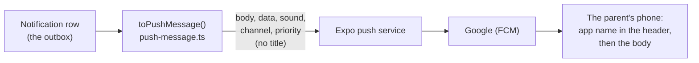

# Step 59.6: Pushes without the title, and status values that never change

> **Written before the code, on 2026-10-28, for the owner's approval.** From the parent app's requests 1 and 5 (`docs/PARENT-APP-REQUESTS.md`) and P-057 in `docs/PROBLEMS-LOG.md`. Reviewed by the systems-architect (one round, nothing blocking; one point turned out wrong when checked, see "Review" below).

## Why

**The title.** The owner's first real pushes on Android read:

```
(icon)  Bantay Aral · now
        Bantay Aral
        Juan tapped in at 7:56 AM
```

Android already puts the app's name at the top of every notification. The second "Bantay Aral" is the `title` the server sends. With the app closed, Android draws the push from what the server sent, so only the server can remove it.

**The values.** The parent app checks each child's `today.status` against the four values it knows, and **drops a child it can't read**, so one odd child doesn't sign the parent out. A fifth value would make that child disappear from every phone still running an older app, with no explanation. The contract already says renaming or removing a field needs `/api/v2`. This step extends that rule to adding a value, and adds a test so the code can't break the rule silently.

## What it costs

Nothing. No new table, column, query, package or setting. Expo's push service is free with or without a title.

## What it will look like

```
(icon)  Bantay Aral · now
        Juan tapped in at 7:56 AM
```

A link notice: "A new parent account was linked to Juan", under the same header. On iOS (later), a push with no title shows the app's name, then the body.



## Decisions

1. **No title on any push, not an empty one.** The `title` key goes from `PushMessage` entirely, so nothing can send it by accident. An empty string `""` could show as a blank line on some Android versions; a missing key never does.
2. **The body stays word for word.** "Juan tapped in at 7:56 AM" already says who, what and when, with the first name only (Step 54's lock-screen rule).
3. **The fixed values are:**
   - `today.status` on `/me` and `status` on `children/:id/taps`: `present`, `late`, `absent`, `idle`
   - a tap's `kind` (`today.latest.kind`, `taps[].kind`) and a tap notification's `kind`: `time_in`, `time_out`
   - `school.notificationPreference`: `off`, `time_in_only`, `time_in_and_time_out`

   A new value for any of these means `/api/v2`. **A new notification `kind` can still be added**, as `guardian_linked` was in Step 55.2: the contract has always said the app must hide a kind it doesn't know, and the app does.
4. **No `statusLabel`.** The parent app offered it as the other option. The promise costs nothing, and the one new kind of day already planned fits without it (decision 5).
5. **Step 63's holidays won't need a fifth status.** A no-class day reaches the app as `flexible: true`, the flag a weekend already uses, plus a new optional field saying why. An installed app shows "No tap" or "Came in", never "Absent". Step 63 in `docs/PLAN.md` now says so, and also lists the two places that say "weekend" outright, to reword then.

## The changes

**`src/services/push/push-sender.ts`.** `PushMessage` loses `title: string;`.

**`src/services/push/push-message.ts`.** `toPushMessage` loses `title: PRODUCT_NAME`, and the now-unused `PRODUCT_NAME` import goes. The comment above it gains one line:

```ts
 * No title (Step 59.6): Android already puts the app's name at the top of
 * every notification, so a title of "Bantay Aral" showed it twice.
```

**Tests.**
- `src/services/push/send-due.test.ts`: the expected message in "says the child's first name, what happened and when" loses `title`. `toEqual` compares every key, so it also proves no title is sent.
- `src/services/push/push-sender.test.ts`: the sample message loses `title`.
- `src/features/parents/api-responses.test.ts`: a new `describe("the values the parent app can read")`. These checks fail at `npm run typecheck` if anyone widens one of the types, and the runtime checks fail at `npm test`:

  ```ts
  import { expectTypeOf } from "vitest";
  import { notificationKindSchema } from "./schemas";
  import { notificationPreferenceSchema } from "@/features/schools/schemas";
  import type { ChildTodayJson, DayTapsJson } from "./api-responses";

  type Status = "present" | "late" | "absent" | "idle";
  type TapKind = "time_in" | "time_out";

  it("never gain a value in /api/v1 (docs/PARENT-API.md)", () => {
    expectTypeOf<ChildTodayJson["today"]["status"]>().toEqualTypeOf<Status>();
    expectTypeOf<DayTapsJson["status"]>().toEqualTypeOf<Status>();
    expectTypeOf<NonNullable<ChildTodayJson["today"]["latest"]>["kind"]>().toEqualTypeOf<TapKind>();
    expectTypeOf<DayTapsJson["taps"][number]["kind"]>().toEqualTypeOf<TapKind>();
    expect(notificationKindSchema.options).toEqual(["time_in", "time_out"]);
    expect(notificationPreferenceSchema.options).toEqual(["off", "time_in_only", "time_in_and_time_out"]);
  });
  ```

  All four are already exported: `ChildTodayJson` (`api-responses.ts:77`), `DayTapsJson` (`:123`), `notificationKindSchema` (`schemas.ts:43`) and `notificationPreferenceSchema` (`src/features/schools/schemas.ts:31`).

**Docs.**
- `docs/PARENT-API.md`: the change rules (line 5) gain the fixed values and the `/api/v2` rule from decision 3. "What a push looks like" loses the title and says why.
- `docs/PUSH.md`: the "What the phone shows" example loses `"title"`.
- `mobile/starter/`: any line that shows the push title, as `docs/PARENT-APP-BRIEF.md` asks for every API change.
- `docs/PARENT-APP-REQUESTS.md`: requests 1 and 5 marked built.
- `docs/BUILD-LOG.md` and P-057's status.

## Review

The systems-architect raised five points, each checked against the code:
1. *"A tap's `kind` uses a type that includes `guardian_linked`."* **Wrong:** `api-responses.ts` takes `NotificationKind` from `src/features/parents/types.ts`, which is `z.enum(["time_in", "time_out"])` (`schemas.ts:43`). The database's enum with `guardian_linked` is a different type. The new test pins it anyway.
2. *"No test holds the rule."* **Taken:** the new `describe` above.
3. *"Two places say 'weekend' outright."* **Taken, for Step 63:** `attendance-hero.tsx:40` and `docs/PARENT-API.md`'s `flexible` lines. The parent app shows only "Came in" and "No tap" (`src/strings.ts:206-207` there), never the word "weekend".
4. *"If the app reads a push's title, it now gets null."* **Checked:** the parent app never reads `content.title`.
5. *"The comment is stale, and `PRODUCT_NAME` becomes unused."* **Taken:** both in "The changes".

## Verify it worked

```bash
npm run lint
npm run check:tokens
npm run typecheck
npm test
npm run build
```

Then, after deploying:
1. Tap a linked child's card at the gate (or record a time in by hand on their Attendance row).
2. On the Android phone with the parent app, the push reads "Bantay Aral · now" once, then "Juan tapped in at 7:56 AM".
3. Tapping it still opens the app at that notification.

## If something goes wrong

- **`npm run typecheck` says `title` doesn't exist on `PushMessage`.** A test or caller still builds one with a title. Remove it there.
- **Lint flags an unused import in `push-message.ts`.** `PRODUCT_NAME` is still imported. Remove the import.
- **The push shows a blank line where the title was.** Something is sending `title: ""` instead of no title. Check the message in the server log (`PUSH_SENDER=log` prints it) has no `title` key.
