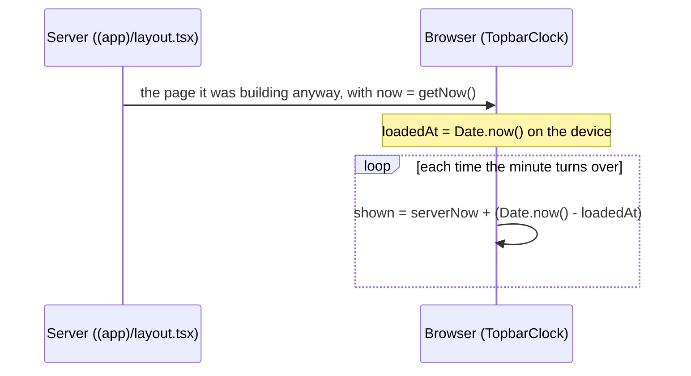

# Step 59.9: The top bar shows the date and time

> **Written from the real diff on 2026-10-29.** The owner asked for it to be built straight away for a demo the next day, so there was no recipe before the code. From P-059 in `docs/PROBLEMS-LOG.md`. The full story is in `docs/BUILD-LOG.md`, "Step 59.9".

## Why

Every staff page showed its name twice:

```
☰  Attendance                          ◐  Principal ▾  Sign out
─────────────────────────────────────────────────────────────
Attendance
Who tapped in today, ...
```

This is an attendance monitor, so the top bar now shows today's date and time instead:

```
☰  Thu, Oct 29 · 9:15 AM                         ◐          (360px)
   Thursday, October 29, 2026 · 9:15 AM   ◐  Principal ▾  Sign out   (1280px)
```

## What it costs

Nothing. No request is made for the time, and there's no new package, setting or table.



Only the time passed on the device is used, never the device's own reading, so a phone set to the wrong time still shows the right one. A pinned `DEMO_NOW` stays still.

## The changes

**1. `src/lib/school-time.ts`: one new formatter** (at the end of the file):

```ts
/** "Thursday, October 29, 2026", or "Thu, Oct 29" when short: the school's calendar date with its weekday. */
export function formatSchoolDay(iso: string, length: "long" | "short"): string {
  return onSchoolClock(iso).toLocaleDateString(
    "en-US",
    length === "long"
      ? { weekday: "long", year: "numeric", month: "long", day: "numeric", timeZone: "UTC" }
      : { weekday: "short", month: "short", day: "numeric", timeZone: "UTC" },
  );
}
```

`timeZone: "UTC"` on the shifted instant is how this file reads the school's clock on any server or browser, as `formatSchoolDate` already does.

**2. `src/lib/school-time.test.ts`:** a `formatSchoolDay` block: both lengths at 11:59 PM on October 29, and `"2026-10-29T16:00:00.000Z"` (midnight in the Philippines) reading "Fri, Oct 30".

**3. `src/components/app-shell/topbar-clock.tsx` (new):**

```tsx
"use client";

export function TopbarClock({ serverNow, pinned }: { serverNow: string; pinned: boolean }) {
  const [now, setNow] = useState(serverNow);

  useEffect(() => {
    if (pinned) return;

    const serverMs = Date.parse(serverNow);
    const loadedAt = Date.now();
    const current = () => serverMs + (Date.now() - loadedAt);
    let timer: ReturnType<typeof setTimeout>;

    function scheduleNextMinute() {
      timer = setTimeout(update, MINUTE_MS - (current() % MINUTE_MS));
    }
    function update() {
      setNow(new Date(current()).toISOString());
      scheduleNextMinute();
    }
    function onVisible() { /* after sleep: clearTimeout, then update() */ }

    scheduleNextMinute();
    document.addEventListener("visibilitychange", onVisible);
    return () => { clearTimeout(timer); document.removeEventListener("visibilitychange", onVisible); };
  }, [serverNow, pinned]);

  return (
    <time dateTime={toSchoolOffsetIso(now)} className="flex min-w-0 flex-1 items-baseline gap-2 ...">
      <span className="truncate">
        <span className="xl:hidden">{formatSchoolDay(now, "short")}</span>
        <span className="hidden xl:inline">{formatSchoolDay(now, "long")}</span>
      </span>
      <span aria-hidden="true" className="text-muted-foreground">·</span>
      <span className="shrink-0">{formatSchoolTime(now)}</span>
    </time>
  );
}
```

Why each part:
- **`setTimeout` to the next minute, not `setInterval` every second.** The time shows minutes only, so the page re-renders once a minute.
- **State is set only inside timer callbacks**, never directly in the effect body, which React's hooks lint rules flag.
- **The first render uses `serverNow` as is**, so the server's HTML and the browser's first render match (no hydration warning, nothing jumps).
- **`truncate` on the date, `shrink-0` on the time:** on a narrow bar the end of the date is cut, never the time.
- **`<time>`, not a heading or `aria-live`:** a screen reader shouldn't announce the clock every minute.

**4. `src/components/app-shell/topbar-clock.test.tsx` (new):** the short and long date and the time from `serverNow`; with fake timers and the device clock set to 2020, it moves 9:15 → 9:16 → 9:17 at the right moments; pinned, it stays at 9:15 after five minutes.

**5. `src/components/app-shell/topbar.tsx`:** `TopbarTitle` → `<TopbarClock key={now} serverNow={now} pinned={demoClock} />`. The props `demoClockLabel: string | null` become `now: string` and `demoClock: boolean`. The badge reads just "Demo clock". `key={now}` restarts the clock when the server sends a new time (a full load or `router.refresh()`); moving between pages keeps the layout, so the clock just keeps going.

**6. `src/components/app-shell/app-shell.tsx`:** passes `now` and `demoClock` through.

**7. `src/app/(app)/layout.tsx`:** `now={now} demoClock={isDemoClock()}`; the `formatSchoolDate`/`formatSchoolTime` import and the label line go.

**8. Delete `src/components/app-shell/topbar-title.tsx`.**

**9. Headings.** The top bar no longer holds the page's `<h1>`, so:
- `src/components/page-header.tsx`: the `as` prop goes; the title is always `<h1>`. Its test's "h1 by default, h2 when asked" becomes "is the page's one h1".
- Remove `as="h2"` from every `PageHeader` in `src/app/(app)/{dashboard,attendance,students,staff,settings}/page.tsx` and `src/features/{students,staff,schools}/*-directory.tsx` (12 in all).
- `src/components/app-shell/access-denied.tsx`: the title `<p>` becomes `<h1>` with the same classes.
- `e2e/login.spec.ts` (the greeting) and `e2e/isolation.spec.ts` ("Students"): `level: 2` → `level: 1`.

**10. Docs:** `docs/APP-SHELL.md` gains "Step 59.9" and its quick recipes change; `docs/PLAN.md` gains the step; P-059; the learning log's two questions.

## Checks

```bash
npm run lint
npm run check:tokens
npm run typecheck
npm test
npm run build
npm run test:e2e
```

Then `npm run dev` and look at any staff page at 360px and 1280px, light and dark:
- The top bar shows today's date and time in Philippine time; the page's own heading appears once.
- Leave it open past the next minute: the time changes without a reload.
- With `DEMO_NOW` set (the browser tests), the clock shows June 19, 2026, 9:15 AM and doesn't move, and the badge reads "Demo clock".
