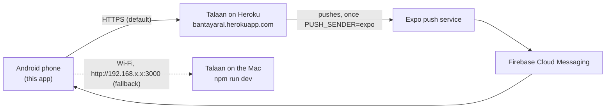

# Which server the app talks to

**The live server is the default.** Talaan is deployed on Heroku at `https://bantayaral.herokuapp.com`, current through Talaan's Step 54.1 (as of 2026-10-19): every parent API address in `docs/TALAAN-API.md` is live there. Develop against it, over HTTPS, so every build behaves like the real one.

Talaan running on the owner's Mac is the fallback, for when the owner is testing a Talaan change that isn't deployed yet, or wants to reset the demo data freely.



## The live server (default)

In this app's `.env`, the owner sets:

```
EXPO_PUBLIC_API_URL=https://bantayaral.herokuapp.com
```

Then restart Expo with `npx expo start --clear` (environment variables are read when the bundle is built). Check from the phone's browser that `https://bantayaral.herokuapp.com/api/v1/health` answers.

Things to know about it:
- **It's shared with the web app's demo.** Accounts and links made from the app are real rows there. Use the demo accounts below, or test accounts with clearly fake emails.
- **Its data isn't reset.** A test parent stays until it's removed in Talaan.
- **Talaan's owner deploys it,** from the `talaan` repository. If an answer from it doesn't match `docs/TALAAN-API.md`, ask the owner whether the deploy is current before changing anything here.
- **The sign-in limits apply:** 5 wrong passwords for one email in 15 minutes, 30 from one network, 100 sign-ups from one network in an hour. Testing from one home Wi-Fi counts as one network.

## Demo accounts and data

- **Parent:** `parent-one@balanga.example`, password `Talaan123!`. Already linked to children at Balanga.
- **A child to link:** school Balanga City National Science High School, LRN `100000000002`, last name Pascual, birth date `2014-03-03` (Jose Pascual, Grade 7 – Rizal). This is Talaan's seed data, checked 2026-10-19; if the live server's data has changed, ask the owner for a current example.
- **Make a tap for a chosen child:** at the gate tablet (`/gate`), tap an NFC sticker linked to that child (web app: Students → the child → Card serial). The push goes out within seconds.
- "Simulate a tap" on the web dashboard taps the next student who hasn't tapped today, not a child you pick, so it's no good for testing one parent's phone.

## Testing a real push (M7)

The live server's push setting is `PUSH_SENDER=log` until M7 (Talaan's `docs/DEPLOY.md`): it builds each push and only writes it to the log. To send for real:

1. The owner has a free Expo account and the app's EAS project, and an **access token** from expo.dev (Account settings → Access tokens).
2. The owner sets both on Heroku, typing the token themselves (never pasted into a chat or a file), from the `talaan` folder:

   ```bash
   heroku config:set PUSH_SENDER=expo EXPO_ACCESS_TOKEN=<the token> --app bantayaral
   ```

   Heroku restarts the server by itself.
3. On the phone, sign in and allow notifications (the app registers its push token).
4. Tap a linked child's sticker at the gate. The phone should show "Jose tapped in at …" within seconds. `heroku logs --tail --app bantayaral` shows `push: sent 1, …`.

If nothing arrives: check the app got `204` from `POST /api/v1/parents/push-tokens`, that the `attendance` channel exists on the phone, and that the school's notification setting isn't "Off". About 15 to 20 minutes after a push, the server checks Expo's receipts; an `InvalidCredentials` or `MismatchSenderId` line in the log means the Firebase setup in Expo's credentials is wrong. Add what you find to `docs/PROBLEMS-LOG.md`.

## The fallback: Talaan on the Mac

In the `talaan` folder:

```bash
docker start talaan-postgres   # the database (Docker Desktop open first)
npm run dev                    # Talaan, at http://localhost:3000
```

1. Find the Mac's address on the Wi-Fi: `ipconfig getifaddr en0` (for example `192.168.1.23`). `npm run dev` also prints it as "Network".
2. Set `EXPO_PUBLIC_API_URL=http://192.168.1.23:3000` in this app's `.env`, and restart Expo with `npx expo start --clear`.
3. Check `http://192.168.1.23:3000/api/v1/health` from the phone's browser. If it doesn't answer, the phone and the Mac aren't on the same network, or macOS's firewall is blocking Node (System Settings → Network → Firewall). The Mac's address can change when it reconnects.

Good to know about the Mac:
- **Plain `http` works in development builds and Expo Go only.** Android blocks it in release builds. Check the current Expo docs if a development build refuses it. Every installable build points at Heroku.
- `npm run db:reset` refills the demo data and signs every phone out, so the app's `401` handling sends it to sign-in, which is expected.
- Pushes go to the log only, unless the owner adds `PUSH_SENDER="expo"` and `EXPO_ACCESS_TOKEN="…"` to Talaan's `.env` and restarts `npm run dev`.
- To tap a chosen child without a reader: make a gate token (`npm run device:create -- --school school-balanga --kind gate --label "Mac gate"`), then `npm run tap:record -- --token <gate token>` and type the card serial (Jose's demo card is `04:5B:B6:11:6C:C7:22`). It runs outside the server, so its push waits for the next check, up to 5 minutes.

## Trying the API by hand

`docs/TALAAN-API.md` has a `curl` example for every address, written for `http://localhost:3000`. Swap in `https://bantayaral.herokuapp.com` for the live server.
